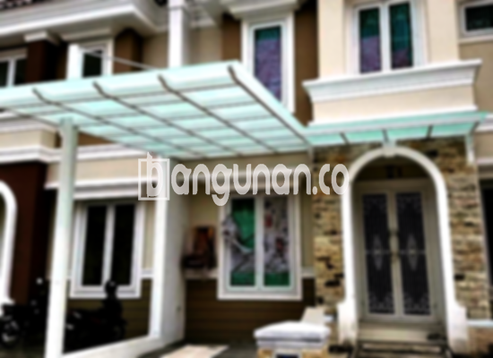

**Jasa Pasang Kanopi Rumah Minimalis di Ciganjur Jakarta** – Memiliki area luar ruangan yang nyaman dan terlindungi adalah dambaan setiap Mitra Bangunan di Ciganjur Jakarta. Kanopi adalah solusi ideal untuk melindungi teras, carport, atau area depan rumah dari panas matahari dan hujan deras, sekaligus mempercantik tampilan fasad rumah Anda. Kami hadir sebagai penyedia jasa pemasangan kanopi rumah minimalis yang terpercaya dan berpengalaman di wilayah Ciganjur Jakarta.

Kanopi tidak hanya berfungsi sebagai pelindung, tetapi juga elemen desain yang memperindah eksterior rumah Anda. Dengan berbagai pilihan model dan material, Anda dapat memilih kanopi yang paling sesuai dengan gaya arsitektur rumah dan kebutuhan fungsional Anda.



## Mengapa Memilih Jasa Pasang Kanopi Rumah Minimalis di Ciganjur Jakarta?

Bagi Anda yang berencana memasang kanopi untuk rumah, berikut adalah beberapa keunggulan yang bisa Anda dapatkan dengan menggunakan layanan kami di Ciganjur Jakarta:

### – Pilihan Model Kanopi yang Beragam

Kami menyediakan beragam model kanopi rumah yang dapat Anda pilih sesuai selera dan kebutuhan Anda. Pilihan model meliputi persegi, persegi panjang, lengkung, dan desain khusus lainnya. Anda dapat menyesuaikan bentuk dan ukuran kanopi agar sesuai dengan karakteristik rumah Anda.

### – Material Berkualitas dan Ramah Lingkungan

Kami hanya menggunakan material berkualitas tinggi yang tahan lama, kokoh, dan ramah lingkungan. Pemilihan material yang tepat akan memastikan kanopi Anda tidak hanya estetik, tetapi juga aman dan awet digunakan dalam jangka panjang.

### – Konstruksi Kuat dan Tahan Lama

Kanopi yang kami pasang dirancang dengan konstruksi yang kuat dan tahan lama. Kami menggunakan teknik pemasangan yang tepat dan material yang berkualitas untuk memastikan kanopi Anda dapat bertahan terhadap berbagai kondisi cuaca ekstrem. Anda akan menikmati manfaat dari kanopi yang kokoh bertahun-tahun.

### – Keamanan dan Kenyamanan Terjamin

Kanopi yang kami pasang memberikan perlindungan optimal terhadap panas matahari, hujan, dan angin. Area di bawah kanopi akan menjadi tempat yang nyaman dan aman untuk bersantai, berkumpul bersama keluarga, atau menyimpan kendaraan Anda.

### – Harga Kompetitif dan Transparan

Kami menawarkan harga yang kompetitif dan transparan untuk setiap layanan pemasangan kanopi. Anda akan mendapatkan penawaran harga yang jelas dan terperinci, tanpa biaya tersembunyi. Kami juga menyediakan berbagai opsi pembayaran yang fleksibel untuk memudahkan Anda.

## Jenis-jenis Kanopi yang Kami Tawarkan di Ciganjur Jakarta

Kami menyediakan berbagai jenis kanopi rumah minimalis yang dapat Anda pilih:

*   **Kanopi Baja Ringan:** Pilihan populer karena ringan, kuat, dan tahan karat. Cocok untuk carport atau teras rumah.
*   **Kanopi Galvalum:** Material yang kuat, tahan lama, dan berbiaya terjangkau. Sering digunakan untuk area parkir atau teras depan.
*   **Kanopi Kaca:** Memberikan tampilan modern dan elegan. Cocok untuk area yang menginginkan pencahayaan alami yang optimal.
*   **Kanopi Polycarbonate:** Ringan, tahan benturan, dan mampu menghalau sinar UV. Ideal untuk area yang membutuhkan perlindungan ekstra.
*   **Kanopi Spandek:** Material ringan dan ekonomis, sering digunakan untuk kebutuhan area yang luas.



Bagi Anda yang berencana memasang kanopi di Ciganjur Jakarta, kami siap membantu mewujudkan impian Anda. Kami menawarkan layanan konsultasi gratis untuk membantu Anda memilih jenis kanopi yang paling sesuai dengan kebutuhan dan anggaran Anda.

**Ref by:**  [Kanopi Rumah Minimalis Ciganjur Jakarta](https://id.wikipedia.org/wiki/Kanopi)

Dengan pengalaman bertahun-tahun dalam pemasangan kanopi, kami menjamin hasil pekerjaan yang rapi, berkualitas tinggi, dan memuaskan. Mitra Bangunan yang sedang mencari jasa pemasangan kanopi rumah minimalis di Ciganjur Jakarta, jangan ragu untuk menghubungi kami melalui tombol WhatsApp atau Telepon yang tersedia di halaman ini. Kami siap memberikan solusi terbaik untuk melindungi dan mempercantik rumah Anda.