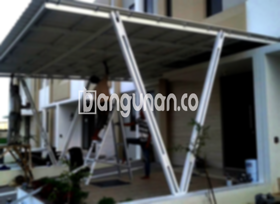

**Jasa Pasang Kanopi Rumah Minimalis di Cilandak Jakarta** – Mitra Bangunan yang ingin melindungi teras, carport, atau area outdoor rumahnya di Cilandak Jakarta, kini tidak perlu khawatir lagi. Kami hadir sebagai solusi praktis dan terpercaya untuk pemasangan kanopi rumah minimalis. Kanopi tidak hanya memberikan perlindungan dari cuaca ekstrem, tetapi juga meningkatkan estetika bangunan Anda.

Kanopi adalah elemen penting dalam desain rumah modern. Pemilihan material dan desain yang tepat akan memberikan perlindungan optimal sekaligus mempercantik tampilan rumah. Kami menawarkan berbagai pilihan kanopi yang dapat disesuaikan dengan gaya arsitektur dan anggaran Anda.



## Keunggulan Memilih Jasa Pasang Kanopi Rumah Minimalis di Cilandak Jakarta

Bagi Anda yang mempertimbangkan untuk memasang kanopi, berikut adalah beberapa keunggulan yang bisa Anda dapatkan:

### \- Pilihan Model Kanopi yang Beragam

Kami menyediakan berbagai model kanopi rumah yang dapat Anda pilih. Anda dapat menemukan desain yang sesuai dengan selera dan kebutuhan Anda, mulai dari bentuk persegi, persegi panjang, hingga desain custom yang unik. Setiap model memiliki daya tarik tersendiri dan dapat disesuaikan dengan gaya arsitektur rumah Anda di Cilandak Jakarta. 

### \- Material Ramah Lingkungan untuk Kanopi Anda

Kanopi yang kami gunakan terbuat dari material yang aman dan ramah lingkungan. Ini memungkinkan Anda untuk menikmati perlindungan optimal tanpa mengkhawatirkan dampak negatif terhadap lingkungan. Material yang digunakan juga mudah dibersihkan, menjaga tampilan kanopi tetap prima dalam jangka panjang.

### \- Ketahanan dan Kekuatan Terjamin

Salah satu keunggulan utama kanopi kami adalah ketahanan dan kekuatannya. Kami hanya menggunakan material berkualitas tinggi yang tahan terhadap cuaca ekstrem, seperti hujan deras, terik matahari, dan angin kencang. Dengan perawatan yang tepat, kanopi yang Anda pilih dapat bertahan selama bertahun-tahun.

Anda dapat mengandalkan kanopi yang kami pasang untuk melindungi properti Anda dari berbagai kondisi cuaca. Ketahanannya yang kuat memastikan investasi Anda memberikan manfaat jangka panjang.

### \- Keamanan dan Kenyamanan yang Meningkat

Kanopi memberikan perlindungan ekstra bagi area di bawahnya. Ini menciptakan ruang yang lebih aman dan nyaman untuk Anda dan keluarga. Kanopi melindungi dari paparan sinar matahari langsung dan hujan, sehingga Anda dapat menikmati waktu berkualitas di luar ruangan tanpa khawatir.

Dengan kanopi, Anda dapat menciptakan area outdoor yang nyaman untuk bersantai, bermain, atau berkumpul dengan keluarga dan teman.

### \- Solusi Hemat Biaya

Kami menawarkan harga yang kompetitif untuk semua jenis kanopi rumah minimalis di Cilandak Jakarta. Kami percaya bahwa setiap orang berhak mendapatkan perlindungan optimal tanpa harus mengeluarkan biaya yang berlebihan. Harga yang kami tawarkan juga transparan dan tidak ada biaya tersembunyi. 

## Informasi Harga dan Jasa Pemasangan Kanopi Rumah Minimalis di Cilandak Jakarta



Banyak pemilik rumah di Cilandak Jakarta yang telah merasakan manfaat memasang kanopi di properti mereka. Kanopi sering digunakan untuk melindungi garasi mobil, area parkir, teras, atau jendela. Pilihan penggunaan kanopi sangat beragam dan disesuaikan dengan kebutuhan masing-masing pemilik rumah.

Untuk memberikan gambaran, harga kanopi rumah dapat bervariasi tergantung pada kualitas material dan desain yang dipilih. Pastikan Anda memilih kanopi yang sesuai dengan anggaran dan kebutuhan Anda.

Harga juga dipengaruhi oleh luas area yang akan ditutupi oleh kanopi. Semakin luas area tersebut, semakin tinggi pula biaya yang dibutuhkan. Kami siap membantu Anda menghitung perkiraan biaya yang sesuai dengan kebutuhan Anda.

Jika Anda membutuhkan jasa pemasangan kanopi profesional di Cilandak Jakarta, jangan ragu untuk menghubungi kami. Tim kami siap memberikan layanan cepat dan efisien. Dengan menggunakan jasa profesional, Anda dapat memastikan bahwa kanopi terpasang dengan benar dan aman.

**Ref by:**  [Kanopi Rumah Minimalis Cilandak Jakarta](https://id.wikipedia.org/wiki/Kanopi)

Semoga informasi ini bermanfaat bagi Mitra Bangunan yang sedang mencari solusi perlindungan untuk rumahnya di Cilandak Jakarta. Jangan tunda lagi, hubungi kami sekarang melalui tombol WhatsApp atau Telepon di halaman ini untuk konsultasi gratis dan penawaran terbaik. Kami siap membantu Anda mewujudkan hunian impian yang nyaman dan terlindungi.