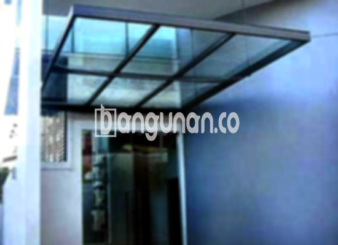

**Jasa Pasang Kanopi Rumah Minimalis di Ciledug Tangerang** – Mitra Bangunan memahami betul kebutuhan akan perlindungan optimal untuk area luar rumah Anda. Kanopi bukan lagi sekadar pelengkap, melainkan elemen penting yang menjaga kenyamanan teras, garasi, atau carport dari cuaca ekstrem. Kami hadir sebagai solusi praktis dan terpercaya bagi Anda di Ciledug Tangerang yang menginginkan kanopi berkualitas dengan desain sesuai selera.

Memilih kanopi yang tepat untuk rumah Anda memerlukan pertimbangan matang. Anda bisa memilih untuk membeli kanopi siap pasang di toko material terdekat atau, untuk hasil yang lebih personal dan sesuai kebutuhan, memesan langsung kepada penyedia jasa seperti kami. Berbagai jenis kanopi tersedia, masing-masing menawarkan keunggulan unik dari segi bahan, kualitas, dan tentu saja, harga. Pastikan Anda memilih kanopi yang paling sesuai dengan anggaran dan preferensi estetika Anda.



## Mengapa Memilih Jasa Pasang Kanopi Rumah Minimalis di Ciledug Tangerang dari Kami?

Bagi Anda yang mempercayakan pemasangan kanopi kepada profesional, ada beberapa keunggulan signifikan yang bisa Anda dapatkan:

### \- Pilihan Model Kanopi yang Beragam

Kami menyediakan beragam model kanopi rumah yang dapat Anda pilih sesuai selera dan kebutuhan. Setiap orang memiliki preferensi desain yang berbeda, dan kami berkomitmen untuk mewujudkannya. Anda dapat memilih kanopi dengan bentuk persegi, persegi panjang, atau bahkan desain khusus yang lebih unik untuk mempercantik tampilan rumah Anda.

### \- Material Ramah Lingkungan untuk Kanopi Anda

Kami hanya menggunakan material berkualitas tinggi yang aman dan ramah lingkungan dalam pembuatan kanopi. Ini memungkinkan Anda menikmati perlindungan optimal tanpa mengkhawatirkan dampak negatif terhadap lingkungan sekitar. Selain itu, material yang kami gunakan juga mudah dibersihkan, sehingga kanopi Anda akan selalu terlihat bersih dan terawat.

### \- Kekuatan dan Ketahanan Terjamin

Salah satu keunggulan utama kanopi yang kami pasang adalah daya tahan dan kekuatannya. Kami menggunakan bahan-bahan berkualitas yang tahan terhadap cuaca ekstrem, seperti hujan, panas, dan angin kencang. Dengan perawatan yang tepat, kanopi rumah Anda dapat bertahan hingga bertahun-tahun tanpa masalah.

Anda dapat mengandalkan kanopi kami untuk memberikan perlindungan jangka panjang bagi rumah Anda. Investasi pada kanopi berkualitas adalah investasi pada kenyamanan dan keamanan keluarga Anda.

### \- Keamanan dan Kenyamanan Maksimal

Kanopi yang terpasang dengan benar akan memberikan keamanan dan kenyamanan maksimal bagi area di bawahnya. Kanopi dapat melindungi Anda dari paparan sinar matahari langsung, hujan, debu, dan kotoran. Ini menciptakan ruang yang lebih nyaman dan aman untuk bersantai, bermain, atau mengumpulkan keluarga.

Dengan kanopi, Anda dapat menikmati aktivitas luar ruangan tanpa khawatir akan cuaca yang tidak menentu.

### \- Harga yang Kompetitif dan Terjangkau

Kami memahami bahwa anggaran adalah pertimbangan penting bagi setiap pelanggan. Oleh karena itu, kami menawarkan harga yang kompetitif dan terjangkau untuk semua jenis kanopi rumah. Harga akan bervariasi tergantung pada jenis bahan, ukuran, dan kompleksitas desain yang Anda pilih.

## Informasi Harga dan Jasa Pemasangan Kanopi Rumah Minimalis di Ciledug Tangerang



Banyak warga Ciledug Tangerang kini memilih untuk memasang kanopi di rumah mereka. Kanopi sering digunakan untuk melindungi garasi mobil, area parkir, atau teras depan rumah. Pilihan penggunaan kanopi sangat beragam, tergantung pada kebutuhan dan preferensi masing-masing pemilik rumah.

Untuk informasi harga yang lebih akurat, kami sarankan Anda untuk menghubungi tim kami. Kami akan dengan senang hati memberikan penawaran harga yang sesuai dengan kebutuhan Anda.

Perlu diingat bahwa harga kanopi dapat bervariasi tergantung pada beberapa faktor, termasuk kualitas bahan, ukuran, dan kompleksitas desain. Pastikan Anda memilih ukuran dan desain yang sesuai dengan kebutuhan Anda agar mendapatkan nilai terbaik untuk investasi Anda.

Kami menyediakan layanan pemasangan kanopi yang cepat, efisien, dan profesional. Dengan memilih jasa pemasangan dari kami, Anda dapat menghemat waktu dan tenaga. Tim kami akan memastikan bahwa kanopi Anda terpasang dengan aman dan tahan lama.

**Ref by:**  [Kanopi Rumah Minimalis Ciledug Tangerang](https://id.wikipedia.org/wiki/Kanopi)

Mitra Bangunan siap membantu Anda mewujudkan area luar rumah yang nyaman dan terlindungi di Ciledug Tangerang. Jangan ragu untuk menghubungi kami melalui tombol WhatsApp atau Telepon yang tersedia di halaman ini untuk konsultasi gratis dan penawaran terbaik. Kami berdedikasi untuk memberikan solusi kanopi yang sempurna untuk rumah Anda.