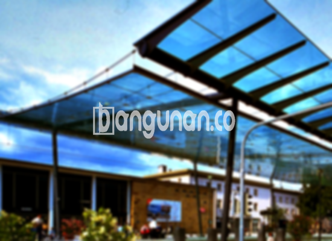

**Jasa Pasang Kanopi Rumah Minimalis di Cilegon** – Memiliki area luar rumah yang terlindungi dan nyaman adalah dambaan setiap pemilik rumah di Cilegon. Kanopi menjadi solusi tepat untuk melindungi teras, garasi, atau bahkan area parkir dari cuaca ekstrem. Mitra Bangunan di Cilegon tidak perlu lagi kesulitan mencari solusi perlindungan yang efektif dan estetik. Kami hadir sebagai penyedia jasa pemasangan kanopi rumah minimalis yang berkualitas dan terjangkau.

Memilih kanopi yang tepat untuk rumah Anda membutuhkan pertimbangan matang. Ada beragam jenis kanopi yang tersedia, masing-masing dengan kelebihan dan kekurangannya. Pemilihan bahan, desain, dan ukuran yang sesuai akan memastikan kanopi Anda berfungsi optimal dan menambah nilai estetika bangunan.



## Keunggulan Menggunakan Jasa Pasang Kanopi Rumah Minimalis di Cilegon

Bagi Anda yang berencana memasang kanopi untuk rumah atau bangunan komersial, berikut beberapa keunggulan yang bisa Anda dapatkan:

### \- Pilihan Model yang Beragam dari Jasa Pasang Kanopi Rumah Minimalis di Cilegon

Kami menyediakan beragam model kanopi rumah yang bisa Anda pilih sesuai selera dan kebutuhan. Masing-masing orang memiliki preferensi desain yang berbeda, dan kami siap mewujudkan desain kanopi impian Anda. Pilihan model yang tersedia meliputi persegi, persegi panjang, melengkung, dan berbagai bentuk lainnya.

### \- Material Ramah Lingkungan dari Jasa Pasang Kanopi Rumah Minimalis di Cilegon

Kami menggunakan bahan-bahan yang tidak berbahaya dan ramah lingkungan dalam pembuatan kanopi. Hal ini menjadi komitmen kami untuk berkontribusi pada kelestarian lingkungan. Selain itu, bahan-bahan yang kami gunakan juga mudah dibersihkan, sehingga kanopi Anda akan selalu terlihat bersih dan terawat.

### \- Ketahanan dan Kekuatan Terjamin dari Jasa Pasang Kanopi Rumah Minimalis di Cilegon

Kanopi yang kami pasang terbuat dari material berkualitas tinggi, sehingga tahan lama dan kokoh. Bahan-bahan yang kami gunakan dirancang untuk menahan berbagai kondisi cuaca ekstrem, sehingga Anda tidak perlu khawatir akan kerusakan akibat hujan, panas, atau angin kencang. Kanopi kami dapat bertahan selama bertahun-tahun dengan perawatan yang tepat.

Anda akan merasakan sendiri manfaatnya, karena kanopi rumah akan menjadi investasi jangka panjang yang memberikan perlindungan optimal. 

### \- Keamanan Optimal dari Jasa Pasang Kanopi Rumah Minimalis di Cilegon

Kanopi memberikan perlindungan ekstra bagi area di bawahnya, menciptakan lingkungan yang lebih aman dan nyaman. Kanopi dapat menghalangi paparan sinar matahari langsung dan hujan deras, sehingga Anda dan keluarga dapat menikmati waktu di luar ruangan tanpa khawatir akan cuaca. Keamanan yang terjamin akan memberikan ketenangan pikiran bagi Anda.

### \- Harga Kompetitif Kanopi Rumah Minimalis di Cilegon

Kami menawarkan harga yang bersaing untuk kanopi rumah minimalis di Cilegon. Harga akan bervariasi tergantung pada jenis kanopi yang Anda pilih, ukuran, dan material yang digunakan. Kami selalu memberikan penawaran terbaik untuk memastikan Anda mendapatkan nilai maksimal dari investasi Anda.

## Harga dan Jasa Pemasangan Kanopi Rumah Minimalis di Cilegon



Banyak pemilik rumah di Cilegon kini memilih untuk memasang kanopi sebagai pelengkap bangunan mereka. Kanopi dapat dipasang di berbagai area, seperti garasi mobil, teras depan, area parkir, atau bahkan sebagai penutup jendela. Pemasangan kanopi dapat disesuaikan dengan kebutuhan spesifik Anda.

Untuk mengetahui perkiraan harga, Anda dapat merujuk pada tabel harga yang tersedia. Harga kanopi rumah bervariasi tergantung pada kualitas material dan kompleksitas desain. Kami akan memberikan penawaran harga yang terperinci setelah melakukan survei lokasi dan memahami kebutuhan Anda secara menyeluruh.

Pemasangan kanopi membutuhkan keahlian dan pengalaman. Dengan menggunakan jasa pemasangan kanopi profesional seperti kami, Anda dapat memastikan bahwa pemasangan dilakukan dengan benar dan aman. Kami memiliki tim yang terampil dan berpengalaman dalam pemasangan berbagai jenis kanopi.

**Ref by:**  [Kanopi Rumah Minimalis Cilegon](https://id.wikipedia.org/wiki/Kanopi)

Mitra Bangunan yang sedang mencari jasa pasang kanopi di Cilegon, jangan ragu untuk menghubungi kami melalui tombol WhatsApp atau Telepon yang tersedia di halaman ini. Kami siap memberikan konsultasi gratis dan membantu Anda memilih kanopi yang paling sesuai dengan kebutuhan dan anggaran Anda. Percayakan kebutuhan kanopi Anda kepada kami, dan nikmati kenyamanan dan perlindungan yang optimal untuk rumah Anda.