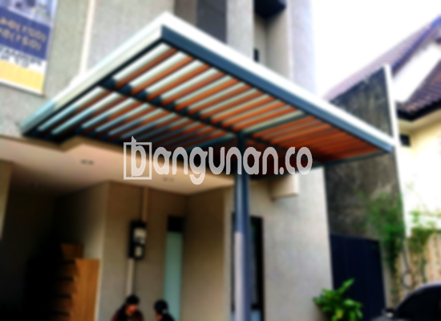

**Jasa Pasang Kanopi Rumah Minimalis di Cililitan Jakarta** – Memiliki area luar ruangan yang nyaman dan terlindungi adalah dambaan setiap pemilik rumah di Cililitan Jakarta. Kanopi hadir sebagai solusi praktis untuk melindungi teras, garasi, atau area outdoor lainnya dari beragam kondisi cuaca. Mitra Bangunan di Cililitan Jakarta tidak perlu lagi khawatir mencari solusi perlindungan optimal untuk properti mereka. Kami menyediakan layanan pembuatan dan pemasangan kanopi rumah minimalis yang berkualitas dan terjangkau.

Untuk menciptakan kenyamanan di rumah, Anda dapat mempertimbangkan pemasangan kanopi. Kanopi tersedia dalam berbagai desain yang dapat disesuaikan dengan gaya arsitektur rumah Anda. Pilihannya beragam, mulai dari material hingga model, memungkinkan Anda menemukan kanopi yang tepat sesuai kebutuhan dan preferensi Anda.



## Keunggulan Memilih Jasa Pasang Kanopi Rumah Minimalis di Cililitan Jakarta

Ada beberapa keuntungan signifikan yang bisa Anda dapatkan dengan menggunakan jasa pasang kanopi rumah minimalis di Cililitan Jakarta:

### \- Pilihan Model Kanopi yang Beragam

Kami menyediakan beragam model kanopi rumah untuk memenuhi selera setiap individu. Anda dapat memilih desain yang sesuai dengan gaya arsitektur dan kebutuhan Anda, misalnya model persegi, persegi panjang, atau sesuai desain khusus.

### \- Material Ramah Lingkungan untuk Kanopi Rumah Minimalis

Material yang kami gunakan dalam pembuatan kanopi kami pilih karena ramah lingkungan dan tidak berbahaya. Ini menjadikan kanopi pilihan yang bertanggung jawab dan berkelanjutan untuk rumah Anda. Selain itu, kanopi kami mudah dibersihkan dan dirawat.

### \- Kanopi Rumah Minimalis: Tahan Lama dan Kokoh

Salah satu keunggulan utama kanopi kami adalah ketahanan dan kekokohannya. Kami menggunakan bahan-bahan berkualitas tinggi yang dirancang untuk tahan terhadap berbagai kondisi cuaca dan penggunaan sehari-hari. Anda dapat mengandalkan kanopi kami untuk memberikan perlindungan jangka panjang.

Kanopi rumah yang terpasang dengan baik dapat bertahan selama bertahun-tahun. Perawatan yang tepat akan semakin memperpanjang umur pakainya. Kami memastikan kanopi yang kami pasang akan bertahan lama dan memberikan nilai tambah pada properti Anda.

### \- Keamanan Terjamin dengan Kanopi Rumah Minimalis

Kanopi memberikan lapisan perlindungan tambahan bagi area di bawahnya. Struktur ini melindungi dari paparan langsung sinar matahari dan hujan, menciptakan lingkungan yang lebih aman dan nyaman. 

Dengan kanopi, area depan rumah Anda terlindungi dari elemen cuaca, sehingga Anda dan keluarga dapat menikmati ruang outdoor tanpa khawatir. Keamanan yang terjamin ini adalah salah satu alasan utama mengapa banyak orang memilih untuk memasang kanopi.

### \- Harga Kanopi Rumah Minimalis yang Ekonomis

Kami memahami pentingnya anggaran dalam setiap proyek pembangunan. Oleh karena itu, kami menawarkan harga yang kompetitif dan terjangkau untuk layanan pasang kanopi rumah minimalis di Cililitan Jakarta. Kami akan membantu Anda menemukan solusi yang sesuai dengan anggaran Anda.

## Informasi Harga dan Jasa Pasang Kanopi Rumah Minimalis di Cililitan Jakarta



Banyak warga Cililitan Jakarta yang kini telah menerapkan kanopi di rumah mereka. Pemanfaatannya beragam, mulai dari melindungi garasi mobil, area parkir, hingga menutupi jendela. Pilihan penggunaan kanopi bergantung pada kebutuhan spesifik Anda.

Untuk memberi Anda gambaran, harga kanopi rumah bervariasi tergantung pada kualitas material yang digunakan. Semakin berkualitas materialnya, semakin tinggi pula harganya. Faktor lain yang memengaruhi harga adalah ukuran dan kompleksitas desain kanopi.

Selain kualitas material, luas area yang akan ditutupi kanopi juga berpengaruh pada harga. Semakin luas area tersebut, semakin banyak material yang dibutuhkan, dan semakin tinggi pula biayanya. Pastikan Anda memperhitungkan ukuran yang tepat sebelum melakukan pemesanan.

Jika Anda membutuhkan jasa pemasangan kanopi profesional, manfaatkan layanan dari penyedia jasa terpercaya. Dengan menggunakan jasa profesional, proses pemasangan akan lebih cepat, efisien, dan hasilnya lebih rapi. 

Demikian informasi mengenai jasa pasang kanopi rumah minimalis di Cililitan Jakarta yang dapat kami sampaikan. Mitra Bangunan yang mencari solusi perlindungan sempurna untuk rumah di Cililitan Jakarta, hubungi kami melalui tombol WhatsApp atau Telepon yang tersedia di halaman ini, dan kami siap memberikan layanan terbaik.

**Ref by:**  [Kanopi Rumah Minimalis Cililitan Jakarta](https://id.wikipedia.org/wiki/Kanopi)