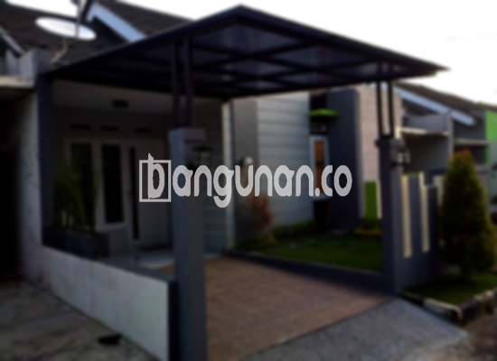

**Jasa Pasang Kanopi Rumah Minimalis di Cilincing Jakarta** – Bagi Mitra Bangunan di Cilincing Jakarta yang ingin melindungi rumah dari terik matahari dan hujan, kanopi adalah solusi yang tepat. Kanopi tidak hanya berfungsi sebagai pelindung, tetapi juga mempercantik tampilan fasad rumah Anda. Kami menyediakan jasa pemasangan kanopi rumah minimalis dengan berbagai pilihan material dan desain yang sesuai dengan kebutuhan dan anggaran Anda.

Memilih kanopi yang tepat untuk rumah Anda memerlukan pertimbangan matang. Ada banyak sekali jenis kanopi yang tersedia di pasaran, masing-masing dengan kelebihan dan kekurangannya. Kami hadir untuk membantu Anda menentukan pilihan terbaik, mulai dari desain hingga proses pemasangan.



## Keunggulan Memilih Jasa Pasang Kanopi Rumah Minimalis di Cilincing Jakarta

Menggunakan jasa profesional untuk pemasangan kanopi rumah minimalis di Cilincing Jakarta menawarkan sejumlah keuntungan signifikan bagi Anda. Berikut beberapa keunggulan yang bisa Anda rasakan:

### \- Pilihan Model Kanopi yang Beragam

Kami menyediakan beragam model kanopi rumah yang bisa Anda pilih sesuai dengan selera dan gaya arsitektur rumah Anda. Preferensi setiap orang berbeda-beda, dan kami memahami kebutuhan tersebut. Anda dapat memilih desain persegi, persegi panjang, atau bahkan bentuk custom yang unik untuk menciptakan tampilan yang personal.

### \- Material Ramah Lingkungan untuk Kanopi yang Berkelanjutan

Kami menggunakan material yang ramah lingkungan dalam pembuatan kanopi rumah. Pilihan bahan ini tidak hanya mengurangi dampak negatif terhadap lingkungan, tetapi juga menjamin keamanan dan kenyamanan bagi Anda dan keluarga. Selain itu, material yang kami gunakan mudah dibersihkan dan dirawat.

### \- Kanopi yang Awet dan Tahan Lama

Salah satu keunggulan utama kanopi yang kami pasang adalah ketahanannya. Kami hanya menggunakan bahan-bahan berkualitas tinggi yang teruji kekuatannya. Dengan perawatan yang tepat, kanopi rumah Anda dapat bertahan selama bertahun-tahun tanpa perlu khawatir akan kerusakan.

Anda akan merasakan manfaatnya langsung – kanopi rumah akan melindungi properti Anda selama bertahun-tahun. Kualitas dan perawatan yang baik akan menentukan masa pakai kanopi Anda.

### \- Keamanan Terjamin dengan Kanopi Rumah Minimalis

Keamanan adalah prioritas utama kami. Kanopi yang kami pasang dirancang untuk memberikan perlindungan optimal terhadap cuaca ekstrem. Dengan kanopi, teras atau carport Anda terlindungi dari hujan deras, sinar matahari yang menyilaukan, dan bahkan serpihan benda yang jatuh. 

Kanopi memberikan rasa aman dan nyaman bagi Anda dan keluarga. Dengan perlindungan yang terjamin, Anda dapat menikmati area luar ruangan rumah Anda tanpa khawatir.

### \- Harga Kanopi Rumah Minimalis yang Kompetitif di Cilincing Jakarta 

Kami menawarkan harga kanopi rumah minimalis yang kompetitif di area Cilincing Jakarta. Kami percaya bahwa setiap orang berhak mendapatkan perlindungan yang berkualitas tanpa harus menguras kantong. Harga akan bervariasi tergantung pada jenis material, ukuran, dan kompleksitas desain yang Anda pilih.

## Informasi Harga dan Jasa Pemasangan Kanopi Rumah Minimalis di Cilincing Jakarta



Banyak orang di Cilincing Jakarta yang kini memilih memasang kanopi di rumah mereka. Kanopi dimanfaatkan untuk berbagai keperluan, seperti melindungi garasi mobil, area parkir, atau sebagai penutup jendela. Semua tergantung pada kebutuhan spesifik Anda.

Sebagai gambaran, harga kanopi rumah berkisar antara Rp. 450.000 hingga Rp. 800.000 untuk kualitas standar. Namun, harga dapat meningkat jika Anda memilih material yang lebih berkualitas tinggi.

Harga juga dipengaruhi oleh beberapa faktor lainnya, termasuk kualitas bahan, luas area yang akan ditutup, dan tingkat kesulitan pemasangan. Untuk mendapatkan penawaran harga yang akurat, kami sarankan Anda untuk menghubungi tim kami.

Bagi Anda yang ingin memasang kanopi untuk rumah Anda, menggunakan jasa pemasangan profesional adalah pilihan yang bijak. Dengan memilih penyedia jasa yang berpengalaman, Anda akan mendapatkan hasil pemasangan yang rapi, cepat, dan efisien.

Demikianlah informasi mengenai Jasa Pasang Kanopi Rumah Minimalis di Cilincing Jakarta yang dapat kami sampaikan. Jangan ragu untuk berkonsultasi langsung dengan tim kami untuk mendapatkan pelayanan dan harga terbaik. Kami siap membantu Anda mewujudkan hunian yang nyaman dan terlindungi. Hubungi kami melalui tombol WhatsApp atau Telepon di halaman ini, dan Mitra Bangunan akan mendapatkan solusi kanopi terbaik untuk rumah Anda.

**Ref by:**  [Kanopi Rumah Minimalis Cilincing Jakarta](https://id.wikipedia.org/wiki/Kanopi)