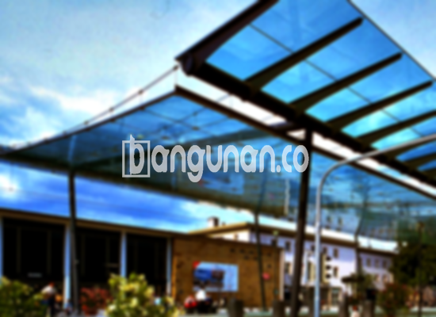

**Jasa Pasang Kanopi Rumah Minimalis di Ciluar Bogor** – Menciptakan area luar rumah yang nyaman dan terlindungi adalah prioritas bagi Mitra Bangunan di Ciluar Bogor. Kanopi menjadi solusi praktis untuk melindungi teras, garasi, atau area parkir dari cuaca ekstrem dan memberikan nilai estetika pada bangunan Anda. Kami hadir sebagai penyedia jasa pemasangan kanopi berkualitas dengan harga terjangkau.

Pilihan kanopi untuk rumah sangat beragam, memungkinkan Anda menyesuaikan desain dengan gaya arsitektur dan kebutuhan spesifik. Setiap jenis kanopi menawarkan keunggulan tersendiri, mulai dari material, kualitas, hingga harga. Penting untuk memilih kanopi yang paling sesuai dengan preferensi dan anggaran Anda.



## Keunggulan Memilih Jasa Pasang Kanopi Rumah Minimalis di Ciluar Bogor

Banyak keuntungan yang bisa Anda peroleh dengan menggunakan jasa pemasangan kanopi profesional di Ciluar Bogor:

### Desain Kanopi yang Beragam dan Fleksibel

Kami menyediakan berbagai model kanopi yang dapat Anda pilih, sesuai dengan selera dan kebutuhan Anda. Anda bebas menentukan bentuk dan ukuran kanopi sesuai dengan area yang ingin dilindungi, seperti persegi, persegi panjang, atau desain khusus lainnya.

### Material Ramah Lingkungan dan Mudah Perawatan

Kanopi yang kami gunakan terbuat dari bahan-bahan berkualitas yang tidak berbahaya dan ramah lingkungan. Material ini juga mudah dibersihkan, sehingga Anda tidak perlu khawatir tentang perawatan yang rumit.

### Ketahanan dan Kekokohan Terjamin

Kanopi yang kami pasang dirancang untuk tahan lama dan kokoh. Kami menggunakan material berkualitas tinggi yang mampu menahan berbagai kondisi cuaca. Dengan perawatan yang tepat, kanopi ini dapat bertahan selama bertahun-tahun.

Anda dapat mengandalkan daya tahan kanopi untuk melindungi properti Anda dari berbagai elemen, seperti hujan, panas, dan angin. Anda akan mendapatkan investasi jangka panjang yang bermanfaat.

### Keamanan dan Kenyamanan yang Meningkat

Kanopi memberikan perlindungan tambahan bagi area di bawahnya, menciptakan lingkungan yang lebih aman dan nyaman. Kanopi dapat menghalangi sinar matahari langsung dan mencegah air hujan masuk, sehingga Anda dapat menikmati area luar rumah kapan saja.

### Harga yang Kompetitif dan Terjangkau

Kami menawarkan harga yang kompetitif dan terjangkau tanpa mengurangi kualitas produk dan layanan kami. Kami berkomitmen untuk memberikan solusi terbaik yang sesuai dengan anggaran Anda.

## Informasi Harga dan Jasa Pemasangan Kanopi Rumah Minimalis di Ciluar Bogor



Banyak warga Ciluar Bogor yang telah merasakan manfaat memasang kanopi di rumah mereka. Kanopi dapat digunakan untuk berbagai keperluan, seperti melindungi garasi mobil, area parkir, atau sebagai penutup jendela. Pilihan ada di tangan Anda, sesuai dengan kebutuhan dan preferensi masing-masing.

Untuk memberikan gambaran, harga kanopi rumah dengan kualitas standar berkisar antara Rp. 450.000 – Rp. 800.000 per meter persegi. Namun, harga dapat bervariasi tergantung pada jenis material, ukuran, dan kompleksitas desain yang Anda pilih. Kami sarankan untuk menghubungi tim kami untuk mendapatkan penawaran harga yang akurat dan sesuai dengan kebutuhan Anda.

Mempercayakan pemasangan kanopi kepada penyedia jasa profesional akan menghemat waktu dan tenaga Anda. Tim kami yang berpengalaman akan memastikan pemasangan dilakukan dengan cepat, rapi, dan sesuai dengan standar keamanan yang berlaku.

Dengan begitu, Anda dapat segera menikmati manfaat dari kanopi baru Anda tanpa perlu khawatir tentang masalah teknis.

Demikian informasi yang dapat kami sampaikan mengenai Jasa Pasang Kanopi Rumah Minimalis di Ciluar Bogor. Mitra Bangunan yang sedang mencari solusi kanopi yang berkualitas dan terjangkau, jangan ragu untuk menghubungi kami melalui tombol WhatsApp atau Telepon di halaman ini. Kami siap membantu Anda mewujudkan hunian yang nyaman dan terlindungi. Terima kasih.

**Ref by:**  [Kanopi Rumah Minimalis Ciluar Bogor](https://id.wikipedia.org/wiki/Kanopi)