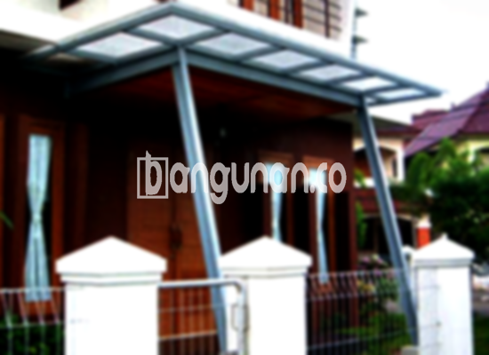

**Jasa Pasang Kanopi Rumah Minimalis di Cimaung** – Bagi Mitra Bangunan di Cimaung, memiliki area luar rumah yang terlindungi dari cuaca adalah sebuah investasi penting. Kanopi rumah bukan hanya memberikan naungan, tetapi juga meningkatkan nilai estetika hunian Anda. Kami menyediakan solusi lengkap untuk pemasangan kanopi rumah minimalis berkualitas tinggi.

Berbagai model kanopi tersedia untuk memenuhi kebutuhan dan gaya arsitektur rumah Anda. Baik untuk melindungi teras, garasi, atau area santai, kanopi adalah pilihan yang tepat. Pemilihan kanopi yang sesuai akan meningkatkan kenyamanan dan keamanan keluarga Anda.



## Keuntungan Menggunakan Jasa Pasang Kanopi Rumah Minimalis di Cimaung

Bagi Anda yang sedang mempertimbangkan untuk memasang kanopi, berikut adalah beberapa keuntungan yang bisa Anda dapatkan dengan memilih layanan kami di Cimaung:

### \- Variasi Model Kanopi yang Luas

Kami menawarkan beragam pilihan model kanopi rumah yang dapat disesuaikan dengan selera Anda. Setiap orang memiliki preferensi desain yang unik, dan kami siap membantu mewujudkannya. Anda dapat memilih model persegi, persegi panjang, lengkung, atau bentuk lainnya sesuai dengan gaya arsitektur rumah Anda.

### \- Bahan Material yang Ramah Lingkungan

Kanopi yang kami gunakan terbuat dari material yang aman dan tidak berbahaya bagi kesehatan serta lingkungan sekitar. Kami berkomitmen untuk menggunakan produk yang berkelanjutan dan ramah lingkungan. Keunggulan lainnya adalah kemudahan dalam membersihkan kanopi, sehingga Anda tidak perlu repot dengan perawatan yang berlebihan.

### \- Konstruksi yang Awet dan Kokoh

Salah satu keunggulan utama dari kanopi kami adalah konstruksinya yang kuat dan tahan lama. Kami menggunakan bahan-bahan berkualitas tinggi yang mampu menahan beban dan tekanan eksternal. Dengan perawatan yang tepat, kanopi buatan kami dapat bertahan selama bertahun-tahun tanpa perlu khawatir akan kerusakan.

Anda akan merasakan sendiri kualitas dan ketahanan kanopi rumah yang kami pasang. Kekuatan konstruksi ini menjamin investasi Anda akan memberikan manfaat jangka panjang.

### \- Tingkat Keamanan yang Tinggi

Kanopi memberikan perlindungan ekstra bagi area di bawahnya, menjadikannya lebih aman dan nyaman. Kanopi dapat menghalangi sinar matahari langsung, hujan, dan bahkan benda-benda yang jatuh dari atas. Keamanan ini sangat penting untuk melindungi keluarga Anda dan barang-barang berharga Anda.

### \- Harga yang Terjangkau di Cimaung

Kami memahami bahwa harga merupakan faktor penting dalam setiap keputusan pembelian. Oleh karena itu, kami menawarkan harga yang kompetitif dan sesuai dengan anggaran Anda. Walaupun harga bervariasi tergantung pada jenis material dan ukuran kanopi, kami selalu berusaha memberikan penawaran terbaik.

## Informasi Harga dan Jasa Pemasangan Kanopi Rumah Minimalis di Cimaung



Pemasangan kanopi semakin populer di kalangan pemilik rumah di Cimaung. Banyak yang menyadari manfaatnya dalam melindungi teras, garasi, atau area luar ruangan lainnya dari cuaca ekstrem. Kanopi tidak hanya fungsional, tetapi juga dapat meningkatkan tampilan rumah Anda.

Harga kanopi rumah di Cimaung berkisar antara Rp. 450.000 hingga Rp. 800.000 untuk kualitas standar. Harga dapat lebih tinggi jika Anda memilih material yang lebih berkualitas atau desain yang lebih kompleks.

Beberapa faktor lain yang memengaruhi harga adalah ukuran kanopi, tingkat kesulitan pemasangan, dan lokasi pemasangan. Pastikan Anda memilih ukuran yang sesuai dengan kebutuhan dan anggaran Anda. Untuk mendapatkan penawaran harga yang akurat, Anda dapat menghubungi kami untuk konsultasi gratis.

Bagi Anda yang menginginkan proses pemasangan yang cepat, efisien, dan profesional, kami sarankan untuk menggunakan jasa pemasangan kanopi dari ahli. Kami memiliki tim yang berpengalaman dan terpercaya yang siap membantu Anda mewujudkan kanopi impian Anda.

Dengan memilih layanan kami, Anda dapat memastikan bahwa kanopi Anda terpasang dengan benar dan aman. Kami mengutamakan kepuasan pelanggan dan memberikan garansi atas setiap pekerjaan yang kami lakukan. Mitra Bangunan di Cimaung, hubungi kami sekarang juga melalui tombol WhatsApp atau Telepon di halaman ini untuk mendapatkan layanan terbaik dan penawaran harga yang menarik.

**Ref by:**  [Kanopi Rumah Minimalis Cimaung](https://id.wikipedia.org/wiki/Kanopi)