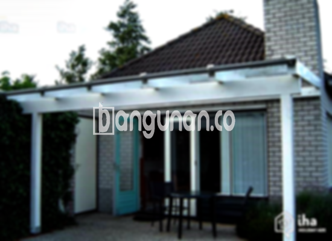

**Jasa Pasang Kanopi Rumah Minimalis di Cimenyan** – Mitra Bangunan yang ingin melindungi teras atau area parkir dari cuaca ekstrem di Cimenyan? Kanopi adalah solusi praktis yang kini semakin populer. Struktur atap ini tidak hanya melindungi dari hujan dan panas, tetapi juga mempercantik tampilan rumah Anda. Kami hadir sebagai penyedia jasa pembuatan dan pemasangan kanopi yang terpercaya di Cimenyan, dengan berbagai pilihan desain dan material yang sesuai kebutuhan Anda.

Memilih kanopi yang tepat untuk rumah membutuhkan pertimbangan matang. Ada begitu banyak model dan bahan yang tersedia, masing-masing menawarkan keunggulan unik. Baik Anda mencari kanopi untuk garasi, teras depan, atau area komersial, kami siap membantu Anda menemukan solusi terbaik. 



## Keunggulan Menggunakan Jasa Pasang Kanopi Rumah Minimalis di Cimenyan

Menggunakan jasa profesional untuk pemasangan kanopi rumah di Cimenyan memberikan banyak keuntungan. Berikut adalah beberapa di antaranya:

### – Pilihan Model Kanopi yang Beragam

Kami menawarkan beragam model kanopi rumah yang bisa Anda sesuaikan dengan selera dan gaya arsitektur rumah Anda. Bentuk kanopi yang tersedia antara lain persegi, persegi panjang, melengkung, dan banyak lagi. Anda dapat memilih desain yang paling sesuai dengan preferensi pribadi Anda.

### – Material Ramah Lingkungan dari Jasa Pasang Kanopi Rumah Minimalis di Cimenyan

Kami hanya menggunakan bahan-bahan berkualitas tinggi yang aman dan ramah lingkungan. Dengan memilih kanopi dari kami, Anda turut berkontribusi dalam menjaga kelestarian lingkungan. Selain itu, material yang kami gunakan mudah dibersihkan dan dirawat.

### – Ketahanan dan Kekuatan Terjamin dari Jasa Pasang Kanopi Rumah Minimalis di Cimenyan

Salah satu keunggulan utama yang kami tawarkan adalah ketahanan dan kekuatan kanopi yang terjamin. Kami menggunakan bahan-bahan berkualitas yang tahan terhadap cuaca ekstrem dan memiliki umur pakai yang panjang. Kanopi yang kami pasang dapat bertahan selama bertahun-tahun dengan perawatan yang tepat.

Anda dapat mengandalkan kanopi rumah untuk melindungi properti Anda dari berbagai kondisi cuaca. Ketahanan ini sangat penting untuk investasi jangka panjang.

### – Keamanan yang Optimal dari Jasa Pasang Kanopi Rumah Minimalis di Cimenyan

Keamanan adalah prioritas utama kami. Kanopi yang kami pasang dirancang untuk memberikan perlindungan maksimal terhadap teras, garasi, atau area luar ruangan lainnya. Kanopi dapat melindungi dari paparan sinar matahari langsung, hujan deras, dan bahkan angin kencang.

Dengan kanopi yang terpasang dengan benar, Anda dapat merasa tenang dan nyaman saat menikmati waktu di luar rumah.

### – Harga Kompetitif Kanopi Rumah Minimalis di Cimenyan

Kami menawarkan harga yang kompetitif dan sesuai dengan kualitas material dan layanan yang kami berikan. Meskipun harga bervariasi tergantung pada jenis kanopi dan ukuran yang Anda pilih, kami selalu berusaha memberikan penawaran terbaik bagi pelanggan kami di Cimenyan.

## Harga dan Jasa Pemasangan Kanopi Rumah Minimalis di Cimenyan



Tren penggunaan kanopi rumah semakin meningkat di kalangan masyarakat Cimenyan. Banyak yang menggunakannya untuk melindungi garasi mobil, area parkir, atau sebagai penutup teras. Pemilihan kanopi yang tepat dapat meningkatkan nilai estetika rumah Anda.

Perlu diketahui bahwa harga kanopi rumah dapat bervariasi tergantung pada kualitas material dan kompleksitas desain. Kami selalu memberikan informasi harga yang transparan dan jujur kepada pelanggan. Untuk mengetahui informasi harga terkini, silakan hubungi kami langsung.

Faktor-faktor seperti ukuran, bahan, dan tingkat kesulitan pemasangan juga akan memengaruhi biaya secara keseluruhan. Kami akan memberikan penawaran harga yang disesuaikan dengan kebutuhan dan anggaran Anda.

Mempercayakan pemasangan kanopi kepada tenaga profesional akan menghemat waktu dan tenaga Anda. Kami memiliki tim yang berpengalaman dan terampil dalam memasang berbagai jenis kanopi dengan cepat dan efisien. Dengan demikian, Anda dapat langsung menikmati manfaat kanopi yang telah terpasang.

**Ref by:**  [Kanopi Rumah Minimalis Cimenyan](https://id.wikipedia.org/wiki/Kanopi)

Mitra Bangunan yang sedang mencari jasa pasang kanopi rumah minimalis di Cimenyan, jangan ragu untuk menghubungi kami melalui tombol WhatsApp atau Telepon yang tersedia di halaman ini. Kami siap memberikan layanan terbaik dan solusi kanopi yang sesuai dengan kebutuhan Anda.