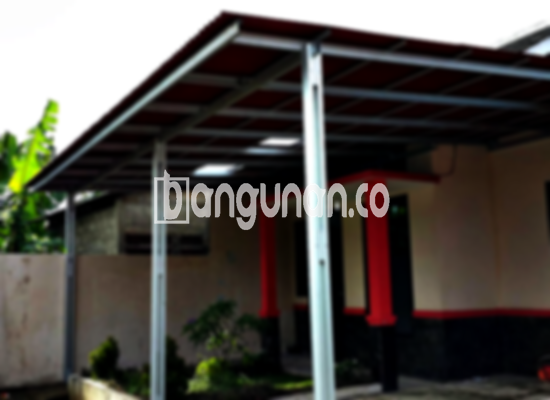

**Jasa Pasang Kanopi Rumah Minimalis di Cinangka Depok** – Memiliki area luar ruangan yang nyaman dan terlindungi adalah dambaan setiap pemilik properti. Kanopi hadir sebagai solusi praktis untuk melindungi teras, garasi, atau area parkir dari cuaca ekstrem. Mitra Bangunan di Cinangka Depok memahami kebutuhan ini dan siap membantu Anda mewujudkannya dengan layanan pemasangan kanopi berkualitas dan terjangkau.

Untuk mempercantik dan melindungi hunian Anda, Anda dapat memilih berbagai jenis kanopi yang sesuai dengan kebutuhan dan anggaran. Kami menyediakan beragam pilihan kanopi yang dapat dipesan sesuai keinginan Anda. Setiap jenis kanopi memiliki keunggulan masing-masing, baik dari segi material, kualitas, maupun harga. Pastikan Anda memilih kanopi yang paling sesuai dengan preferensi dan kebutuhan Anda.



## Keuntungan Menggunakan Jasa Pasang Kanopi Rumah Minimalis di Cinangka Depok

Bagi Anda yang mempertimbangkan untuk memasang kanopi di Cinangka Depok, berikut beberapa keuntungan yang bisa Anda dapatkan:

### \- Pilihan Model yang Beragam

Kami menawarkan berbagai macam model kanopi rumah yang bisa Anda pilih. Anda dapat menemukan desain yang sesuai dengan gaya arsitektur rumah Anda dan selera pribadi. Model-model yang tersedia termasuk persegi, persegi panjang, melengkung, dan banyak lagi.

### \- Material Ramah Lingkungan

Kanopi yang kami pasang menggunakan material yang ramah lingkungan. Hal ini memastikan bahwa Anda tidak hanya mendapatkan perlindungan optimal tetapi juga berkontribusi pada pelestarian lingkungan. Bahan-bahan yang digunakan juga mudah dibersihkan, sehingga perawatan kanopi menjadi lebih praktis.

### \- Ketahanan dan Keawetan Terjamin

Salah satu keunggulan utama kanopi yang kami pasang adalah ketahanan dan keawetannya. Material berkualitas tinggi memastikan bahwa kanopi dapat bertahan lama meskipun terpapar cuaca ekstrem. Dengan perawatan yang tepat, kanopi Anda dapat memberikan perlindungan selama bertahun-tahun.

Anda dapat mengandalkan kanopi untuk melindungi properti Anda dari berbagai kondisi cuaca, termasuk hujan deras dan terik matahari. Keawetan material akan menghemat biaya perbaikan dan penggantian dalam jangka panjang.

### \- Keamanan yang Optimal

Kanopi yang terpasang dengan baik memberikan keamanan tambahan bagi area di bawahnya. Kanopi melindungi dari paparan langsung sinar matahari dan hujan, sehingga Anda dapat menikmati aktivitas di luar ruangan dengan lebih nyaman dan aman.

Keamanan ini juga penting untuk melindungi barang-barang berharga yang berada di bawah kanopi, seperti kendaraan atau perabotan taman.

### \- Harga yang Kompetitif

Kami menawarkan harga yang kompetitif untuk layanan pemasangan kanopi rumah minimalis di Cinangka Depok. Kami memahami bahwa anggaran adalah pertimbangan penting bagi setiap pelanggan, dan kami berkomitmen untuk memberikan solusi yang terjangkau tanpa mengorbankan kualitas.

## Informasi Harga dan Jasa Pemasangan Kanopi Rumah Minimalis di Cinangka Depok



Banyak pemilik rumah di Cinangka Depok yang telah merasakan manfaat memiliki kanopi. Apakah Anda sedang mencari kanopi untuk garasi, teras, atau area parkir, kami siap membantu Anda menemukan solusi yang tepat. Kami menghadirkan berbagai pilihan material, termasuk baja ringan, galvalum, kaca, dan polycarbonate, sehingga Anda dapat memilih yang paling sesuai dengan kebutuhan dan anggaran Anda.

Harga kanopi rumah bervariasi tergantung pada beberapa faktor, seperti jenis material, ukuran, dan kompleksitas desain. Untuk mendapatkan penawaran harga yang akurat, kami sarankan Anda untuk menghubungi tim kami dan berkonsultasi langsung. Kami akan dengan senang hati memberikan informasi lebih lanjut mengenai harga dan opsi yang tersedia.

Memilih penyedia jasa pemasangan kanopi yang berpengalaman akan memastikan bahwa kanopi Anda terpasang dengan benar dan aman. Kami memiliki tim profesional yang terlatih dan berpengalaman dalam pemasangan berbagai jenis kanopi. Dengan menggunakan jasa kami, Anda dapat yakin bahwa kanopi Anda akan terpasang dengan rapi dan sesuai dengan harapan Anda.

Dengan layanan profesional dan harga yang bersaing, Kami adalah pilihan yang tepat untuk kebutuhan pemasangan kanopi Anda di Cinangka Depok. Mitra Bangunan siap membantu Anda menciptakan ruang luar ruangan yang nyaman, aman, dan estetis. Jangan ragu untuk menghubungi kami melalui tombol WhatsApp atau Telepon di halaman ini untuk mendapatkan konsultasi gratis dan penawaran terbaik.

**Ref by:**  [Kanopi Rumah Minimalis Cinangka Depok](https://id.wikipedia.org/wiki/Kanopi)