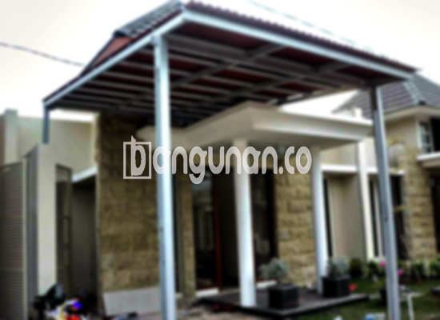

**Jasa Pasang Kanopi Rumah Minimalis di Ciomas** – Memiliki area luar rumah yang nyaman dan terlindungi adalah dambaan setiap pemilik rumah. Kanopi hadir sebagai solusi praktis untuk menjaga teras, garasi, atau area lain dari paparan cuaca ekstrem. Mitra Bangunan di Ciomas kini dapat menikmati kenyamanan ini dengan layanan pemasangan kanopi minimalis yang terjangkau dan berkualitas.

Kanopi tidak hanya berfungsi sebagai pelindung, tetapi juga dapat meningkatkan estetika rumah Anda. Dengan berbagai model dan material yang tersedia, Anda dapat memilih kanopi yang paling sesuai dengan gaya arsitektur rumah Anda. 



## Mengapa Memilih Jasa Pasang Kanopi Rumah Minimalis di Ciomas?

Bagi Anda yang berencana memasang kanopi, berikut adalah beberapa keunggulan yang bisa Anda dapatkan dengan memilih layanan kami di Ciomas:

### \- Pilihan Model yang Beragam

Kami menyediakan beragam model kanopi rumah yang dapat Anda sesuaikan dengan preferensi pribadi. Anda dapat memilih desain yang sesuai dengan gaya arsitektur rumah Anda, mulai dari model persegi, persegi panjang, hingga desain yang lebih unik dan modern.

### \- Material Ramah Lingkungan

Kami menggunakan material yang tidak berbahaya bagi lingkungan, sehingga Anda dapat merasa nyaman dan berkontribusi pada pelestarian alam. Material yang ringan juga memudahkan proses pembersihan dan perawatan.

### \- Ketahanan dan Kekuatan Terjamin

Kanopi yang kami pasang terbuat dari material berkualitas tinggi, yang menjamin kekuatan dan ketahanan terhadap cuaca ekstrem. Investasi ini akan memberikan perlindungan jangka panjang untuk rumah Anda di Ciomas.

Anda akan merasakan manfaatnya secara langsung, di mana kanopi kami dapat bertahan hingga puluhan tahun dengan perawatan yang tepat. 

### \- Keamanan dan Kenyamanan Optimal

Kanopi memberikan perlindungan maksimal terhadap cuaca, seperti sinar matahari dan hujan. Dengan demikian, area di bawah kanopi tetap nyaman untuk digunakan, bahkan saat kondisi cuaca tidak mendukung.

Dengan perlindungan yang terjamin, Anda dapat menikmati waktu bersama keluarga atau teman di area luar rumah tanpa khawatir terganggu oleh kondisi cuaca.

### \- Harga yang Kompetitif

Kami menawarkan harga yang terjangkau tanpa mengorbankan kualitas. Kami memahami bahwa setiap orang memiliki anggaran yang berbeda, sehingga kami berusaha memberikan solusi yang sesuai dengan kebutuhan Anda.

## Informasi Harga dan Jasa Pemasangan Kanopi Rumah Minimalis di Ciomas



Banyak pemilik rumah di Ciomas yang kini memilih untuk memasang kanopi sebagai pelengkap bangunan mereka. Kanopi dapat digunakan untuk berbagai keperluan, seperti melindungi garasi mobil, area parkir, atau jendela rumah dari paparan cuaca.

Untuk informasi harga terkini dan penawaran terbaik, silakan lihat tabel harga di bawah ini atau hubungi tim kami.

Bagi Anda yang ingin pemasangan kanopi lebih cepat dan efisien, kami menyediakan layanan pemasangan profesional. Tim kami akan memastikan proses pemasangan berjalan lancar dan sesuai dengan standar keamanan.

**Ref by:**  [Kanopi Rumah Minimalis Ciomas](https://id.wikipedia.org/wiki/Kanopi)

Dengan demikian, Mitra Bangunan di Ciomas tidak perlu lagi khawatir tentang area luar rumah yang terpapar cuaca. Hubungi kami sekarang juga melalui tombol WhatsApp atau Telepon di halaman ini untuk mendapatkan konsultasi gratis dan penawaran terbaik. Kami siap membantu Anda menciptakan rumah impian yang nyaman dan terlindungi!