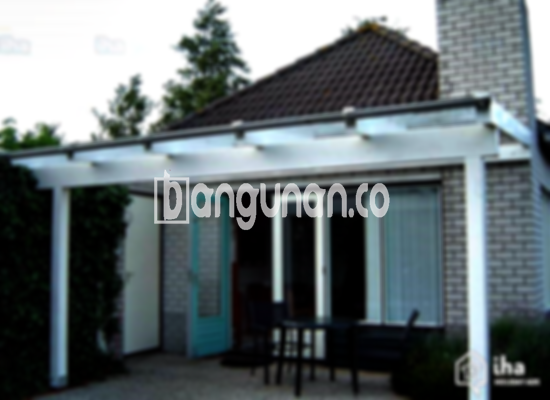

**Jasa Pasang Kanopi Rumah Minimalis di Cipaku Bogor** – Memiliki area luar rumah yang nyaman dan terlindungi adalah dambaan setiap pemilik rumah di Cipaku Bogor. Kanopi hadir sebagai solusi praktis untuk menjaga teras, garasi, atau area parkir dari panas matahari dan hujan. Mitra Bangunan menyediakan layanan pembuatan dan pemasangan kanopi berkualitas dengan harga terjangkau, disesuaikan dengan kebutuhan Anda.

Bagi Anda yang ingin mempercantik dan melindungi properti, memilih penyedia jasa yang tepat adalah kunci utama. Kami menawarkan beragam pilihan kanopi yang tidak hanya fungsional, tetapi juga meningkatkan estetika rumah Anda.



## Keuntungan Menggunakan Jasa Pasang Kanopi Rumah Minimalis di Cipaku Bogor

Investasi pada kanopi bukan hanya soal perlindungan, tetapi juga peningkatan nilai properti Anda. Berikut adalah beberapa keuntungan yang bisa Anda peroleh dengan menggunakan layanan kami di Cipaku Bogor.

### \- Ragam Model Kanopi yang Sesuai Selera

Kami memahami bahwa setiap pemilik rumah memiliki preferensi desain yang unik. Itulah mengapa kami menyediakan berbagai model kanopi yang dapat Anda pilih sesuai dengan gaya arsitektur rumah Anda. Anda dapat memilih berbagai bentuk, mulai dari persegi, persegi panjang, hingga desain custom yang lebih kompleks.

### \- Bahan Berkualitas dan Ramah Lingkungan

Kami hanya menggunakan bahan-bahan berkualitas tinggi yang tahan lama dan ramah lingkungan. Pemilihan material yang tepat memastikan kanopi Anda tidak hanya kuat, tetapi juga aman bagi kesehatan keluarga dan lingkungan sekitar. Selain itu, material yang kami gunakan mudah dibersihkan dan dirawat.

### \- Konstruksi Kuat dan Tahan Lama

Kanopi yang kami pasang dirancang untuk menahan berbagai kondisi cuaca ekstrem. Dengan menggunakan material yang berkualitas dan teknik pemasangan yang tepat, kami menjamin kekuatan dan ketahanan kanopi Anda dalam jangka waktu yang lama. Anda dapat mengandalkan kanopi kami untuk melindungi properti Anda selama bertahun-tahun.

### \- Meningkatkan Keamanan dan Kenyamanan

Kanopi memberikan perlindungan ekstra terhadap sinar matahari langsung dan hujan lebat, sehingga Anda dapat menikmati area luar rumah dengan lebih nyaman. Selain itu, kanopi juga dapat meningkatkan keamanan dengan mencegah barang-barang outdoor terpapar cuaca buruk.

### \- Solusi Ekonomis untuk Perlindungan Properti

Dibandingkan dengan perbaikan kerusakan akibat paparan cuaca, pemasangan kanopi adalah solusi yang jauh lebih ekonomis dalam jangka panjang. Dengan melindungi properti Anda dari kerusakan, kanopi dapat menghemat biaya perbaikan dan perawatan di masa depan.

## Informasi Harga dan Jasa Pemasangan Kanopi Rumah Minimalis di Cipaku Bogor



Banyak warga Cipaku Bogor yang kini menyadari pentingnya memiliki kanopi untuk melindungi rumah dan kendaraan mereka. Kanopi dapat diaplikasikan di berbagai area, seperti garasi, teras, carport, atau bahkan jendela. Pilihan tergantung pada kebutuhan dan preferensi masing-masing.

Untuk mendapatkan informasi harga yang lebih akurat dan sesuai dengan kebutuhan Anda, kami sarankan Anda untuk menghubungi tim kami. Harga kanopi dapat bervariasi tergantung pada jenis material, ukuran, dan kompleksitas desain. Kami akan memberikan penawaran terbaik yang sesuai dengan anggaran Anda.

Kami juga menyediakan layanan pemasangan kanopi profesional yang cepat dan efisien. Tim kami akan memastikan kanopi Anda terpasang dengan benar dan aman, sehingga Anda dapat langsung menikmati manfaatnya.

Bagi Anda yang berlokasi di Cipaku Bogor dan sekitarnya, jangan ragu untuk menghubungi kami untuk konsultasi gratis. Kami siap membantu Anda mewujudkan hunian yang nyaman dan terlindungi dengan kanopi berkualitas.

**Ref by:**  [Kanopi Rumah Minimalis Cipaku Bogor](https://id.wikipedia.org/wiki/Kanopi)

Mitra Bangunan siap menjadi solusi terbaik untuk kebutuhan kanopi Anda di Cipaku Bogor. Hubungi kami melalui tombol WhatsApp atau Telepon di halaman ini untuk mendapatkan penawaran menarik dan layanan pemasangan yang profesional. Percayakan kenyamanan dan keamanan properti Anda kepada ahlinya. Kami tunggu kabar baik dari Anda!