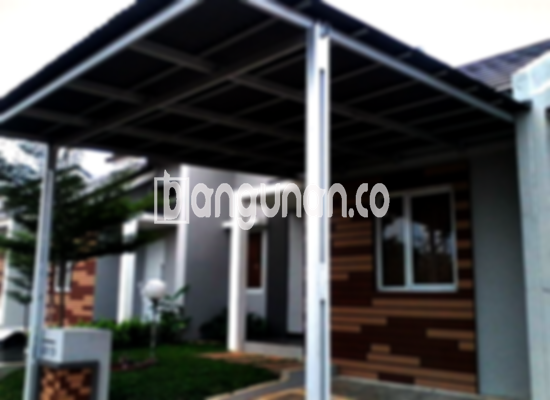

**Jasa Pasang Kanopi Rumah Minimalis di Cipedak Jakarta** – Memiliki pelindung yang andal untuk area luar rumah merupakan dambaan banyak orang. Kanopi memberikan solusi praktis untuk menciptakan ruang yang nyaman dan terlindungi dari berbagai kondisi cuaca. Mitra Bangunan di Cipedak Jakarta kini dapat menikmati kenyamanan tersebut tanpa perlu repot mencari tukang yang tepat. Kami menyediakan layanan pemasangan kanopi berkualitas tinggi dengan harga terjangkau untuk rumah Anda. 

Dengan berbagai pilihan desain dan material, kanopi dapat menjadi elemen penting dalam meningkatkan estetika dan fungsionalitas hunian Anda. Penting untuk memilih penyedia jasa yang terpercaya untuk memastikan kualitas dan keamanan kanopi yang dipasang.



## Keunggulan Jasa Pasang Kanopi Rumah Minimalis di Cipedak Jakarta

Bagi Anda yang sedang mempertimbangkan untuk memasang kanopi, ada beberapa keuntungan utama yang dapat Anda peroleh dengan memilih layanan kami:

### – Variasi Model yang Luas untuk Jasa Pasang Kanopi Rumah Minimalis di Cipedak Jakarta

Salah satu keunggulan utama dalam memilih kanopi adalah banyaknya pilihan model yang tersedia. Anda dapat menyesuaikan desain kanopi dengan gaya arsitektur rumah Anda. Tersedia berbagai model, mulai dari yang sederhana hingga yang lebih kompleks, sehingga Anda dapat menemukan yang paling sesuai dengan preferensi Anda. Beberapa contoh model yang populer termasuk persegi, persegi panjang, dan desain custom.

### – Penggunaan Material Ramah Lingkungan pada Jasa Pasang Kanopi Rumah Minimalis di Cipedak Jakarta

Kami berkomitmen untuk menggunakan material yang berkualitas dan ramah lingkungan. Dengan demikian, Anda tidak hanya mendapatkan kanopi yang tahan lama, tetapi juga berkontribusi pada pelestarian lingkungan. Material yang digunakan juga dipilih karena kemudahannya dalam perawatan dan kebersihannya.

### – Daya Tahan dan Kekuatan Jasa Pasang Kanopi Rumah Minimalis di Cipedak Jakarta

Kanopi yang kami pasang dirancang untuk tahan lama dan kuat, mampu menahan berbagai kondisi cuaca ekstrem. Konstruksi yang solid dan penggunaan material berkualitas tinggi memastikan kanopi Anda akan memberikan perlindungan optimal selama bertahun-tahun. Anda dapat mengandalkan ketahanan kanopi kami untuk melindungi properti Anda.

Anda akan melihat sendiri bagaimana kanopi rumah yang terpasang dengan baik dapat bertahan untuk jangka waktu yang sangat panjang. Perawatan yang rutin dan tepat akan semakin memperpanjang usia pakainya.

### – Keamanan yang Terjamin dari Jasa Pasang Kanopi Rumah Minimalis di Cipedak Jakarta

Kanopi memberikan perlindungan efektif terhadap sinar matahari langsung, hujan, dan debu, menciptakan area yang lebih aman dan nyaman di bawahnya. Ini memungkinkan Anda untuk menikmati aktivitas di luar ruangan tanpa perlu khawatir dengan kondisi cuaca yang tidak menentu. Anda bisa merasa lebih tenang dan aman dengan adanya kanopi.

Perlindungan yang optimal ini akan membuat Anda merasa nyaman dan terlindungi saat berada di bawah kanopi.

### – Harga yang Bersaing untuk Kanopi Rumah Minimalis di Cipedak Jakarta

Kami menawarkan harga yang kompetitif untuk setiap jenis kanopi yang kami pasang. Meskipun kami mengutamakan kualitas, kami juga memahami pentingnya anggaran yang terjangkau bagi setiap pelanggan. Anda dapat memilih kanopi yang sesuai dengan anggaran Anda tanpa mengorbankan kualitas.

## Detail Harga dan Jasa Pemasangan Kanopi Rumah Minimalis di Cipedak Jakarta



Apakah area luar rumah Anda sudah dilengkapi dengan kanopi? Banyak pemilik rumah di Cipedak Jakarta yang mulai menyadari pentingnya memiliki kanopi untuk melindungi garasi, teras, atau area parkir mereka. Pemilihan kanopi yang tepat dapat memberikan manfaat jangka panjang bagi kenyamanan dan keamanan hunian Anda.

Harga kanopi rumah bervariasi tergantung pada jenis material yang digunakan, ukuran, dan kompleksitas desain. Biasanya, harga untuk kualitas standar berkisar antara Rp. 450.000 – Rp. 800.000. Namun, harga dapat meningkat jika Anda memilih material yang lebih premium atau desain yang lebih rumit.

Faktor-faktor seperti kualitas material, ukuran area yang akan ditutupi, dan tingkat kesulitan pemasangan akan mempengaruhi harga akhir. Penting untuk berkonsultasi dengan penyedia jasa untuk mendapatkan penawaran harga yang akurat. Kami akan memberikan estimasi biaya yang jelas dan transparan.

Jika Anda mencari jasa pemasangan kanopi yang terpercaya di Cipedak Jakarta, kami siap membantu Anda. Dengan pengalaman dan keahlian kami, kami dapat memberikan solusi kanopi yang sesuai dengan kebutuhan dan anggaran Anda.

**Ref by:**  [Kanopi Rumah Minimalis Cipedak Jakarta](https://id.wikipedia.org/wiki/Kanopi)

Mitra Bangunan yang sedang mencari solusi perlindungan terbaik untuk rumah mereka di Cipedak Jakarta, jangan ragu untuk menghubungi kami melalui tombol WhatsApp atau Telepon yang tersedia di halaman ini. Kami siap memberikan konsultasi gratis dan membantu Anda menemukan kanopi yang sempurna untuk rumah Anda.