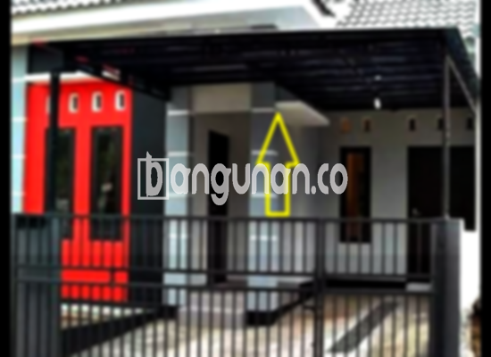

**Jasa Pasang Kanopi Rumah Minimalis di Cipeundeuy** – Mempertimbangkan kanopi sebagai pelengkap bangunan rumah merupakan keputusan cerdas bagi Mitra Bangunan di Cipeundeuy. Atap tambahan ini tidak hanya memberikan perlindungan dari cuaca ekstrem, tetapi juga meningkatkan nilai estetika properti Anda. Kami hadir sebagai solusi terpercaya untuk jasa pemasangan kanopi rumah minimalis, menawarkan berbagai pilihan desain dan material berkualitas yang sesuai dengan kebutuhan hunian Anda.

Dalam iklim Cipeundeuy yang seringkali memiliki perubahan cuaca yang tidak terduga, pemasangan kanopi menjadi investasi penting. Kanopi akan melindungi Anda dari sengatan matahari yang terik di siang hari, serta hujan deras yang dapat mengganggu aktivitas di luar ruangan. Dengan memilih model kanopi yang tepat, Anda dapat menciptakan ruang outdoor yang nyaman dan fungsional.



## Keunggulan Menggunakan Jasa Pasang Kanopi Rumah Minimalis di Cipeundeuy

Bagi Anda yang sedang mempertimbangkan pemasangan kanopi untuk rumah atau tempat usaha, ada banyak keuntungan yang bisa diperoleh, antara lain:

### \- Pilihan Model yang Sangat Beragam

Kami memahami bahwa setiap orang memiliki selera desain yang berbeda. Oleh karena itu, kami menyediakan berbagai pilihan model kanopi rumah yang bisa Anda pilih. Mulai dari model sederhana hingga desain yang lebih kompleks, kami siap mewujudkan impian Anda. Anda dapat memilih model persegi, persegi panjang, melengkung, atau bahkan desain custom yang sesuai dengan gaya arsitektur rumah Anda.

### \- Material Berkualitas dan Ramah Lingkungan

Kami hanya menggunakan material berkualitas tinggi yang tahan lama dan ramah lingkungan. Pemilihan material yang tepat tidak hanya menjamin kualitas kanopi, tetapi juga berkontribusi pada pelestarian lingkungan. Bahan-bahan yang kami gunakan juga ringan, sehingga memudahkan proses pemasangan dan perawatan.

### \- Konstruksi yang Kokoh dan Tahan Lama

Salah satu keunggulan utama yang kami tawarkan adalah konstruksi kanopi yang kokoh dan tahan lama. Kami menggunakan bahan-bahan berkualitas tinggi dan teknik pemasangan yang profesional, sehingga kanopi yang kami pasang dapat menahan beban berat dan kondisi cuaca ekstrem. Dengan perawatan yang rutin, kanopi buatan kami dapat bertahan hingga bertahun-tahun.

Anda dapat mengandalkan ketahanan dan kekuatan kanopi rumah kami untuk melindungi properti Anda dari berbagai kerusakan. Keawetan yang terjamin adalah investasi jangka panjang yang cerdas.

### \- Perlindungan Optimal dari Cuaca

Kanopi memberikan perlindungan yang optimal terhadap berbagai faktor cuaca. Area di bawah kanopi akan terlindungi dari sinar matahari langsung, hujan, angin, dan bahkan debu. Dengan demikian, Anda dapat menikmati ruang outdoor dengan lebih nyaman dan aman, tanpa khawatir akan kondisi cuaca yang berubah-ubah.

### \- Harga yang Bersaing dan Terjangkau

Kami menawarkan harga yang kompetitif untuk setiap jenis kanopi rumah minimalis di Cipeundeuy. Harga akan disesuaikan dengan jenis bahan, ukuran, dan tingkat kesulitan pemasangan. Kami selalu berusaha memberikan penawaran terbaik tanpa mengorbankan kualitas produk dan layanan kami.

## Harga dan Jasa Pemasangan Kanopi Rumah Minimalis di Cipeundeuy



Pemasangan kanopi menjadi semakin populer di kalangan warga Cipeundeuy. Banyak orang menyadari manfaat kanopi dalam melindungi rumah dari cuaca ekstrem dan meningkatkan nilai estetika bangunan. Kanopi dapat dipasang di berbagai area, seperti teras, garasi, jendela, atau bahkan area parkir.

Biaya pemasangan kanopi bervariasi tergantung pada beberapa faktor, seperti jenis material, ukuran, dan kompleksitas desain. Penting untuk memilih penyedia jasa pemasangan yang terpercaya dan berpengalaman untuk memastikan hasil yang optimal. Kami menawarkan layanan pemasangan kanopi profesional dengan harga yang kompetitif.

Memilih material yang tepat juga penting dalam menentukan harga kanopi. Kanopi baja ringan cenderung lebih terjangkau dibandingkan dengan kanopi kaca atau polycarbonate. Namun, kanopi kaca menawarkan tampilan yang lebih mewah dan modern. Pertimbangkan kebutuhan dan anggaran Anda sebelum membuat keputusan.

Kami siap memberikan konsultasi gratis untuk membantu Anda memilih jenis kanopi yang paling sesuai dengan kebutuhan dan anggaran Anda. Dengan pengalaman dan keahlian kami, kami dapat memberikan solusi yang tepat untuk properti Anda di Cipeundeuy. 

**Ref by:**  [Kanopi Rumah Minimalis Cipeundeuy](https://id.wikipedia.org/wiki/Kanopi)

Jika Anda sedang mencari jasa pasang kanopi rumah minimalis yang terpercaya di Cipeundeuy, jangan ragu untuk menghubungi kami. Kami siap melayani Anda dengan profesionalisme dan dedikasi tinggi. Mitra Bangunan di Cipeundeuy, jangan tunda lagi! Hubungi kami sekarang juga melalui tombol WhatsApp atau Telepon yang tersedia di halaman ini untuk mendapatkan penawaran terbaik dan layanan yang memuaskan.