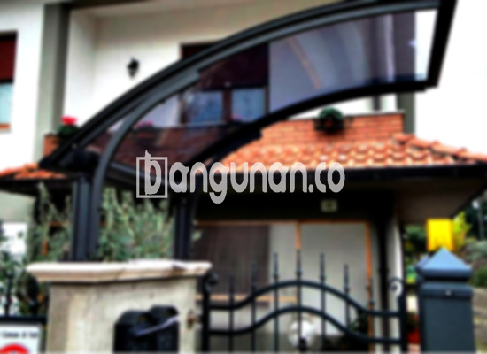

**Jasa Pasang Kanopi Rumah Minimalis di Cipulir Jakarta** – Memiliki area luar rumah yang terlindungi dari cuaca adalah impian setiap pemilik properti. Mitra Bangunan di Cipulir Jakarta hadir untuk mewujudkannya dengan menyediakan layanan pemasangan kanopi berkualitas dan terjangkau. Kanopi bukan sekadar atap pelindung; ia adalah investasi untuk kenyamanan dan keamanan hunian Anda.

Dengan berbagai pilihan desain dan material yang tersedia, kami membantu Anda menemukan solusi kanopi yang tepat untuk rumah Anda, sesuai dengan gaya dan anggaran yang Anda miliki. Perlindungan dari terik matahari dan hujan lebat akan menjadikan ruang luar rumah Anda lebih nyaman untuk dinikmati.



## Keunggulan Memilih Jasa Pasang Kanopi Rumah Minimalis di Cipulir Jakarta

Bagi Anda yang mempertimbangkan untuk memasang kanopi di rumah, terdapat sejumlah keunggulan yang bisa didapatkan. Layanan profesional di Cipulir Jakarta menawarkan solusi terbaik untuk memenuhi kebutuhan perlindungan dan estetika rumah Anda.

### – Beragam Pilihan Model Kanopi yang Sesuai Kebutuhan

Kami menyediakan berbagai pilihan model kanopi yang dapat Anda sesuaikan dengan preferensi dan gaya arsitektur rumah Anda. Setiap individu memiliki selera yang berbeda dalam memilih kanopi, dan kami berkomitmen untuk memenuhi kebutuhan tersebut. Model yang tersedia meliputi desain persegi, persegi panjang, dan berbagai bentuk lainnya yang dapat dikustomisasi.

### – Menggunakan Material Ramah Lingkungan untuk Kanopi

Kanopi yang kami gunakan dibuat dari bahan-bahan yang tidak berbahaya bagi lingkungan, menjadikan pilihan yang bertanggung jawab bagi Anda. Dengan memilih kanopi dari kami, Anda turut berkontribusi dalam menjaga kelestarian alam. Selain itu, material ini juga mudah dibersihkan dan tahan terhadap kotoran.

### – Kanopi Tahan Lama dan Kokoh untuk Perlindungan Jangka Panjang

Keunggulan signifikan yang ditawarkan adalah daya tahan dan kekokohan. Material berkualitas tinggi yang kami gunakan memastikan kanopi mampu bertahan dalam berbagai kondisi cuaca dan lingkungan. Investasi dalam kanopi yang kuat akan memberikan perlindungan yang berkelanjutan bagi rumah Anda.

Kanopi yang dirawat dengan baik dapat bertahan selama bertahun-tahun. Perawatan rutin akan menjaga kualitas dan kekuatan kanopi Anda, memastikan investasi Anda memberikan manfaat jangka panjang.

### – Keamanan Ekstra dengan Pemasangan Kanopi Profesional

Keamanan merupakan prioritas utama kami. Kanopi memberikan lapisan perlindungan tambahan bagi area di bawahnya, menciptakan ruang yang lebih aman dan nyaman. Kanopi melindungi dari paparan langsung sinar matahari dan hujan, sehingga memungkinkan Anda menikmati ruang luar ruangan dengan tenang.

Dengan kanopi, Anda dapat menciptakan area yang terlindungi dengan baik untuk bersantai, bermain, atau berkumpul bersama keluarga. Keamanan yang terjamin akan memberikan ketenangan pikiran bagi Anda dan keluarga.

### – Harga Kanopi Rumah Minimalis di Cipulir Jakarta yang Bersaing

Kami menawarkan harga yang kompetitif untuk berbagai jenis kanopi rumah minimalis di Cipulir Jakarta. Harga dapat bervariasi tergantung pada jenis material dan desain yang Anda pilih, tetapi kami selalu berusaha memberikan penawaran terbaik bagi Anda. 

## Informasi Harga dan Jasa Pemasangan Kanopi Rumah Minimalis di Cipulir Jakarta



Apakah Anda sedang mempertimbangkan untuk memasang kanopi di rumah Anda? Banyak pemilik rumah di Cipulir Jakarta yang telah merasakan manfaatnya. Kanopi dapat digunakan untuk berbagai keperluan, seperti melindungi garasi mobil, menciptakan area parkir yang teduh, atau menutupi jendela. Penyesuaian dan aplikasi kanopi sepenuhnya bergantung pada kebutuhan spesifik Anda.

Untuk mendapatkan gambaran harga, silakan lihat informasi yang tersedia. Harga dapat berbeda-beda tergantung pada jenis material yang digunakan, ukuran kanopi, dan tingkat kompleksitas pemasangan.

Selain itu, harga juga dipengaruhi oleh kualitas material. Semakin tinggi kualitas material, semakin tinggi pula harganya. Ukuran kanopi juga berperan dalam menentukan harga; semakin besar luasnya, semakin mahal biayanya. Pastikan Anda memilih ukuran yang tepat sesuai dengan kebutuhan Anda.

Bagi Anda yang membutuhkan pemasangan kanopi yang cepat dan efisien, menggunakan jasa pemasangan profesional adalah pilihan yang tepat. Tim kami akan memastikan pemasangan dilakukan dengan benar dan sesuai dengan standar keamanan yang berlaku.

**Ref by:**  [Kanopi Rumah Minimalis Cipulir Jakarta](https://id.wikipedia.org/wiki/Kanopi)

Sebagai kesimpulan, Mitra Bangunan hadir sebagai solusi terpercaya untuk kebutuhan kanopi rumah minimalis Anda di Cipulir Jakarta. Kami berkomitmen untuk memberikan kualitas terbaik dengan harga yang kompetitif. Hubungi kami melalui tombol WhatsApp atau Telepon di halaman ini untuk konsultasi gratis dan penawaran terbaik. Jangan ragu untuk bertanya – kami siap membantu Anda menemukan kanopi impian Anda.