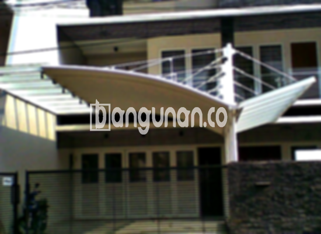

**Jasa Pasang Kanopi Rumah Minimalis di Ciputat Tangerang** – Bagi Mitra Bangunan di Ciputat Tangerang, memiliki kanopi yang berkualitas adalah investasi penting untuk kenyamanan dan estetika rumah. Kanopi berfungsi sebagai pelindung optimal dari cuaca ekstrem, seperti hujan dan terik matahari langsung, sekaligus mempercantik tampilan properti Anda. Kami hadir sebagai solusi terpercaya untuk kebutuhan pembuatan dan pemasangan kanopi yang sesuai dengan gaya dan anggaran Anda.

Kami menyediakan beragam pilihan desain dan material kanopi yang dapat disesuaikan dengan kebutuhan spesifik Anda. Memilih kanopi yang tepat tidak hanya memberikan perlindungan, tetapi juga meningkatkan nilai estetika rumah Anda secara signifikan. 



## Keunggulan Menggunakan Jasa Pasang Kanopi Rumah Minimalis di Ciputat Tangerang

Bagi Anda yang mempertimbangkan untuk memasang kanopi di rumah, berikut adalah beberapa keuntungan utama yang dapat Anda peroleh:

### – Pilihan Model yang Beragam dari Jasa Pasang Kanopi Rumah Minimalis di Ciputat Tangerang

Kami menawarkan berbagai model kanopi yang bisa Anda pilih sesuai dengan selera dan desain rumah Anda. Setiap individu memiliki preferensi unik, dan kami berkomitmen untuk menyediakan opsi yang beragam, mulai dari desain persegi, persegi panjang, hingga bentuk-bentuk inovatif lainnya.

### – Material Ramah Lingkungan dari Jasa Pasang Kanopi Rumah Minimalis di Ciputat Tangerang

Kami hanya menggunakan material berkualitas tinggi yang ramah lingkungan dalam pembuatan kanopi. Dengan memilih kanopi dari kami, Anda turut berkontribusi dalam menjaga kelestarian lingkungan. Material yang kami gunakan juga mudah dibersihkan, sehingga perawatan kanopi menjadi lebih praktis.

### – Ketahanan dan Kekuatan Terjamin dari Jasa Pasang Kanopi Rumah Minimalis di Ciputat Tangerang

Salah satu keunggulan utama kanopi yang kami tawarkan adalah ketahanan dan kekuatannya. Kami menggunakan material berkualitas yang mampu bertahan terhadap berbagai kondisi cuaca ekstrem. Kanopi yang kami pasang dapat bertahan selama bertahun-tahun dengan perawatan yang tepat.

Anda akan merasakan manfaatnya secara langsung, karena kanopi rumah kami dirancang untuk tahan lama. Keawetannya bergantung pada perawatan yang Anda lakukan; dengan perawatan yang baik, kanopi Anda akan tetap prima selama bertahun-tahun.

### – Keamanan Optimal dari Jasa Pasang Kanopi Rumah Minimalis di Ciputat Tangerang

Kanopi memberikan perlindungan ekstra bagi area di bawahnya, seperti teras, garasi, atau area parkir. Dengan kanopi, Anda tidak perlu khawatir lagi terhadap paparan sinar matahari langsung atau hujan deras. Keamanan yang terjamin akan memberikan Anda ketenangan pikiran dalam menikmati waktu di luar ruangan.

Kanopi efektif menghalangi terik matahari dan hujan, sehingga area di bawahnya tetap nyaman digunakan. Hal ini tentu saja memberikan kenyamanan dan keamanan bagi Anda dan keluarga.

### – Harga yang Kompetitif untuk Kanopi Rumah Minimalis di Ciputat Tangerang

Kami memahami pentingnya anggaran dalam setiap proyek pembangunan atau renovasi. Oleh karena itu, kami menawarkan harga yang kompetitif untuk semua jenis kanopi rumah minimalis di Ciputat Tangerang. Harga akan bervariasi tergantung pada jenis material, ukuran, dan kompleksitas desain.

## Harga dan Jasa Pemasangan Kanopi Rumah Minimalis di Ciputat Tangerang



Banyak pemilik rumah di Ciputat Tangerang yang kini menggunakan kanopi untuk melindungi berbagai area properti mereka. Kanopi dapat diaplikasikan di atas garasi mobil, area parkir, jendela, atau bahkan sebagai penutup teras. Pilihan penggunaan kanopi sangat fleksibel dan dapat disesuaikan dengan kebutuhan Anda.

Untuk memberikan gambaran, harga kanopi rumah dengan kualitas standar berkisar antara Rp. 450.000 – Rp. 800.000. Namun, harga dapat berbeda tergantung pada kualitas material yang Anda pilih. Semakin tinggi kualitas material, tentu saja semakin tinggi pula harganya. 

Selain kualitas material, harga juga dipengaruhi oleh ukuran kanopi. Semakin luas area yang ingin ditutupi, semakin besar pula biaya yang dibutuhkan. Pastikan Anda memilih ukuran yang tepat sesuai dengan kebutuhan Anda.

Bagi Anda yang ingin memasang kanopi, kami sangat merekomendasikan untuk menggunakan jasa pemasangan profesional. Dengan menggunakan jasa pemasangan, Anda dapat memastikan bahwa kanopi terpasang dengan benar dan aman. Hal ini akan menghemat waktu dan tenaga Anda, serta mencegah potensi masalah di kemudian hari.

Kami siap membantu Anda mewujudkan kanopi impian untuk rumah Anda di Ciputat Tangerang. Jangan ragu untuk menghubungi kami melalui tombol WhatsApp atau Telepon di halaman ini untuk mendapatkan informasi lebih lanjut dan penawaran terbaik. Mitra Bangunan siap menjadi mitra terpercaya Anda dalam menciptakan hunian yang nyaman dan terlindungi. 

**Ref by:**  [Kanopi Rumah Minimalis Ciputat Tangerang](https://id.wikipedia.org/wiki/Kanopi)