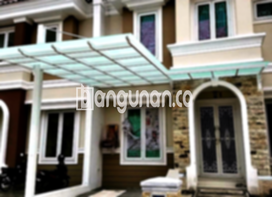

**Jasa Pasang Kanopi Rumah Minimalis di Ciracas Jakarta** – Memiliki area luar ruangan yang nyaman dan terlindungi adalah dambaan setiap pemilik rumah di Ciracas Jakarta. Mitra Bangunan memahami kebutuhan ini dan hadir sebagai solusi terbaik untuk melindungi teras, garasi, atau area outdoor Anda dari cuaca ekstrem. Kami menyediakan jasa pemasangan kanopi berkualitas dengan harga terjangkau, dirancang khusus untuk memenuhi kebutuhan hunian Anda.

Kanopi bukan hanya sekadar pelindung dari hujan dan panas; ia juga dapat meningkatkan estetika rumah Anda. Dengan beragam pilihan desain dan material, Anda dapat menemukan kanopi yang sempurna untuk melengkapi gaya arsitektur rumah Anda.



## Keunggulan Memilih Jasa Pasang Kanopi Rumah Minimalis di Ciracas Jakarta

Mempercayakan pemasangan kanopi kepada profesional seperti kami akan memberikan Anda sejumlah keuntungan signifikan. Berikut ini beberapa keunggulan yang bisa Anda dapatkan:

### \- Pilihan Model Kanopi yang Beragam

Kami menyediakan berbagai model kanopi yang dapat Anda sesuaikan dengan preferensi dan kebutuhan Anda. Anda dapat memilih dari berbagai desain, mulai dari yang sederhana hingga yang lebih kompleks, untuk menciptakan tampilan yang sesuai dengan gaya rumah Anda. Beberapa pilihan model yang tersedia termasuk kanopi persegi, persegi panjang, lengkung, dan banyak lagi.

### \- Material Berkualitas dan Ramah Lingkungan

Kami menggunakan material berkualitas tinggi yang tidak hanya tahan lama tetapi juga ramah lingkungan. Material yang kami gunakan aman untuk Anda dan keluarga, serta membantu menjaga kelestarian lingkungan. Selain itu, material yang kami pilih juga mudah dibersihkan, sehingga Anda tidak perlu khawatir tentang perawatan yang rumit.

### \- Konstruksi Kuat dan Tahan Lama

Kanopi yang kami pasang dirancang untuk tahan lama dan mampu menahan berbagai kondisi cuaca. Kami menggunakan material yang kuat dan kokoh, serta teknik pemasangan yang tepat, untuk memastikan kanopi Anda tetap berfungsi optimal selama bertahun-tahun. Anda dapat mengandalkan kanopi kami untuk memberikan perlindungan yang andal bagi rumah Anda.

### \- Keamanan Terjamin

Keamanan adalah prioritas utama kami. Kanopi yang kami pasang dirancang untuk memberikan perlindungan maksimal terhadap hujan, sinar matahari, dan elemen cuaca lainnya. Dengan kanopi yang kuat dan terpasang dengan benar, Anda dapat merasa aman dan nyaman beraktivitas di area outdoor rumah Anda.

### \- Harga yang Kompetitif

Kami menawarkan harga yang kompetitif untuk jasa pemasangan kanopi kami. Kami percaya bahwa setiap orang berhak mendapatkan perlindungan yang berkualitas tanpa harus mengeluarkan biaya yang mahal. Kami selalu berusaha untuk memberikan penawaran terbaik kepada pelanggan kami di Ciracas Jakarta.

## Harga dan Jasa Pemasangan Kanopi Rumah Minimalis di Ciracas Jakarta



Banyak pemilik rumah di Ciracas Jakarta kini telah memasang kanopi untuk melindungi teras, garasi, atau area parkir mereka. Kanopi dapat memberikan perlindungan dari cuaca buruk sekaligus meningkatkan nilai estetika rumah Anda. 

Untuk mendapatkan informasi lebih lanjut mengenai harga dan layanan pemasangan kami, silakan hubungi tim kami. Kami akan dengan senang hati memberikan konsultasi gratis dan membantu Anda menemukan solusi kanopi yang tepat untuk rumah Anda. Anda juga dapat melihat contoh-contoh kanopi yang telah kami pasang di berbagai lokasi di Ciracas Jakarta.

Kami sangat menyarankan Anda untuk berinvestasi pada kanopi berkualitas tinggi yang akan memberikan perlindungan maksimal bagi rumah Anda. Dengan kanopi yang tepat, Anda dapat menikmati area outdoor rumah Anda sepanjang tahun tanpa harus khawatir tentang cuaca. [Jasa Pasang Kanopi Rumah Minimalis di Angke Jakarta](/jasa-pasang-kanopi-rumah-minimalis-di-angke-jakarta/) juga merupakan solusi yang bisa Anda pertimbangkan jika berada di area tersebut.

**Ref by:**  [Kanopi Rumah Minimalis Ciracas Jakarta](https://id.wikipedia.org/wiki/Kanopi)

Mitra Bangunan siap membantu Anda mewujudkan hunian yang nyaman dan terlindungi di Ciracas Jakarta. Jangan ragu untuk menghubungi kami melalui tombol WhatsApp atau Telepon yang tersedia di halaman ini untuk mendapatkan penawaran terbaik dan layanan pemasangan kanopi yang profesional.