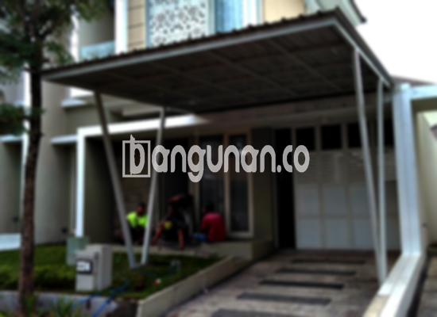

**Jasa Pasang Kanopi Rumah Minimalis di Cirebon** – Apabila Anda membicarakan tentang kanopi, nampaknya konsep ini sudah menjadi hal yang umum bagi banyak orang. Kanopi merupakan struktur atap yang kerap dipasang untuk melindungi sebuah area seperti halaman depan ruko atau properti lain dari berbagai kondisi cuaca, misalnya hujan atau paparan sinar matahari. Untuk rumah, kanopi dirancang khusus untuk memenuhi kebutuhan sehari-hari Anda, memberikan perlindungan sekaligus menambah nilai estetika bangunan. Mitra Bangunan di Cirebon kini dapat menikmati solusi praktis ini tanpa perlu mencari tukang secara terpisah.

Ada beragam cara untuk mendapatkan kanopi yang Anda inginkan, mulai dari membelinya di toko bangunan lokal hingga memesan desain khusus yang sesuai dengan gaya rumah Anda. Tersedia berbagai model kanopi rumah yang dapat dipilih sesuai dengan preferensi dan anggaran. Setiap jenis kanopi memiliki kelebihan masing-masing, baik dari segi material, kualitas, harga, maupun estetika. Pastikan Anda memilih kanopi yang tepat untuk memenuhi kebutuhan dan harapan Anda.



## Keunggulan Menggunakan Jasa Pasang Kanopi Rumah Minimalis di Cirebon

Bagi Anda yang sedang mempertimbangkan untuk memasang kanopi di rumah, berikut adalah beberapa keuntungan yang bisa Anda dapatkan:

### \- Variasi Model yang Luas dari Jasa Pasang Kanopi Rumah Minimalis di Cirebon

Salah satu pertimbangan utama saat membeli kanopi adalah model yang tersedia. Kami menyediakan berbagai pilihan model kanopi rumah yang memungkinkan Anda menyesuaikannya dengan gaya arsitektur rumah Anda. Setiap individu memiliki selera yang berbeda dalam memilih desain kanopi, dan kami berkomitmen untuk mewujudkannya sesuai keinginan Anda. Anda bisa memilih model persegi, persegi panjang, atau bahkan desain khusus yang unik.

### \- Material Ramah Lingkungan dari Jasa Pasang Kanopi Rumah Minimalis di Cirebon

Kanopi yang kami tawarkan dibuat dari material yang tidak berbahaya bagi lingkungan, sehingga Anda dapat menggunakan kanopi ini dengan tenang. Penggunaan kanopi rumah akan berkontribusi pada gaya hidup yang lebih ramah lingkungan. Selain itu, kanopi ini juga mudah dibersihkan, sehingga Anda tidak perlu khawatir dengan kotoran yang menumpuk.

### \- Daya Tahan dan Kekuatan Terbukti dari Jasa Pasang Kanopi Rumah Minimalis di Cirebon

Keunggulan utama yang ditawarkan kanopi kami adalah daya tahan dan kekuatannya. Kami hanya menggunakan material berkualitas tinggi yang mampu menahan berbagai kondisi cuaca ekstrem. Hal ini menjadikan kanopi sebagai solusi atap yang efisien dan tahan lama. Anda dapat mengandalkan kanopi ini untuk melindungi rumah Anda selama bertahun-tahun.

Anda dapat membuktikan sendiri ketahanan kanopi rumah ini, yang mampu bertahan hingga puluhan tahun dengan perawatan yang tepat. Perawatan yang rutin akan membantu menjaga kualitas dan memperpanjang umur pakainya.

### \- Keamanan yang Terjamin dari Jasa Pasang Kanopi Rumah Minimalis di Cirebon

Keamanan merupakan aspek penting yang kami prioritaskan. Kanopi yang kami pasang memberikan perlindungan optimal untuk area di bawahnya, seperti teras atau garasi. Kanopi berfungsi sebagai penghalang terhadap cuaca ekstrem, seperti sinar matahari yang terik dan hujan deras, sehingga Anda dan keluarga dapat merasa nyaman dan aman.

Dengan kanopi yang terpasang dengan baik, Anda tidak perlu khawatir lagi dengan paparan cuaca yang dapat merusak barang-barang atau mengganggu aktivitas di luar ruangan.

### \- Harga yang Bersaing dari Jasa Pasang Kanopi Rumah Minimalis di Cirebon

Kami memahami bahwa harga merupakan pertimbangan penting bagi setiap pelanggan. Oleh karena itu, kami menawarkan harga yang kompetitif untuk jasa pemasangan kanopi rumah minimalis di Cirebon. Harga akan bervariasi tergantung pada jenis material, ukuran, dan desain kanopi yang Anda pilih.

## Harga dan Jasa Pemasangan Kanopi Rumah Minimalis di Cirebon



Apakah Anda sudah mempertimbangkan untuk memasang kanopi di rumah Anda? Banyak pemilik rumah di Cirebon yang telah merasakan manfaatnya. Kanopi dapat digunakan untuk melindungi garasi mobil, menciptakan area parkir yang teduh, atau sebagai penutup jendela. Penggunaannya sepenuhnya tergantung pada kebutuhan Anda.

Sebagai gambaran, harga kanopi rumah dengan kualitas standar berkisar antara Rp. 450.000 hingga Rp. 800.000. Harga tersebut dapat meningkat jika Anda memilih material berkualitas premium atau desain yang lebih kompleks.

Harga juga dipengaruhi oleh beberapa faktor, seperti kualitas material, ukuran kanopi, dan tingkat kesulitan pemasangan. Kami selalu berusaha memberikan harga yang transparan dan sesuai dengan anggaran Anda. Pastikan Anda memilih ukuran dan desain yang sesuai dengan kebutuhan Anda untuk mendapatkan hasil yang optimal.

Bagi Anda yang membutuhkan jasa pemasangan kanopi profesional, kami siap membantu. Dengan menggunakan jasa pemasangan, proses akan lebih cepat dan efisien. Anda dapat langsung menikmati manfaat kanopi setelah pemasangan selesai.

**Ref by:**  [Kanopi Rumah Minimalis Cirebon](https://id.wikipedia.org/wiki/Kanopi)

Dengan memilih layanan kami, Mitra Bangunan di Cirebon akan mendapatkan kanopi berkualitas yang tahan lama, aman, dan estetis. Jangan tunda lagi, hubungi kami segera melalui tombol WhatsApp atau Telepon di halaman ini untuk mendapatkan konsultasi gratis dan penawaran terbaik. Kami berkomitmen untuk memberikan solusi kanopi yang sempurna untuk rumah Anda.