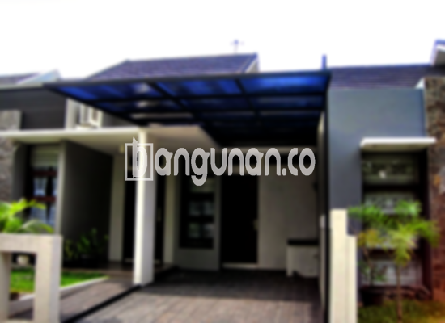

**Jasa Pasang Kanopi Rumah Minimalis di Cisalak Depok** – Memiliki area luar rumah yang nyaman dan terlindungi adalah impian setiap pemilik rumah di Cisalak Depok. Kanopi hadir sebagai solusi praktis untuk menjaga teras, garasi, atau area terbuka lainnya dari cuaca ekstrem. Mitra Bangunan memahami kebutuhan ini dan hadir dengan layanan pemasangan kanopi rumah minimalis yang berkualitas dan terjangkau.

Untuk menciptakan ruang luar yang fungsional dan estetis, Anda bisa mempertimbangkan pemasangan kanopi. Kanopi tidak hanya melindungi dari panas matahari dan hujan, tetapi juga mempercantik tampilan rumah Anda. Ada banyak pilihan desain dan material yang bisa disesuaikan dengan gaya arsitektur rumah dan anggaran Anda.



## Keunggulan Memilih Jasa Pasang Kanopi Rumah Minimalis di Cisalak Depok

Bagi Anda yang berencana memasang kanopi untuk rumah atau bangunan lainnya di Cisalak Depok, terdapat beberapa keuntungan yang bisa Anda dapatkan:

### \- Pilihan Model Kanopi yang Beragam

Kami menyediakan beragam model kanopi rumah untuk memenuhi selera setiap pelanggan. Anda dapat memilih desain yang paling sesuai dengan gaya rumah Anda, mulai dari yang sederhana hingga yang lebih kompleks. Beberapa pilihan model kanopi yang tersedia antara lain persegi, persegi panjang, dan bentuk khusus sesuai permintaan.

### \- Material Ramah Lingkungan

Kami mengutamakan penggunaan material yang ramah lingkungan dalam pembuatan kanopi. Hal ini menunjukkan komitmen kami terhadap keberlanjutan dan kesehatan lingkungan. Selain itu, material yang kami gunakan juga mudah dibersihkan, sehingga Anda tidak perlu khawatir akan kotoran yang menempel.

### \- Ketahanan dan Kekokohan Terjamin

Salah satu keunggulan utama kanopi buatan kami adalah ketahanannya yang teruji. Kami menggunakan material berkualitas tinggi yang mampu menahan cuaca ekstrem dan penggunaan jangka panjang. Dengan perawatan yang tepat, kanopi rumah Anda dapat bertahan selama bertahun-tahun.

Kanopi yang kokoh dan awet dapat memberikan rasa aman dan nyaman bagi Anda dan keluarga. Anda tidak perlu khawatir akan kerusakan akibat angin kencang atau hujan deras.

### \- Tingkat Keamanan yang Optimal

Keamanan merupakan prioritas utama kami dalam pemasangan kanopi. Kanopi yang kami pasang akan memberikan perlindungan maksimal terhadap area di bawahnya, baik dari paparan sinar matahari langsung, hujan, maupun benda-benda yang mungkin jatuh dari atas. 

Dengan kanopi, Anda dapat menikmati waktu di luar rumah dengan lebih tenang dan nyaman.

### \- Harga yang Kompetitif

Kami menawarkan harga yang bersaing untuk layanan pemasangan kanopi rumah minimalis di Cisalak Depok. Harga akan disesuaikan dengan jenis material, ukuran, dan desain kanopi yang Anda pilih. Kami percaya bahwa setiap orang berhak mendapatkan kanopi berkualitas tanpa harus menguras kantong.

## Informasi Harga dan Jasa Pemasangan Kanopi Rumah Minimalis di Cisalak Depok



Banyak orang kini mempertimbangkan pemasangan kanopi untuk meningkatkan kenyamanan dan nilai estetika rumah mereka. Kanopi dapat digunakan untuk berbagai keperluan, seperti melindungi garasi mobil, area parkir, atau jendela rumah dari cuaca buruk. 

Untuk mengetahui perkiraan biaya, Anda dapat menghubungi tim kami untuk mendapatkan penawaran yang sesuai dengan kebutuhan Anda.

Kami menawarkan jasa pemasangan kanopi profesional dengan hasil yang rapi dan berkualitas tinggi. Dengan mempercayakan pekerjaan ini kepada ahlinya, Anda dapat menghemat waktu dan tenaga serta memastikan bahwa kanopi terpasang dengan aman dan tepat.

**Ref by:**  [Kanopi Rumah Minimalis Cisalak Depok](https://id.wikipedia.org/wiki/Kanopi)

Mitra Bangunan siap membantu Anda mewujudkan hunian yang nyaman dan terlindungi dengan kanopi rumah minimalis yang berkualitas. Jangan ragu untuk menghubungi kami melalui tombol WhatsApp atau Telepon di halaman ini untuk konsultasi gratis dan penawaran terbaik di Cisalak Depok.