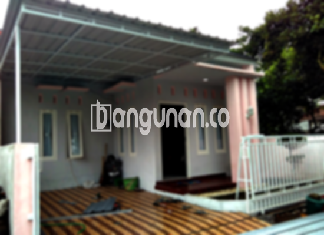

**Jasa Pasang Kanopi Rumah Minimalis di Cisauk Tangerang** – Mencari solusi untuk melindungi area luar rumah dari cuaca ekstrem? Kanopi adalah jawaban tepat. Kanopi tidak hanya memberikan perlindungan dari hujan dan terik matahari, tetapi juga menambah nilai estetika pada bangunan Anda. Bagi Mitra Bangunan di Cisauk Tangerang yang menginginkan kanopi berkualitas dengan harga terjangkau, Kami hadir sebagai solusi terbaik.

Kami menyediakan berbagai jenis kanopi yang dapat disesuaikan dengan kebutuhan dan desain rumah Anda. Dari kanopi baja ringan yang ekonomis hingga kanopi kaca yang elegan, Kami siap mewujudkan impian Anda memiliki area luar ruangan yang nyaman dan aman.



## Keunggulan Memilih Jasa Pasang Kanopi Rumah Minimalis di Cisauk Tangerang

Bagi Anda yang berencana memasang kanopi untuk rumah atau bangunan komersial, menggunakan jasa profesional menawarkan sejumlah keuntungan signifikan. Berikut adalah beberapa kelebihan yang bisa Anda dapatkan:

### \- Pilihan Model Kanopi yang Beragam

Kami memahami bahwa setiap pemilik rumah memiliki selera yang berbeda. Oleh karena itu, Kami menyediakan beragam model kanopi rumah yang dapat Anda pilih sesuai dengan gaya arsitektur dan preferensi pribadi Anda. Anda dapat memilih berbagai bentuk, seperti persegi, persegi panjang, atau bahkan desain khusus yang disesuaikan dengan keinginan Anda.

### \- Material Ramah Lingkungan untuk Kanopi Anda

Kami sangat memperhatikan aspek keberlanjutan lingkungan. Kanopi rumah yang Kami gunakan terbuat dari material yang tidak berbahaya dan ramah lingkungan. Dengan memilih produk Kami, Anda turut berkontribusi dalam menjaga kelestarian alam. Selain itu, kanopi Kami mudah dibersihkan, sehingga Anda tidak perlu khawatir akan kotoran yang menumpuk.

### \- Kanopi yang Awet dan Tahan Lama

Salah satu keunggulan utama dari kanopi yang Kami pasang adalah ketahanannya. Kami menggunakan material berkualitas tinggi yang mampu bertahan dalam kondisi cuaca ekstrem. Dengan perawatan yang tepat, kanopi rumah Anda dapat bertahan selama bertahun-tahun tanpa perlu khawatir akan kerusakan.

Anda dapat yakin bahwa investasi Anda akan memberikan manfaat jangka panjang. Kanopi Kami dirancang untuk menghadapi berbagai tantangan cuaca dan memberikan perlindungan optimal bagi properti Anda.

### \- Keamanan Terjamin dengan Kanopi Berkualitas

Keamanan merupakan prioritas utama Kami. Kanopi yang Kami pasang dirancang untuk memberikan perlindungan maksimal terhadap area di bawahnya. Dengan kanopi, Anda dapat merasa tenang karena terlindungi dari sinar matahari yang terik dan hujan deras. 

Ini menjadikan area tersebut ideal untuk bersantai, bermain, atau melakukan aktivitas luar ruangan lainnya dengan aman dan nyaman.

### \- Harga Kanopi Rumah Minimalis di Cisauk Tangerang yang Kompetitif

Kami berkomitmen untuk menawarkan harga yang terjangkau tanpa mengorbankan kualitas. Kami memahami bahwa setiap pelanggan memiliki anggaran yang berbeda. Oleh karena itu, Kami menawarkan berbagai pilihan material dan desain yang sesuai dengan kebutuhan dan anggaran Anda. 

Untuk informasi lebih detail mengenai harga, silakan lihat tabel harga di bawah ini atau hubungi tim Kami untuk mendapatkan penawaran khusus.

## Informasi Harga dan Jasa Pemasangan Kanopi Rumah Minimalis di Cisauk Tangerang



Apakah Anda sudah mempertimbangkan untuk memasang kanopi di rumah Anda? Banyak pemilik rumah saat ini yang semakin menyadari manfaat kanopi untuk meningkatkan kenyamanan dan nilai properti mereka. Kanopi dapat digunakan untuk berbagai keperluan, seperti melindungi garasi mobil, menciptakan area parkir yang teduh, atau mempercantik teras rumah.

Pilihan material kanopi juga beragam, mulai dari baja ringan, galvalum, kaca, hingga polycarbonate. Setiap material memiliki kelebihan dan kekurangan masing-masing. Kami siap membantu Anda memilih material yang paling sesuai dengan kebutuhan dan anggaran Anda.

**Ref by:**  [Kanopi Rumah Minimalis Cisauk Tangerang](https://id.wikipedia.org/wiki/Kanopi)

Mitra Bangunan yang sedang mencari jasa pasang kanopi rumah minimalis di Cisauk Tangerang, jangan ragu untuk menghubungi Kami melalui tombol WhatsApp atau Telepon yang tersedia di halaman ini. Kami akan dengan senang hati membantu Anda mewujudkan area luar ruangan yang nyaman, aman, dan estetis.