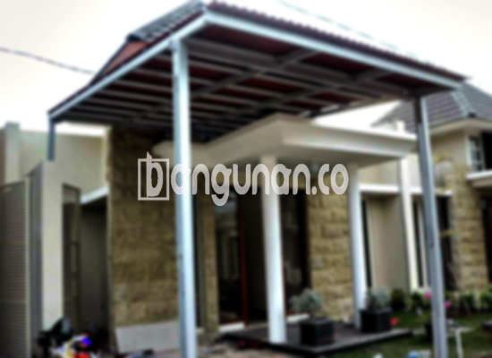

**Jasa Pasang Kanopi Rumah Minimalis di Ciseeng** – Mempertimbangkan perlindungan optimal untuk teras atau garasi rumah Anda di Ciseeng? Kanopi adalah solusi tepat yang tidak hanya melindungi dari cuaca ekstrem seperti hujan dan sengatan matahari, tetapi juga meningkatkan estetika bangunan. Kami hadir sebagai penyedia jasa pemasangan kanopi rumah minimalis yang terpercaya, menawarkan layanan berkualitas dengan harga yang bersaing untuk seluruh wilayah Ciseeng dan sekitarnya. Mitra Bangunan di Ciseeng dapat mengandalkan kami untuk mendapatkan kanopi impian yang sesuai dengan kebutuhan dan anggaran Anda.

Untuk memperindah dan memperluas fungsi ruang luar rumah, pemasangan kanopi menjadi pilihan yang sangat populer. Banyak model dan material kanopi tersedia untuk dipilih, memungkinkan Anda menyesuaikan desain dengan gaya arsitektur rumah Anda. Kami menyediakan beragam pilihan kanopi rumah yang dapat disesuaikan dengan preferensi Anda, mulai dari material, warna, hingga desain yang diinginkan.

## Kelebihan Memilih Jasa Pasang Kanopi Rumah Minimalis di Ciseeng

Bagi Anda yang berencana memasang kanopi di Ciseeng, terdapat sejumlah keuntungan yang dapat Anda peroleh dengan memilih layanan kami:

### \- Variasi Model Kanopi yang Luas dari Jasa Pasang Kanopi Rumah Minimalis di Ciseeng

Kami menawarkan beragam model kanopi rumah untuk memenuhi berbagai selera dan kebutuhan Anda. Anda dapat memilih dari berbagai bentuk dan desain yang tersedia, termasuk model persegi, persegi panjang, melengkung, atau bahkan desain khusus sesuai permintaan. Setiap model memiliki keunikan tersendiri yang dapat mempercantik tampilan rumah Anda.

### \- Penggunaan Material Ramah Lingkungan oleh Jasa Pasang Kanopi Rumah Minimalis di Ciseeng

Kami berkomitmen untuk menggunakan material yang aman dan ramah lingkungan dalam setiap pemasangan kanopi. Material yang kami gunakan tidak hanya berkualitas tinggi, tetapi juga tidak membahayakan kesehatan Anda dan lingkungan sekitar. Kanopi yang kami pasang mudah dibersihkan dan dirawat, sehingga awet dan tahan lama.

### \- Kanopi Kuat dan Tahan Lama dari Jasa Pasang Kanopi Rumah Minimalis di Ciseeng

Salah satu keunggulan utama dari kanopi yang kami pasang adalah kekuatannya. Kami menggunakan material berkualitas tinggi yang tahan terhadap cuaca ekstrem dan perubahan suhu. Dengan perawatan yang tepat, kanopi Anda dapat bertahan selama bertahun-tahun tanpa kehilangan kualitasnya.

Anda dapat menikmati manfaatnya dalam jangka waktu yang panjang. Keawetan kanopi sangat bergantung pada perawatan yang Anda lakukan secara berkala. Dengan perawatan yang baik, kanopi rumah akan tetap kokoh dan berfungsi dengan optimal selama bertahun-tahun.

### \- Keamanan yang Terjamin dari Jasa Pasang Kanopi Rumah Minimalis di Ciseeng

Kanopi yang kami pasang memberikan perlindungan optimal terhadap area di bawahnya, seperti teras, garasi, atau area parkir. Kanopi melindungi dari paparan sinar matahari langsung, hujan deras, dan angin kencang, menciptakan lingkungan yang lebih aman dan nyaman bagi Anda dan keluarga.

Dengan kanopi, area di bawahnya akan terlindungi secara sempurna dari berbagai kondisi cuaca. Keamanan yang terjamin ini memberikan ketenangan pikiran dan kenyamanan bagi Anda dan keluarga.

### \- Harga yang Terjangkau untuk Kanopi Rumah Minimalis di Ciseeng

Kami menawarkan harga yang kompetitif dan terjangkau untuk semua jenis kanopi rumah minimalis di Ciseeng. Kami percaya bahwa kualitas tidak harus mahal, dan kami berkomitmen untuk memberikan penawaran terbaik kepada setiap pelanggan.

## Informasi Harga dan Jasa Pemasangan Kanopi Rumah Minimalis di Ciseeng



Memiliki kanopi di rumah Anda merupakan investasi yang cerdas untuk meningkatkan kenyamanan dan estetika hunian Anda. Banyak orang di Ciseeng saat ini yang sudah merasakan manfaatnya, mulai dari melindungi kendaraan dari panas dan hujan hingga menciptakan area ruang terbuka yang nyaman untuk bersantai dan menjamu tamu. Kanopi dapat diaplikasikan di berbagai area, seperti garasi, teras, carport, atau bahkan di atas jendela.

Sebagai referensi, harga kanopi rumah di Ciseeng berkisar antara Rp. 450.000 hingga Rp. 800.000 per meter persegi untuk kualitas menengah. Namun, harga dapat bervariasi tergantung pada jenis material, desain, dan ukuran kanopi yang Anda pilih. Untuk informasi harga yang lebih akurat dan sesuai dengan kebutuhan Anda, silakan kontak kami.

Faktor-faktor yang dapat mempengaruhi harga kanopi antara lain adalah kualitas material, kompleksitas desain, dan luas area yang akan ditutupi. Semakin berkualitas material yang digunakan, semakin mahal pula harganya. Desain yang rumit juga dapat meningkatkan biaya pemasangan. Penting untuk mempertimbangkan semua faktor ini sebelum membuat keputusan.

Bagi Anda yang membutuhkan jasa pemasangan kanopi profesional di Ciseeng, kami siap membantu. Tim ahli kami akan memastikan proses pemasangan berjalan dengan lancar dan efisien, menghasilkan kanopi yang berkualitas dan sesuai dengan harapan Anda.



Demikianlah pembahasan mengenai Jasa Pasang Kanopi Rumah Minimalis di Ciseeng. Jangan tunda lagi, percayakan kebutuhan kanopi Anda pada ahlinya. Mitra Bangunan di Ciseeng dapat menghubungi kami melalui tombol WhatsApp atau Telepon yang tersedia di halaman ini untuk mendapatkan konsultasi gratis dan penawaran terbaik. Kami siap menjadi mitra terpercaya Anda dalam menciptakan hunian yang nyaman dan terlindungi.

**Ref by:**  [Kanopi Rumah Minimalis Ciseeng](https://id.wikipedia.org/wiki/Kanopi)