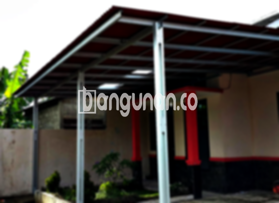

**Jasa Pasang Kanopi Rumah Minimalis di Citeureup** – Memiliki area luar rumah yang terlindungi dari cuaca ekstrem adalah impian setiap pemilik rumah. Mitra Bangunan di Citeureup tidak perlu khawatir lagi mencari solusi praktis dan estetis untuk teras, garasi, atau area terbuka lainnya. Kami hadir sebagai penyedia jasa pemasangan kanopi rumah minimalis yang terpercaya dan terjangkau, siap membantu mewujudkan kenyamanan hunian Anda.

Kanopi bukan hanya pelindung dari panas matahari dan hujan, tetapi juga elemen penting dalam mempercantik tampilan fasad rumah Anda. Dengan desain minimalis yang modern, kanopi yang tepat akan meningkatkan nilai estetika properti Anda. 



## Keunggulan Memilih Jasa Pasang Kanopi Rumah Minimalis di Citeureup

Bagi Anda yang mempertimbangkan pemasangan kanopi untuk rumah di Citeureup, berikut adalah beberapa keunggulan yang bisa Anda dapatkan:

### – Pilihan Model Kanopi yang Beragam

Kami menyediakan beragam model kanopi rumah yang dapat Anda pilih sesuai dengan preferensi dan kebutuhan Anda. Setiap orang memiliki selera yang berbeda dalam menentukan desain kanopi yang ideal untuk rumah mereka. Anda dapat memilih dari berbagai bentuk seperti persegi, persegi panjang, atau desain khusus lainnya.

### – Material Berkualitas dan Ramah Lingkungan

Kanopi yang kami gunakan dibuat dari material berkualitas tinggi yang tidak hanya tahan lama tetapi juga ramah lingkungan. Penggunaan material yang tepat memastikan kanopi aman bagi keluarga Anda dan berkontribusi pada keberlanjutan lingkungan. Selain itu, material yang kami gunakan mudah dibersihkan, sehingga perawatan kanopi menjadi lebih praktis.

### – Ketahanan dan Kekuatan Terjamin

Salah satu keunggulan utama kanopi kami adalah ketahanan dan kekuatannya. Material berkualitas yang digunakan mampu menahan berbagai kondisi cuaca ekstrem dan memberikan perlindungan optimal bagi area di bawahnya. Anda dapat mengandalkan kanopi kami untuk bertahan selama bertahun-tahun dengan perawatan yang tepat.

Anda akan melihat sendiri bagaimana kanopi rumah dapat bertahan puluhan tahun. Hal ini bergantung pada perawatan yang Anda lakukan; jika dilakukan dengan baik, kualitas kanopi akan tetap terjaga dalam jangka waktu yang lama.

### – Keamanan dan Kenyamanan Optimal

Keamanan merupakan prioritas utama kami. Kanopi yang kami pasang memberikan perlindungan yang efektif terhadap sinar matahari, hujan, dan elemen alam lainnya. Dengan demikian, area di bawah kanopi menjadi lebih nyaman dan aman untuk digunakan, baik untuk bersantai, berkumpul dengan keluarga, atau menyimpan kendaraan. 

Kanopi kami memastikan Anda terlindungi secara maksimal dari cuaca yang tidak menentu.

### – Harga Kompetitif dan Terjangkau

Kami memahami pentingnya anggaran dalam setiap proyek pembangunan. Oleh karena itu, kami menawarkan harga kanopi rumah yang kompetitif dan terjangkau di Citeureup. Meskipun demikian, kami tidak mengorbankan kualitas material dan pengerjaan demi harga yang murah.

## Informasi Harga dan Jasa Pemasangan Kanopi Rumah Minimalis di Citeureup



Sudahkah Anda mempertimbangkan untuk memasang kanopi di rumah Anda? Banyak orang di Citeureup yang telah merasakan manfaatnya, baik untuk melindungi garasi mobil, area parkir, atau sebagai penutup jendela. Pilihan penggunaan kanopi sangat fleksibel dan bergantung pada kebutuhan spesifik Anda.

Untuk memberikan gambaran, harga kanopi rumah dapat bervariasi tergantung pada kualitas material dan kompleksitas desain. Untuk kualitas sedang, perkiraan harga berkisar antara Rp. 450.000 hingga Rp. 800.000. Harga akan lebih tinggi jika Anda memilih material yang lebih premium dan fitur tambahan.

Harga juga dipengaruhi oleh beberapa faktor lain, termasuk ukuran kanopi dan model yang Anda pilih. Setiap model kanopi memiliki karakteristik dan biaya produksi yang berbeda. Pastikan Anda memilih ukuran yang sesuai dengan kebutuhan Anda agar mendapatkan hasil yang optimal.

Jika Anda memerlukan bantuan dalam pemasangan kanopi, kami menyediakan layanan pemasangan profesional yang cepat dan efisien. Dengan menggunakan jasa pemasangan, Anda tidak perlu repot mengurus sendiri proses instalasi dan dapat langsung menikmati manfaat kanopi baru Anda.

Demikianlah informasi mengenai Jasa Pasang Kanopi Rumah Minimalis di Citeureup yang dapat kami sampaikan. Mitra Bangunan mengundang Anda untuk berkonsultasi dengan tim kami guna mendapatkan pelayanan dan harga terbaik sesuai kebutuhan Anda. Kami siap membantu mewujudkan kenyamanan rumah impian Anda.

**Ref by:**  [Kanopi Rumah Minimalis Citeureup](https://id.wikipedia.org/wiki/Kanopi)