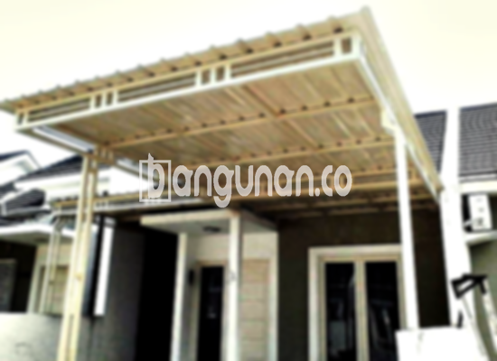

**Jasa Pasang Kanopi Rumah Minimalis di Ciwaringin Bogor** – Menciptakan ruang luar yang nyaman dan terlindungi adalah prioritas utama bagi banyak pemilik rumah di Ciwaringin Bogor. Kanopi hadir sebagai solusi efektif untuk melindungi teras, garasi, atau area parkir dari berbagai kondisi cuaca. Mitra Bangunan memahami kebutuhan ini dan hadir sebagai penyedia jasa pemasangan kanopi rumah minimalis yang terpercaya dan terjangkau di wilayah Ciwaringin Bogor.

Kanopi bukan hanya berfungsi melindungi dari hujan dan panas, tetapi juga meningkatkan estetika rumah Anda. Dengan desain yang tepat, kanopi dapat menyatu harmonis dengan gaya arsitektur rumah Anda, menciptakan tampilan yang lebih modern dan menarik.



## Keunggulan Memilih Jasa Pasang Kanopi Rumah Minimalis di Ciwaringin Bogor

Bagi Anda yang mempertimbangkan penggunaan jasa pasang kanopi untuk hunian atau bisnis di Ciwaringin Bogor, berikut adalah beberapa keunggulan yang bisa Anda dapatkan:

### \- Pilihan Model Kanopi yang Beragam

Kami menyediakan beragam model kanopi rumah yang dapat Anda pilih sesuai dengan selera dan kebutuhan Anda. Setiap orang memiliki preferensi desain yang berbeda, dan kami siap mewujudkannya. Anda dapat memilih dari berbagai bentuk, seperti persegi, persegi panjang, atau desain khusus sesuai permintaan.

### \- Bahan Material Ramah Lingkungan

Kami menggunakan material yang tidak berbahaya bagi lingkungan, sehingga aman untuk Anda dan keluarga. Memilih kanopi dari bahan ramah lingkungan adalah langkah kecil yang berdampak positif bagi keberlanjutan lingkungan. Selain itu, kanopi kami mudah dibersihkan dan dirawat.

### \- Konstruksi Awet dan Kuat

Salah satu keunggulan utama dari kanopi yang kami pasang adalah daya tahannya yang terjamin. Kami menggunakan material berkualitas tinggi yang tahan terhadap cuaca ekstrem dan korosi. Konstruksi yang kokoh memastikan kanopi Anda dapat bertahan selama bertahun-tahun dengan perawatan yang tepat.

Anda dapat mengandalkan kekuatan dan ketahanan kanopi rumah kami. Dengan perawatan yang baik, kanopi akan menjadi investasi jangka panjang yang memberikan perlindungan optimal.

### \- Keamanan dan Kenyamanan Terjamin

Kanopi yang terpasang dengan baik akan memberikan perlindungan maksimal terhadap elemen cuaca. Halaman depan rumah atau area parkir Anda akan terlindungi dari sinar matahari yang terik dan hujan deras. Dengan begitu, Anda dan keluarga dapat merasa nyaman dan aman saat berada di luar ruangan.

### \- Harga Kompetitif untuk Kanopi Rumah Minimalis di Ciwaringin Bogor

Kami menawarkan harga yang kompetitif untuk semua jenis kanopi rumah minimalis di Ciwaringin Bogor. Kami percaya bahwa setiap orang berhak mendapatkan perlindungan berkualitas tanpa harus menguras kantong. Ingin mengetahui detail harga? Silakan lihat  untuk informasi lebih lanjut.

## Harga dan Proses Pemasangan Kanopi Rumah Minimalis di Ciwaringin Bogor

Banyak warga Ciwaringin Bogor yang telah mempercayakan kebutuhan kanopi mereka kepada kami. Kanopi dapat diaplikasikan untuk berbagai area, seperti garasi, teras, atau area parkir. Pilihan penggunaannya bergantung pada kebutuhan spesifik Anda.

Sebagai gambaran, harga kanopi rumah berkisar antara Rp. 450.000 – Rp. 800.000 per meter persegi untuk kualitas standar. Harga dapat bervariasi tergantung pada jenis material, ukuran, dan kompleksitas desain.

Faktor-faktor yang memengaruhi harga meliputi kualitas material yang digunakan, ukuran kanopi yang dibutuhkan, dan kompleksitas desain. Kami akan memberikan penawaran harga yang sesuai dengan kebutuhan dan anggaran Anda.

Untuk Anda yang ingin memasang kanopi di rumah, kami menyediakan layanan pemasangan profesional yang cepat dan efisien. Tim kami akan memastikan kanopi terpasang dengan rapi dan aman.

**Ref by:**  [Kanopi Rumah Minimalis Ciwaringin Bogor](https://id.wikipedia.org/wiki/Kanopi)

Itulah sedikit informasi mengenai jasa pasang kanopi rumah minimalis di Ciwaringin Bogor. Jangan ragu untuk menghubungi kami melalui tombol WhatsApp atau Telepon di halaman ini untuk konsultasi gratis dan mendapatkan penawaran harga terbaik. Mitra Bangunan siap membantu Anda menciptakan hunian yang nyaman dan terlindungi.