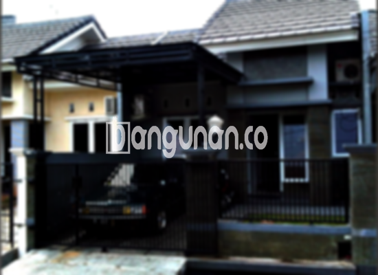

**Jasa Pasang Kanopi Rumah Minimalis di Curug Tangerang** – Memiliki area luar rumah yang nyaman dan terlindungi adalah dambaan setiap pemilik hunian di Curug Tangerang. Kanopi menjadi solusi praktis untuk perlindungan dari panas matahari dan hujan. Mitra Bangunan hadir sebagai penyedia jasa pemasangan kanopi rumah minimalis yang berkualitas dan terjangkau, membantu Anda menciptakan kenyamanan di hunian tercinta.



## Keunggulan Menggunakan Jasa Pasang Kanopi Rumah Minimalis di Curug Tangerang

Bagi Anda yang berencana memasang kanopi, berikut adalah beberapa keunggulan yang bisa Anda dapatkan:

### – Pilihan Model yang Beragam dari Jasa Pasang Kanopi Rumah Minimalis di Curug Tangerang

Kami menyediakan beragam pilihan model kanopi yang dapat Anda sesuaikan dengan desain rumah Anda. Setiap orang memiliki preferensi berbeda dalam memilih kanopi. Anda dapat memilih dari berbagai bentuk seperti persegi, persegi panjang, atau desain custom sesuai keinginan. 

### – Material Ramah Lingkungan untuk Jasa Pasang Kanopi Rumah Minimalis di Curug Tangerang

Material yang kami gunakan tidak hanya berkualitas, tetapi juga ramah lingkungan. Kanopi yang terbuat dari material yang tepat akan memberikan manfaat jangka panjang tanpa memberikan dampak negatif pada lingkungan sekitar. Terlebih lagi, kanopi kami mudah dibersihkan dan dirawat.

### – Ketahanan dan Kekokohan Jasa Pasang Kanopi Rumah Minimalis di Curug Tangerang

Salah satu keunggulan utama kanopi yang kami pasang adalah ketahanannya. Dengan menggunakan material berkualitas tinggi, kanopi kami dirancang untuk tahan lama dan mampu menahan berbagai kondisi cuaca ekstrem. Anda dapat mengandalkannya untuk bertahun-tahun mendatang.

Anda akan menemukan bahwa kanopi rumah yang kami pasang dapat bertahan hingga puluhan tahun, tergantung pada perawatan yang dilakukan. Perawatan yang baik akan semakin memperpanjang umur dan kualitas kanopi.

### – Keamanan yang Terjamin dari Jasa Pasang Kanopi Rumah Minimalis di Curug Tangerang

Kanopi yang kami pasang memberikan perlindungan maksimal terhadap area di bawahnya. Kanopi melindungi dari paparan langsung cahaya matahari dan hujan, menciptakan ruang yang aman dan nyaman. Perlindungan ini sangat penting untuk menjaga barang-barang Anda di garasi atau menciptakan area bersantai yang nyaman di teras.

### – Harga Kompetitif untuk Kanopi Rumah Minimalis di Curug Tangerang

Kami menawarkan harga yang kompetitif tanpa mengorbankan kualitas. Harga kanopi tentu bervariasi tergantung pada jenis material dan ukuran yang dipilih. Kami menyediakan berbagai opsi agar sesuai dengan anggaran Anda.

## Harga dan Jasa Pemasangan Kanopi Rumah Minimalis di Curug Tangerang



Apakah Anda sudah mempertimbangkan memasang kanopi untuk rumah Anda di Curug Tangerang? Banyak orang kini memilih memasang kanopi untuk melindungi garasi mobil, area parkir, atau bahkan sebagai penutup jendela. Pilihan penggunaan kanopi sangat beragam dan disesuaikan dengan kebutuhan masing-masing pemilik rumah.

Untuk informasi lebih detail mengenai harga, kami sarankan untuk melihat tabel harga yang tersedia atau menghubungi tim kami untuk mendapatkan penawaran terbaik sesuai dengan kebutuhan Anda. Kami akan memberikan estimasi biaya berdasarkan jenis kanopi, ukuran, dan kompleksitas pemasangan.

Kami juga menyediakan jasa pemasangan kanopi yang profesional dan efisien. Dengan menggunakan jasa pemasangan, Anda akan mendapatkan hasil yang rapi dan sesuai dengan harapan Anda. Kami memastikan proses pemasangan berjalan dengan lancar dan aman.

**Ref by:**  [Kanopi Rumah Minimalis Curug Tangerang](https://id.wikipedia.org/wiki/Kanopi)

Mitra Bangunan siap membantu Anda mewujudkan area luar rumah yang nyaman dan terlindungi. Jangan ragu untuk menghubungi kami melalui tombol WhatsApp atau Telepon yang tersedia di halaman ini untuk konsultasi gratis dan penawaran terbaik. Kami berkomitmen untuk memberikan layanan terbaik untuk kebutuhan kanopi rumah Anda di Curug Tangerang.