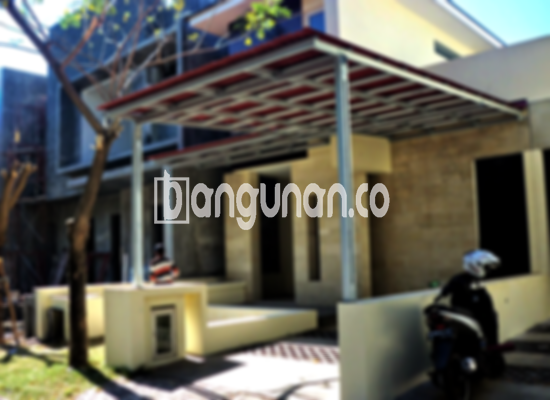

**Jasa Pasang Kanopi Rumah Minimalis di Dukuh Jakarta** – Memiliki area terbuka yang nyaman dan terlindungi adalah keinginan banyak orang. Kanopi menjadi solusi ideal untuk melindungi teras, garasi, atau area depan rumah dari panas matahari dan hujan. Mitra Bangunan di Dukuh Jakarta dapat mewujudkan hunian impian dengan memilih jasa pasang kanopi rumah minimalis yang tepat. Kami hadir untuk memberikan solusi estetis dan fungsional bagi kebutuhan perlindungan properti Anda.

Pilihan kanopi rumah yang beragam memungkinkan Anda menyesuaikan desain dengan gaya arsitektur dan preferensi pribadi. Setiap jenis kanopi memiliki keunggulan tersendiri, baik dari segi material, kualitas, maupun harga. Pastikan Anda memilih kanopi yang paling sesuai dengan kebutuhan dan anggaran Anda.



## Mengapa Memilih Jasa Pasang Kanopi Rumah Minimalis di Dukuh Jakarta?

Bagi Anda yang ingin memasang kanopi untuk rumah atau ruko, terdapat sejumlah keunggulan yang bisa Anda peroleh dengan menggunakan jasa profesional di Dukuh Jakarta:

### \- Pilihan Model Kanopi yang Beragam

Kami menyediakan berbagai macam model kanopi rumah yang dapat Anda pilih sesuai dengan selera. Setiap orang memiliki preferensi masing-masing dalam memilih desain kanopi yang cocok dengan gaya rumah mereka. Anda bisa memilih antara model persegi, persegi panjang, atau desain khusus sesuai keinginan.

### \- Material Ramah Lingkungan

Kanopi yang kami gunakan terbuat dari material berkualitas yang tidak berbahaya bagi lingkungan. Penggunaan material ramah lingkungan ini menjadikan kanopi Anda sebagai pilihan yang bertanggung jawab dan berkelanjutan. Selain itu, kanopi mudah dibersihkan, sehingga tidak memerlukan perawatan yang rumit.

### \- Konstruksi Tahan Lama dan Kokoh

Salah satu keunggulan utama dari kanopi yang kami pasang adalah ketahanannya. Material berkualitas tinggi yang kami gunakan memastikan kanopi Anda kuat, kokoh, dan tahan terhadap cuaca ekstrem. Dengan perawatan yang tepat, kanopi rumah Anda dapat bertahan selama bertahun-tahun.

Anda dapat mengandalkan kekuatan dan daya tahan kanopi kami yang dirancang untuk menahan beban dan tekanan dari berbagai kondisi cuaca. Keawetannya akan memberikan Anda ketenangan pikiran dan perlindungan jangka panjang.

### \- Keamanan dan Kenyamanan Terjamin

Kanopi yang terpasang dengan baik akan memberikan perlindungan optimal bagi area di bawahnya. Kanopi dapat menghalangi sinar matahari langsung dan hujan, menciptakan lingkungan yang lebih nyaman dan aman. Keamanan ini akan menjadikan Anda lebih tenang dan nyaman saat menggunakan area tersebut.

Dengan kanopi, Anda dapat menikmati waktu di luar ruangan tanpa khawatir terhadap cuaca yang tidak menentu. 

### \- Solusi Ekonomis untuk Perlindungan Properti

Kami menawarkan harga yang kompetitif untuk jasa pasang kanopi rumah minimalis di Dukuh Jakarta. Harga kanopi bervariasi tergantung pada jenis material, ukuran, dan kompleksitas desain. Kami akan memberikan penawaran terbaik sesuai dengan anggaran Anda.

## Informasi Harga dan Jasa Pemasangan Kanopi Rumah Minimalis di Dukuh Jakarta



Banyak orang di era modern ini yang mulai mempertimbangkan pemasangan kanopi untuk rumah mereka. Kanopi tidak hanya berfungsi sebagai pelindung, tetapi juga sebagai elemen dekoratif yang mempercantik tampilan rumah. Baik digunakan untuk garasi, teras, atau area parkir, kanopi dapat memberikan manfaat yang signifikan.

Untuk mengetahui perkiraan biaya, Anda dapat melihat detail harga di tabel yang tersedia. Harga kanopi rumah dapat bervariasi tergantung pada kualitas material yang dipilih. Semakin berkualitas materialnya, semakin tinggi pula harganya.

Selain kualitas material, ukuran kanopi juga memengaruhi harga. Semakin luas area yang ingin ditutupi, semakin mahal biaya pemasangannya. Pastikan Anda menentukan ukuran yang sesuai dengan kebutuhan dan anggaran Anda.

Untuk pemasangan yang cepat dan efisien, Anda dapat menggunakan jasa pemasangan kanopi profesional seperti kami. Tim ahli kami akan memastikan proses pemasangan berjalan lancar dan hasil yang memuaskan.

Itulah informasi mengenai jasa pasang kanopi rumah minimalis di Dukuh Jakarta yang dapat kami sampaikan. Mitra Bangunan yang mencari solusi perlindungan dan keindahan untuk properti Anda, jangan ragu untuk menghubungi kami melalui tombol WhatsApp atau Telepon di halaman ini. Kami siap membantu Anda menemukan kanopi yang tepat untuk kebutuhan Anda.

**Ref by:**  [Kanopi Rumah Minimalis Dukuh Jakarta](https://id.wikipedia.org/wiki/Kanopi)