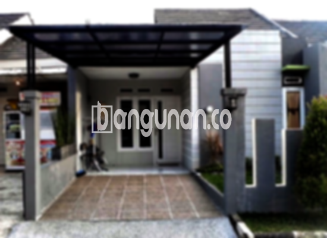

**Jasa Pasang Kanopi Rumah Minimalis di Duren Sawit Jakarta** – Menciptakan kenyamanan dan perlindungan bagi properti Anda adalah prioritas utama. Mitra Bangunan di Duren Sawit Jakarta tidak perlu ragu lagi untuk menemukan solusi yang tepat bagi kebutuhan kanopi rumah Anda. Kami hadir sebagai penyedia jasa pembuatan dan pemasangan kanopi yang berkualitas dan terjangkau, dirancang khusus untuk mempercantik dan melindungi hunian Anda.



## Mengapa Memilih Jasa Pasang Kanopi Rumah Minimalis di Duren Sawit Jakarta?

Bagi Anda yang berencana memasang kanopi untuk rumah, ada sejumlah keunggulan yang bisa Anda dapatkan dengan mempercayakan pekerjaan ini kepada profesional di Duren Sawit Jakarta.

### \- Pilihan Model Kanopi yang Beragam

Kami menyediakan beragam pilihan model kanopi rumah yang dapat Anda sesuaikan dengan gaya arsitektur dan selera Anda. Setiap orang memiliki preferensi tersendiri dalam memilih desain kanopi, dan kami siap mewujudkannya. Anda dapat memilih dari berbagai bentuk seperti persegi, persegi panjang, atau desain custom sesuai keinginan.

### \- Material Berkualitas dan Ramah Lingkungan

Material yang kami gunakan dalam pembuatan kanopi dipilih dengan cermat untuk memastikan kualitas dan keberlanjutan lingkungan. Kanopi kami dibuat dari bahan-bahan yang tidak berbahaya, sehingga ramah lingkungan dan aman untuk keluarga Anda. Selain itu, kanopi juga mudah dibersihkan dan dirawat.

### \- Daya Tahan dan Kekokohan Terjamin

Kanopi yang kami pasang dirancang untuk tahan lama dan kokoh menghadapi berbagai kondisi cuaca. Penggunaan material berkualitas tinggi memastikan bahwa kanopi Anda akan menjadi investasi jangka panjang yang menguntungkan. Anda dapat mengandalkan kekuatan dan ketahanan kanopi kami selama bertahun-tahun.

Anda dapat membuktikan sendiri kualitasnya, karena kanopi rumah akan bertahan hingga puluhan tahun. Masa pakai kanopi juga bergantung pada perawatan yang Anda lakukan. Dengan perawatan yang baik, kanopi rumah Anda akan tetap kokoh dan berfungsi dengan optimal.

### \- Keamanan dan Kenyamanan Optimal

Kanopi yang terpasang dengan baik akan memberikan perlindungan maksimal bagi area di bawahnya. Kanopi melindungi dari paparan sinar matahari langsung dan hujan deras, menciptakan lingkungan yang nyaman dan aman untuk keluarga Anda. Dengan begitu, Anda dapat menikmati waktu di luar ruangan tanpa khawatir cuaca ekstrem.

### \- Harga yang Kompetitif dan Terjangkau

Kami memahami pentingnya anggaran dalam setiap proyek pembangunan. Oleh karena itu, kami menawarkan harga yang kompetitif dan terjangkau untuk semua jenis kanopi rumah di Duren Sawit Jakarta. Harga akan bervariasi tergantung pada model, material, dan ukuran kanopi yang Anda pilih.

## Informasi Harga dan Jasa Pemasangan Kanopi Rumah Minimalis di Duren Sawit Jakarta



Apakah Anda sudah mempertimbangkan untuk memasang kanopi di rumah Anda? Banyak orang saat ini yang memilih untuk menambahkan kanopi di properti mereka, baik untuk area garasi mobil, tempat parkir, atau sebagai penutup jendela. Pilihan ini sepenuhnya tergantung pada kebutuhan dan preferensi Anda. 

Untuk mendapatkan informasi harga yang lebih akurat, kami sarankan Anda untuk melihat tabel harga yang tersedia atau menghubungi tim kami untuk konsultasi gratis. Kami akan dengan senang hati membantu Anda menemukan solusi kanopi yang sesuai dengan anggaran dan kebutuhan Anda.

Dengan menggunakan jasa pemasangan kanopi profesional, Anda akan mendapatkan hasil yang cepat, efisien, dan berkualitas tinggi. Jadi, Anda dapat langsung menikmati manfaat dari kanopi baru Anda tanpa perlu repot.

**Ref by:**  [Kanopi Rumah Minimalis Duren Sawit Jakarta](https://id.wikipedia.org/wiki/Kanopi)

Demikianlah informasi mengenai Jasa Pasang Kanopi Rumah Minimalis di Duren Sawit Jakarta yang dapat kami sampaikan. Mitra Bangunan yang sedang mencari solusi terbaik untuk perlindungan dan estetika rumah Anda, jangan ragu untuk menghubungi kami melalui tombol WhatsApp atau Telepon di halaman ini. Kami siap memberikan layanan terbaik dan membantu Anda mewujudkan hunian impian Anda.