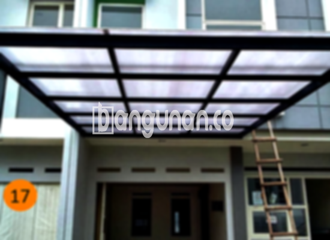

**Jasa Pasang Kanopi Rumah Minimalis di Duri Jakarta** – Mencari solusi untuk melindungi teras atau garasi dari cuaca ekstrem di Duri Jakarta? Mitra Bangunan menemukan jawabannya! Kanopi merupakan elemen penting dalam desain rumah modern, memberikan perlindungan optimal dari hujan dan panas, sekaligus meningkatkan nilai estetika bangunan Anda. Kami hadir sebagai penyedia jasa pemasangan kanopi rumah minimalis yang terpercaya di Duri Jakarta, menawarkan beragam pilihan material dan desain yang sesuai dengan kebutuhan Anda.

Banyaknya pilihan material dan desain kanopi terkadang bisa membingungkan. Kami siap membantu Anda memilih solusi terbaik yang tidak hanya fungsional, namun juga harmonis dengan gaya arsitektur rumah Anda di Duri Jakarta. Dengan pengalaman dan tenaga ahli yang kami miliki, kami menjamin hasil pemasangan yang rapi, kuat, dan tahan lama.



## Keunggulan Menggunakan Jasa Pasang Kanopi Rumah Minimalis di Duri Jakarta

Memilih layanan profesional untuk pemasangan kanopi memberikan banyak keuntungan. Berikut adalah beberapa keunggulan yang akan Anda dapatkan dengan mempercayakan pekerjaan ini kepada kami di Duri Jakarta:

### - Pilihan Model Kanopi yang Beragam

Kami menawarkan berbagai model kanopi rumah yang dapat Anda pilih sesuai dengan preferensi dan kebutuhan Anda.  Dari desain sederhana hingga yang lebih kompleks, Anda memiliki kebebasan untuk menyesuaikan tampilan kanopi dengan gaya rumah Anda. Anda dapat memilih model persegi, persegi panjang, atau bahkan desain khusus sesuai dengan keinginan Anda.

### - Material Ramah Lingkungan untuk Kanopi di Duri Jakarta

Kami hanya menggunakan material berkualitas tinggi yang ramah lingkungan dalam pembuatan kanopi. Hal ini tidak hanya memberikan keamanan bagi Anda dan keluarga, tetapi juga berkontribusi pada kelestarian lingkungan sekitar Duri Jakarta. Material yang kami gunakan juga mudah dibersihkan, sehingga Anda tidak perlu khawatir tentang perawatan yang rumit.

### - Ketahanan dan Kekuatan Kanopi yang Terjamin

Kanopi yang kami pasang dirancang untuk tahan lama dan kuat menghadapi berbagai kondisi cuaca ekstrem. Ini karena kami hanya menggunakan bahan-bahan berkualitas tinggi yang teruji kekuatannya. Investasi pada kanopi berkualitas akan memberikan perlindungan jangka panjang untuk properti Anda di Duri Jakarta.

Anda akan mendapati bahwa kanopi yang terpasang dengan baik dapat bertahan selama bertahun-tahun. Perawatan yang rutin akan semakin memperpanjang usia pakainya, menjadikannya solusi investasi yang cerdas.

### - Keamanan dan Kenyamanan Optimal

Kanopi memberikan perlindungan yang signifikan terhadap berbagai elemen cuaca. Area di bawah kanopi akan terlindungi dari paparan sinar matahari langsung dan hujan deras, menciptakan ruang yang nyaman dan aman untuk bersantai atau beraktivitas di luar ruangan. Keamanan yang terjamin tentu menjadi prioritas utama bagi setiap pemilik rumah di Duri Jakarta.

### - Solusi Ekonomis untuk Perlindungan Rumah Anda

Kami menawarkan harga yang kompetitif dan terjangkau untuk semua layanan pemasangan kanopi.  Kami memahami bahwa setiap anggaran berbeda-beda, oleh karena itu kami menyediakan berbagai pilihan material dan desain yang dapat disesuaikan dengan anggaran Anda. Pastikan untuk menanyakan informasi harga terkini kepada tim kami.

## Harga dan Jasa Pemasangan Kanopi Rumah Minimalis di Duri Jakarta



Banyak warga Duri Jakarta telah merasakan manfaat memiliki kanopi di rumah mereka. Kanopi dapat diaplikasikan untuk berbagai area, seperti garasi mobil, teras depan, area parkir, atau bahkan sebagai pelindung jendela. Pilihan penggunaannya sangat tergantung pada kebutuhan spesifik Anda.

Harga kanopi rumah bervariasi tergantung pada material, ukuran, dan desain yang dipilih. Kami merekomendasikan untuk berkonsultasi langsung dengan tim kami guna mendapatkan penawaran harga yang paling sesuai dengan kebutuhan dan anggaran Anda.

Faktor-faktor yang memengaruhi harga meliputi mutu material, kompleksitas desain, dan luas area yang akan ditutupi oleh kanopi. Semakin besar ukuran yang dibutuhkan, semakin tinggi pula biayanya. Pastikan Anda memilih ukuran yang proporsional dengan kebutuhan dan area yang tersedia.

Bagi Anda yang ingin memasang kanopi rumah, kami menyediakan layanan pemasangan profesional yang cepat, efisien, dan terpercaya. Dengan mempercayakan pekerjaan ini kepada kami, Anda dapat memastikan hasil pemasangan yang rapi dan memuaskan. Kami melayani pemasangan kanopi untuk berbagai jenis bangunan, baik rumah tinggal, ruko, maupun bangunan komersial di wilayah Duri Jakarta.

**Ref by:**  [Kanopi Rumah Minimalis Duri Jakarta](https://id.wikipedia.org/wiki/Kanopi)

Mitra Bangunan siap membantu Anda mewujudkan hunian yang nyaman dan terlindungi dengan kanopi berkualitas. Hubungi kami melalui tombol WhatsApp atau Telepon di halaman ini untuk berkonsultasi lebih lanjut dan mendapatkan penawaran harga terbaik untuk layanan pemasangan kanopi rumah minimalis di Duri Jakarta. Kami berkomitmen untuk memberikan pelayanan yang ramah, profesional, dan sesuai dengan harapan Anda.