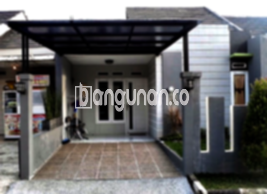

**Jasa Pasang Kanopi Rumah Minimalis di Gandaria Jakarta** – Memiliki area terbuka yang terlindungi cuaca adalah kebutuhan penting bagi setiap pemilik rumah. Mitra Bangunan di Gandaria Jakarta tidak perlu lagi kesulitan mencari solusi terbaik untuk melindungi teras, garasi, atau area outdoor lainnya. Kami hadir sebagai penyedia jasa pembuatan dan pemasangan kanopi berkualitas dengan harga yang kompetitif.

Kanopi bukan hanya sekadar elemen tambahan pada bangunan, tetapi juga investasi penting untuk kenyamanan dan keindahan hunian Anda. Dengan memilih kanopi yang tepat, Anda dapat menciptakan ruang yang lebih fungsional dan nyaman untuk berbagai aktivitas.



## Keunggulan Menggunakan Jasa Pasang Kanopi Rumah Minimalis di Gandaria Jakarta

Bagi Anda yang mempertimbangkan penggunaan kanopi untuk rumah, ada beberapa keunggulan utama yang bisa Anda dapatkan:

### – Pilihan Model yang Beragam dari Jasa Pasang Kanopi Rumah Minimalis di Gandaria Jakarta

Kami menyediakan beragam model kanopi yang dapat Anda sesuaikan dengan gaya arsitektur rumah Anda. Setiap orang memiliki preferensi yang berbeda, dan kami menawarkan berbagai pilihan desain mulai dari yang sederhana hingga yang lebih kompleks. Anda dapat memilih bentuk yang paling sesuai dengan selera Anda, seperti persegi, persegi panjang, atau desain khusus lainnya.

### – Material Ramah Lingkungan dari Jasa Pasang Kanopi Rumah Minimalis di Gandaria Jakarta

Kami menggunakan material yang ramah lingkungan dalam pembuatan kanopi. Hal ini menunjukkan komitmen kami terhadap kelestarian lingkungan. Material yang ringan juga memudahkan proses pembersihan, sehingga kanopi Anda akan selalu terlihat bersih dan terawat.

### – Ketahanan dan Kekuatan Produk Jasa Pasang Kanopi Rumah Minimalis di Gandaria Jakarta

Salah satu keunggulan utama kanopi kami adalah ketahanan dan kekuatannya. Kami hanya menggunakan bahan-bahan berkualitas tinggi yang mampu menahan cuaca ekstrem dan penggunaan jangka panjang. Keawetan kanopi akan memberikan Anda nilai investasi yang optimal selama bertahun-tahun.

Anda dapat mengandalkan kanopi yang kami pasang untuk memberikan perlindungan yang tahan lama. Dengan perawatan yang tepat, kanopi dapat bertahan selama puluhan tahun dan tetap berfungsi dengan baik.

### – Keamanan Terjamin dari Jasa Pasang Kanopi Rumah Minimalis di Gandaria Jakarta

Kanopi yang kami pasang memberikan perlindungan optimal terhadap berbagai elemen cuaca, seperti sinar matahari dan hujan. Hal ini menciptakan lingkungan yang lebih aman dan nyaman di bawahnya. Anda dapat menikmati area terbuka tanpa khawatir terganggu oleh cuaca buruk.

Dengan perlindungan yang terjamin, Anda dapat memaksimalkan penggunaan ruang terbuka di rumah Anda, baik untuk bersantai, berkumpul dengan keluarga, atau menjalankan aktivitas lainnya.

### – Harga yang Kompetitif untuk Kanopi Rumah Minimalis di Gandaria Jakarta

Kami menawarkan harga yang kompetitif untuk semua jenis kanopi rumah. Harga akan bervariasi tergantung pada jenis kanopi yang Anda pilih dan tingkat kesulitan pemasangannya. Kami selalu berusaha memberikan penawaran terbaik tanpa mengorbankan kualitas produk dan layanan.

## Informasi Harga dan Jasa Pemasangan Kanopi Rumah Minimalis di Gandaria Jakarta



Banyak pemilik rumah di Gandaria Jakarta yang mulai menyadari pentingnya memasang kanopi untuk melindungi properti mereka. Kanopi dapat digunakan untuk berbagai keperluan, seperti melindungi garasi mobil, area parkir, atau sebagai penutup jendela. Pilihan penggunaan tergantung pada kebutuhan spesifik Anda.

Untuk mendapatkan informasi lebih lanjut mengenai perkiraan biaya pemasangan, kami sarankan Anda untuk berkonsultasi langsung dengan tim kami. Kami akan memberikan penawaran yang sesuai dengan kebutuhan dan anggaran Anda.

Harga juga akan dipengaruhi oleh ukuran kanopi yang Anda inginkan. Semakin besar area yang perlu ditutupi, maka semakin tinggi pula biayanya. Pastikan Anda memilih ukuran yang sesuai dengan kebutuhan Anda dan mempertimbangkan tata letak properti Anda.

Jika Anda membutuhkan jasa pemasangan kanopi profesional di Gandaria Jakarta, jangan ragu untuk menghubungi kami. Kami akan memberikan layanan yang cepat, efisien, dan berkualitas tinggi.

Dengan demikian, itulah beberapa informasi penting mengenai Jasa Pasang Kanopi Rumah Minimalis di Gandaria Jakarta. Mitra Bangunan siap membantu Anda mewujudkan area outdoor yang nyaman dan terlindungi. Hubungi kami melalui tombol WhatsApp atau Telepon di halaman ini untuk konsultasi dan penawaran terbaik.

**Ref by:**  [Kanopi Rumah Minimalis Gandaria Jakarta](https://id.wikipedia.org/wiki/Kanopi)