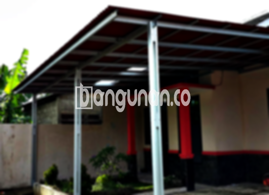

**Jasa Pasang Kanopi Rumah Minimalis di Gandul Depok** – Menciptakan kenyamanan di sekitar rumah adalah prioritas utama, dan kanopi menjadi solusi yang tepat untuk melindungi teras, garasi, atau area luar lainnya dari cuaca ekstrem. Mitra Bangunan di Gandul Depok menghadirkan layanan pemasangan kanopi berkualitas dengan harga terjangkau untuk memenuhi kebutuhan hunian Anda. Investasi pada kanopi yang tepat bukan hanya menambah nilai estetika rumah, tetapi juga memberikan perlindungan maksimal bagi keluarga.

Memilih kanopi yang sesuai dengan gaya rumah dan kebutuhan fungsional adalah kunci. Untungnya, ada beragam pilihan yang tersedia, masing-masing menawarkan keunggulan unik. Mari kita telaah lebih lanjut manfaat dan jenis-jenis kanopi yang bisa mempercantik dan melindungi rumah Anda di Gandul Depok.



## Mengapa Memilih Jasa Pasang Kanopi Rumah Minimalis di Gandul Depok?

Terdapat beberapa keuntungan signifikan yang akan Anda dapatkan dengan menggunakan jasa pemasangan kanopi profesional di Gandul Depok. Berikut adalah poin-poin penting yang perlu Anda pertimbangkan:

### \- Pilihan Model Kanopi yang Beragam

Kami menyediakan berbagai model kanopi yang dapat disesuaikan dengan gaya arsitektur rumah Anda. Anda dapat memilih dari berbagai bentuk seperti persegi, persegi panjang, atau desain yang lebih unik sesuai selera. Dengan variasi yang beragam ini, Anda dapat menemukan kanopi yang sempurna untuk melengkapi estetika rumah Anda.

### \- Bahan Material Ramah Lingkungan

Kami berkomitmen untuk menggunakan bahan material yang ramah lingkungan dalam pembuatan kanopi. Ini tidak hanya mengurangi dampak negatif terhadap lingkungan tetapi juga memastikan kesehatan dan keselamatan Anda dan keluarga. Bahan-bahan yang kami gunakan juga mudah dibersihkan dan dirawat.

### \- Ketahanan dan Kekuatan Teruji

Kanopi yang kami pasang dirancang untuk tahan lama dan kuat. Kami hanya menggunakan bahan berkualitas tinggi yang mampu menahan berbagai kondisi cuaca ekstrem. Kekuatan dan daya tahan ini memastikan investasi Anda memberikan manfaat jangka panjang. Anda dapat menikmati ketenangan pikiran karena kanopi Anda akan bertahan selama bertahun-tahun.

### \- Keamanan Terjamin

Keamanan adalah prioritas utama kami. Kanopi yang kami pasang memberikan perlindungan optimal terhadap hujan, panas, dan debu. Dengan kanopi, Anda dapat menciptakan area luar ruangan yang nyaman dan aman untuk keluarga dan teman-teman Anda. Perlindungan ini juga membantu mencegah kerusakan pada properti Anda.

### \- Harga Terjangkau

Kami menawarkan harga yang kompetitif dan terjangkau untuk semua layanan pemasangan kanopi kami. Kami percaya bahwa kualitas tidak harus mahal. Kami akan bekerja sama dengan Anda untuk menemukan solusi yang sesuai dengan anggaran Anda tanpa mengorbankan kualitas.

## Informasi Harga dan Jasa Pemasangan Kanopi Rumah Minimalis di Gandul Depok



Banyak warga Gandul Depok yang sudah merasakan manfaat memiliki kanopi di rumah mereka. Kanopi dapat digunakan untuk berbagai keperluan, mulai dari melindungi garasi mobil, menyediakan tempat parkir yang teduh, hingga menutupi jendela. Pemanfaatan kanopi sangat fleksibel dan dapat disesuaikan dengan kebutuhan Anda.

Untuk memberikan gambaran, harga kanopi rumah bervariasi tergantung pada kualitas bahan dan kompleksitas desain. Anda dapat menemukan pilihan kanopi dengan harga mulai dari Rp. 450.000 hingga Rp. 800.000 untuk kualitas standar. Harga dapat meningkat jika Anda memilih bahan yang lebih premium atau desain yang lebih rumit. Kami siap memberikan penawaran harga yang sesuai dengan kebutuhan spesifik Anda.

Penting untuk mempertimbangkan berbagai faktor yang memengaruhi harga, seperti jenis bahan kanopi, ukuran area yang akan ditutupi, dan tingkat kesulitan pemasangan. Untuk mendapatkan penawaran harga yang akurat dan terperinci, kami sarankan untuk berkonsultasi langsung dengan tim kami.

Jika Anda membutuhkan bantuan dalam pemasangan kanopi, kami menyediakan jasa pemasangan profesional yang cepat dan efisien. Dengan menggunakan jasa pemasangan profesional, Anda dapat memastikan kanopi terpasang dengan benar dan aman.

**Ref by:**  [Kanopi Rumah Minimalis Gandul Depok](https://id.wikipedia.org/wiki/Kanopi)

Mitra Bangunan siap membantu Anda mewujudkan hunian yang nyaman dan terlindungi dengan kanopi berkualitas. Jangan ragu untuk menghubungi kami melalui tombol WhatsApp atau Telepon pada halaman ini untuk konsultasi gratis dan penawaran harga terbaik di Gandul Depok. Kami berkomitmen untuk memberikan solusi kanopi yang sesuai dengan kebutuhan dan anggaran Anda.