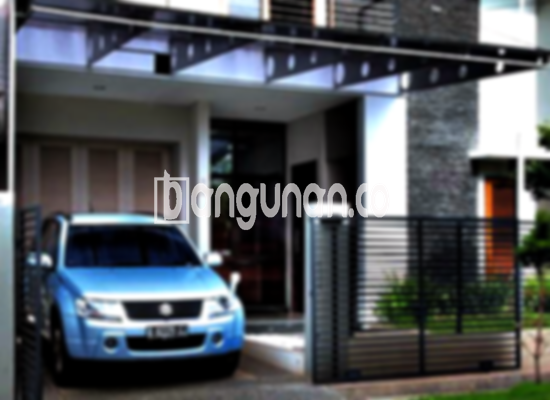

**Jasa Pasang Kanopi Rumah Minimalis di Gedong Jakarta** – Bagi Mitra Bangunan di Gedong Jakarta, melindungi teras, carport, atau area luar rumah dari cuaca ekstrem adalah kebutuhan penting. Kanopi bukan hanya berfungsi sebagai pelindung, tetapi juga mempercantik tampilan fasad rumah Anda. Kami hadir sebagai solusi praktis untuk pembuatan dan pemasangan kanopi berkualitas dengan harga terjangkau.

Memilih kanopi yang tepat akan meningkatkan kenyamanan dan nilai estetika rumah Anda. Ada berbagai pilihan material dan desain yang tersedia, menyesuaikan dengan gaya arsitektur dan anggaran Anda. Kami siap membantu Anda mewujudkan kanopi impian, tanpa perlu repot mencari tukang terpisah.



## Keunggulan Menggunakan Jasa Pasang Kanopi Rumah Minimalis di Gedong Jakarta

Bagi Anda yang mempertimbangkan untuk memasang kanopi, ada sejumlah keuntungan signifikan yang bisa Anda dapatkan:

### \- Pilihan Model Kanopi yang Beragam

Kami menawarkan berbagai tipe kanopi yang dapat Anda pilih sesuai selera dan kebutuhan. Setiap orang memiliki preferensi desain yang berbeda, dan kami berusaha mengakomodasi semua keinginan Anda. Pilihan desain yang tersedia mencakup bentuk persegi, persegi panjang, dan variasi lainnya.

### \- Material Ramah Lingkungan

Kami berkomitmen untuk menggunakan material yang aman dan tidak berbahaya bagi lingkungan. Penggunaan material ramah lingkungan merupakan bagian dari tanggung jawab kami terhadap kelestarian alam. Selain itu, kanopi yang kami pasang mudah dibersihkan, sehingga Anda tidak perlu khawatir dengan perawatan yang rumit.

### \- Daya Tahan dan Kekuatan Terjamin

Salah satu keunggulan utama kanopi yang kami pasang adalah ketahanan dan kekokohannya. Kami hanya menggunakan material berkualitas tinggi yang mampu bertahan lama terhadap berbagai kondisi cuaca. Dengan perawatan yang tepat, kanopi buatan kami dapat bertahan selama bertahun-tahun.

Anda dapat mengandalkan kualitas kanopi yang kami pasang untuk melindungi properti Anda dari kerusakan akibat cuaca ekstrem. Keawetan ini menjadikan investasi Anda semakin berharga. 

### \- Tingkat Keamanan yang Tinggi

Kanopi memberikan perlindungan tambahan bagi area di bawahnya, meningkatkan keamanan properti Anda. Halaman depan rumah, garasi, atau area parkir akan terlindungi dari paparan langsung sinar matahari dan hujan. 

Dengan demikian, Anda dapat merasa lebih aman dan nyaman saat berkegiatan di area tersebut. Perlindungan maksimal ini menjadi nilai tambah dari penggunaan kanopi.

### \- Harga yang Kompetitif di Gedong Jakarta

Kami menawarkan harga yang kompetitif untuk layanan pemasangan kanopi di Gedong Jakarta. Meskipun harga dapat bervariasi tergantung pada jenis material, ukuran, dan desain yang dipilih, kami selalu berusaha memberikan penawaran terbaik bagi pelanggan kami.

## Harga dan Jasa Pemasangan Kanopi Rumah Minimalis di Gedong Jakarta



Apakah Anda sudah mempertimbangkan untuk memasang kanopi di rumah Anda? Semakin banyak orang yang menyadari manfaat kanopi untuk melindungi dan mempercantik rumah mereka. Kanopi dapat digunakan untuk berbagai keperluan, seperti melindungi garasi mobil, area parkir, atau sebagai penutup jendela.

Untuk informasi harga terbaru, silakan hubungi kami. Tim kami akan dengan senang hati memberikan detail biaya berdasarkan kebutuhan spesifik Anda.

Harga kanopi juga dipengaruhi oleh beberapa faktor, termasuk kualitas material yang digunakan dan ukuran kanopi yang Anda pilih. Semakin berkualitas materialnya, semakin tinggi pula harganya. Ukuran kanopi juga berperan penting dalam menentukan harga akhir. Kami akan membantu Anda memilih ukuran yang paling sesuai dengan kebutuhan dan anggaran Anda.

Bagi Anda yang ingin memasang kanopi dengan cepat dan efisien, kami menyediakan layanan pemasangan profesional. Dengan tenaga ahli yang berpengalaman, kami dapat menyelesaikan pemasangan kanopi dengan rapi dan tepat waktu.

Itulah informasi penting mengenai Jasa Pasang Kanopi Rumah Minimalis di Gedong Jakarta. Jangan tunda lagi, segera konsultasikan kebutuhan kanopi rumah Anda kepada kami untuk mendapatkan layanan terbaik. Mitra Bangunan di Gedong Jakarta, kami siap membantu Anda menciptakan hunian yang nyaman dan terlindungi. Terimakasih.

**Ref by:**  [Kanopi Rumah Minimalis Gedong Jakarta](https://id.wikipedia.org/wiki/Kanopi)