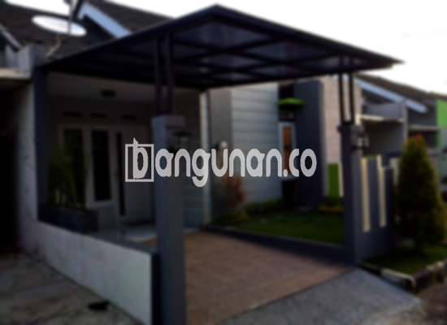

**Jasa Pasang Kanopi Rumah Minimalis di Genteng Bogor** – Memiliki area luar rumah yang terlindungi dan nyaman merupakan prioritas setiap pemilik rumah di Genteng Bogor. Kanopi menjadi solusi praktis untuk menjaga teras, garasi, atau area parkir dari paparan cuaca ekstrem. Mitra Bangunan di Genteng Bogor tidak perlu khawatir mencari kontraktor yang terpercaya; Kami hadir untuk memberikan layanan pembuatan dan pemasangan kanopi berkualitas dengan harga terjangkau.

Kanopi tidak hanya berfungsi sebagai pelindung, tetapi juga meningkatkan estetika bangunan Anda. Dengan berbagai pilihan desain dan material, Anda dapat menciptakan tampilan yang serasi dengan gaya arsitektur rumah.



## Mengapa Memilih Jasa Pasang Kanopi Rumah Minimalis di Genteng Bogor?

Bagi Anda yang membutuhkan kanopi untuk rumah atau bangunan komersial, berikut adalah keunggulan yang dapat Anda peroleh dengan menggunakan jasa Kami:

### \- Pilihan Model Kanopi yang Beragam

Kami menyediakan beragam model kanopi rumah untuk memenuhi selera dan kebutuhan Anda. Setiap orang memiliki preferensi desain yang unik, dan Kami siap mewujudkannya. Anda dapat memilih kanopi dengan bentuk persegi, persegi panjang, atau bahkan desain khusus sesuai keinginan.

### \- Material Ramah Lingkungan

Kami hanya menggunakan bahan-bahan yang aman dan tidak berbahaya bagi lingkungan. Dengan menggunakan kanopi dari Kami, Anda turut berkontribusi dalam menjaga kelestarian alam. Selain itu, material yang Kami gunakan juga mudah dibersihkan, sehingga perawatan kanopi menjadi lebih praktis.

### \- Kualitas Terjamin & Tahan Lama

Salah satu keunggulan utama yang Kami tawarkan adalah kualitas produk yang terjamin. Kanopi yang Kami buat menggunakan material berkualitas tinggi, sehingga kokoh dan tahan lama. Dengan perawatan yang tepat, kanopi buatan Kami dapat bertahan hingga puluhan tahun.

Anda dapat mengandalkan kekuatan dan ketahanan kanopi Kami untuk melindungi properti Anda dari berbagai kondisi cuaca.

### \- Keamanan yang Optimal

Keamanan merupakan aspek penting dalam pembuatan kanopi. Kami memastikan setiap kanopi yang Kami pasang memberikan perlindungan maksimal bagi area di bawahnya. Kanopi Kami mampu menghalangi paparan sinar matahari langsung dan hujan lebat, sehingga Anda dan keluarga dapat merasa nyaman dan aman.

Dengan keamanan yang terjamin, Anda tidak perlu khawatir lagi terhadap kerusakan properti akibat cuaca buruk.

### \- Harga yang Kompetitif

Kami menawarkan harga yang terjangkau tanpa mengurangi kualitas produk dan layanan Kami. Harga kanopi disesuaikan dengan jenis material, kompleksitas desain, dan ukuran yang Anda inginkan. Percayakan Kami untuk memberikan solusi kanopi yang sesuai dengan anggaran Anda.

## Informasi Harga dan Jasa Pemasangan Kanopi Rumah Minimalis di Genteng Bogor



Apakah Anda sudah mempertimbangkan untuk memasang kanopi di rumah Anda? Banyak pemilik rumah di Genteng Bogor yang kini menggunakan kanopi untuk melindungi garasi mobil, area parkir, atau sebagai penutup jendela. Pemilihan jenis kanopi disesuaikan dengan kebutuhan spesifik Anda.

Harga kanopi rumah bervariasi tergantung pada kualitas material dan desain yang dipilih. Untuk kualitas standar, harga berkisar antara Rp. 450.000 – Rp. 800.000 per meter persegi. Harga dapat lebih tinggi jika Anda menginginkan material premium atau desain yang lebih kompleks.

Selain biaya material, faktor lain yang memengaruhi harga adalah ukuran kanopi. Semakin besar ukuran yang Anda butuhkan, semakin tinggi biayanya. Pastikan Anda menghitung luas area yang akan ditutupi kanopi dengan cermat sebelum melakukan pemesanan.

Untuk Anda yang ingin memasang kanopi dengan cepat dan efisien, Kami menyediakan jasa pemasangan profesional. Tim Kami akan memastikan proses pemasangan berjalan lancar dan sesuai dengan standar keamanan.

Itulah beberapa informasi penting mengenai Jasa Pasang Kanopi Rumah Minimalis di Genteng Bogor. Mitra Bangunan siap membantu Anda mewujudkan area luar rumah yang nyaman dan terlindungi. Jangan ragu untuk menghubungi Kami melalui tombol WhatsApp atau Telepon di halaman ini, dan dapatkan penawaran terbaik untuk kebutuhan kanopi Anda. Kami akan dengan senang hati memberikan solusi yang tepat untuk rumah Anda.

**Ref by:**  [Kanopi Rumah Minimalis Genteng Bogor](https://id.wikipedia.org/wiki/Kanopi)