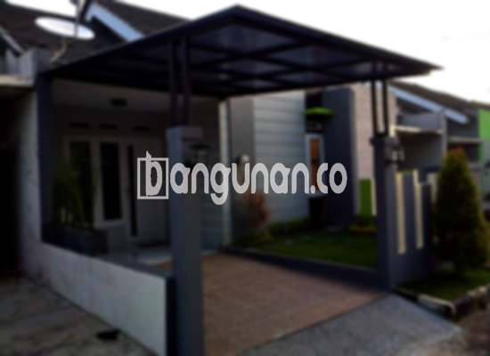

**Jasa Pasang Kanopi Rumah Minimalis di Glodok Jakarta** – Memiliki area luar ruangan yang terlindungi dari cuaca ekstrem adalah impian setiap pemilik rumah. Mitra Bangunan di Glodok Jakarta tidak perlu lagi khawatir mencari solusi yang tepat untuk melindungi teras, garasi, atau area parkir. Kami menyediakan layanan pembuatan dan pemasangan kanopi berkualitas tinggi dengan harga terjangkau, disesuaikan dengan kebutuhan dan anggaran Anda.

Kanopi bukan hanya sekadar pelindung dari panas dan hujan; ia juga dapat meningkatkan estetika rumah Anda. Dengan berbagai pilihan desain dan material, kami akan membantu Anda menciptakan kanopi yang sempurna untuk melengkapi gaya arsitektur rumah Anda di Glodok Jakarta.



## Keunggulan Memilih Jasa Pasang Kanopi Rumah Minimalis di Glodok Jakarta

Bagi Anda yang mempertimbangkan untuk memasang kanopi di rumah, berikut adalah beberapa keuntungan yang dapat Anda rasakan:

### – Pilihan Model Kanopi yang Beragam

Kami menawarkan berbagai macam model kanopi untuk memenuhi selera dan kebutuhan Anda. Anda dapat memilih dari berbagai desain, seperti persegi, persegi panjang, atau bentuk khusus sesuai dengan preferensi Anda. Dengan banyaknya pilihan yang tersedia, Anda pasti akan menemukan kanopi yang sesuai dengan gaya rumah Anda di Glodok Jakarta.

### – Material Ramah Lingkungan untuk Kanopi Rumah Minimalis

Kami menggunakan bahan-bahan berkualitas tinggi yang ramah lingkungan dalam pembuatan kanopi. Hal ini memastikan bahwa kanopi Anda tidak hanya tahan lama tetapi juga berkontribusi pada lingkungan yang lebih sehat. Kanopi kami juga mudah dibersihkan, sehingga Anda tidak perlu khawatir tentang perawatan yang rumit.

### – Kanopi yang Awet dan Kokoh untuk Investasi Jangka Panjang

Salah satu keunggulan utama kanopi yang kami pasang adalah daya tahannya. Kami hanya menggunakan material yang teruji kualitasnya, sehingga kanopi Anda dapat bertahan selama bertahun-tahun bahkan puluhan tahun dengan perawatan yang tepat. Investasi ini akan memberikan perlindungan yang berkelanjutan untuk rumah Anda.

Anda akan merasakan manfaatnya secara langsung, karena kanopi kami dirancang untuk tahan terhadap berbagai kondisi cuaca di Glodok Jakarta.

### – Keamanan yang Terjamin dengan Kanopi Rumah Minimalis

Kanopi yang kami pasang memberikan perlindungan ekstra bagi area di bawahnya. Kanopi melindungi dari paparan sinar matahari langsung dan hujan deras, menciptakan lingkungan yang lebih nyaman dan aman bagi keluarga Anda. Dengan kanopi, Anda dapat menikmati waktu berkualitas di luar ruangan tanpa khawatir akan cuaca buruk.

### – Harga Kanopi Rumah Minimalis di Glodok Jakarta yang Kompetitif

Kami percaya bahwa kualitas tidak harus mahal. Itulah sebabnya kami menawarkan harga yang kompetitif untuk semua layanan pemasangan kanopi kami. Kami akan memberikan penawaran yang sesuai dengan anggaran Anda tanpa mengorbankan kualitas produk dan layanan.

## Informasi Harga dan Jasa Pemasangan Kanopi Rumah Minimalis di Glodok Jakarta



Banyak pemilik rumah di Glodok Jakarta yang kini menyadari pentingnya memiliki kanopi. Pemasangan kanopi dapat dilakukan di berbagai area, seperti garasi mobil, area parkir, atau bahkan sebagai penutup jendela. Fungsi kanopi sangat bervariasi, tergantung pada kebutuhan dan preferensi pemilik rumah.

Untuk mendapatkan informasi harga yang akurat sesuai dengan kebutuhan Anda, kami sarankan Anda untuk menghubungi tim kami. Kami akan memberikan estimasi biaya yang rinci dan transparan, tanpa biaya tersembunyi. 
<table class="table">
  <caption>Perbandingan Jenis Kanopi</caption>
  <thead>
    <tr><th>Jenis Kanopi</th><th>Material</th><th>Kelebihan</th><th>Kekurangan</th></tr>
  </thead>
  <tbody>
    <tr><td>Baja Ringan</td><td>Rangka Baja Ringan + Atap Spandek/Alderon</td><td>Ringan, Kuat, Harga Terjangkau</td><td>Kurang Cocok untuk Desain Rumit</td></tr>
    <tr><td>Galvalum</td><td>Rangka Baja Galvalum + Atap Spandek/Alderon</td><td>Tahan Karat, Kuat</td><td>Pilihan Desain Terbatas</td></tr>
    <tr><td>Kaca</td><td>Rangka Besi/Aluminium + Kaca Tempered</td><td>Estetis, Mewah</td><td>Lebih Mahal, Mudah Pecah</td></tr>
    <tr><td>Polycarbonate</td><td>Rangka Besi/Aluminium + Polycarbonate</td><td>Ringan, Tahan Benturan, Tahan UV</td><td>Harga Lebih Tinggi dari Spandek</td></tr>
  </tbody>
</table>

Kami menyediakan jasa pemasangan kanopi yang cepat, profesional, dan terpercaya. Tim kami terdiri dari tenaga ahli yang berpengalaman dan siap membantu Anda mewujudkan kanopi impian Anda.

**Ref by:**  [Kanopi Rumah Minimalis Glodok Jakarta](https://id.wikipedia.org/wiki/Kanopi)

Mitra Bangunan yang sedang mencari jasa pasang kanopi di Glodok Jakarta, jangan ragu untuk menghubungi kami melalui tombol WhatsApp atau Telepon yang tersedia di halaman ini. Kami siap memberikan konsultasi gratis dan membantu Anda menemukan solusi kanopi terbaik untuk rumah Anda.