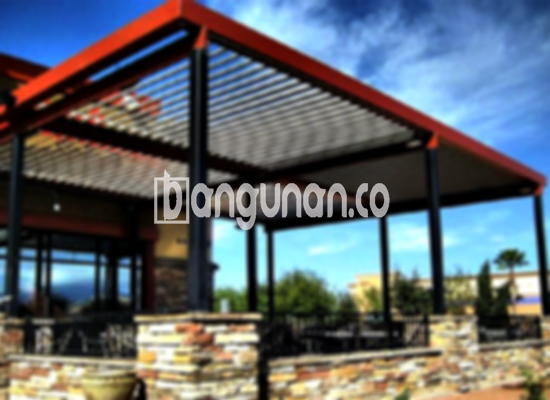

**Jasa Pasang Kanopi Rumah Minimalis di Gondangdia Jakarta** – Menciptakan perlindungan yang nyaman dan estetis untuk properti Anda adalah prioritas utama. Bagi Mitra Bangunan di Gondangdia Jakarta, kanopi menawarkan solusi ideal untuk melindungi teras, garasi, atau area outdoor dari cuaca ekstrem. Kami hadir sebagai penyedia jasa pemasangan kanopi berkualitas dengan harga terjangkau, membantu Anda mewujudkan hunian yang lebih nyaman dan fungsional.

Kanopi bukan sekadar atap pelindung; ia juga berperan penting dalam mempercantik tampilan rumah Anda. Dengan berbagai pilihan desain dan material, Anda dapat menemukan kanopi yang sesuai dengan gaya arsitektur dan preferensi pribadi.



## Keunggulan Menggunakan Jasa Pasang Kanopi Rumah Minimalis di Gondangdia Jakarta

Bagi Anda yang mempertimbangkan untuk memasang kanopi rumah, berikut beberapa manfaat signifikan yang dapat Anda peroleh:

### Model Kanopi yang Beragam

Pilihan model kanopi sangatlah beragam, memungkinkan Anda memilih desain yang paling sesuai dengan selera dan gaya arsitektur rumah Anda.  Kami menawarkan berbagai opsi, mulai dari model persegi, persegi panjang, hingga desain khusus sesuai permintaan Anda. Dengan begitu, Anda dapat menciptakan tampilan yang unik dan personal.

### Bahan Ramah Lingkungan

Kami hanya menggunakan bahan-bahan berkualitas tinggi yang aman dan ramah lingkungan. Dengan memilih kanopi dari kami, Anda turut berkontribusi dalam menjaga kelestarian alam. Selain itu, bahan-bahan ini juga mudah dibersihkan, sehingga perawatan kanopi menjadi lebih praktis.

### Daya Tahan dan Kekuatan Terjamin

Keunggulan utama lainnya adalah daya tahan dan kekuatan kanopi yang kami pasang. Material berkualitas yang kami gunakan memastikan kanopi mampu bertahan dalam berbagai kondisi cuaca dan memberikan perlindungan jangka panjang.  Anda dapat mengandalkan kanopi rumah untuk melindungi properti Anda selama bertahun-tahun.

Anda akan merasakan sendiri ketahanan kanopi kami, yang mampu bertahan hingga puluhan tahun dengan perawatan yang tepat. Hal ini akan memberikan nilai investasi yang optimal bagi properti Anda.

### Keamanan yang Optimal

Kanopi memberikan perlindungan ekstra bagi area di bawahnya, melindungi dari paparan langsung sinar matahari, hujan, dan elemen cuaca lainnya. Kondisi ini menciptakan lingkungan yang lebih aman dan nyaman untuk aktivitas di luar ruangan. Dengan kanopi, halaman depan rumah Anda akan terlindungi dengan baik.

### Harga Ekonomis di Gondangdia Jakarta

Kami memahami pentingnya anggaran dalam setiap proyek pembangunan. Oleh karena itu, kami menawarkan solusi kanopi rumah dengan harga yang kompetitif dan ekonomis.  Kami percaya bahwa setiap properti berhak mendapatkan perlindungan berkualitas tanpa harus menguras kantong Anda.

## Harga dan Jasa Pemasangan Kanopi Rumah Minimalis di Gondangdia Jakarta



Banyak pemilik rumah di Gondangdia Jakarta yang kini memilih untuk memasang kanopi sebagai pelengkap properti mereka. Penerapan kanopi dapat ditemukan pada berbagai area seperti garasi mobil, area parkir, atau sebagai penutup jendela. Pemilihan jenis kanopi disesuaikan dengan kebutuhan dan fungsi yang diinginkan.

Untuk mendapatkan informasi lebih lanjut mengenai harga dan biaya pemasangan kanopi rumah di Gondangdia Jakarta, silakan merujuk ke tabel harga di bawah ini, atau jangan ragu untuk menghubungi tim kami.

**Ref by:**  [Kanopi Rumah Minimalis Gondangdia Jakarta](https://id.wikipedia.org/wiki/Kanopi)

Dengan pengalaman dan dedikasi kami, Kami siap membantu Anda mewujudkan kanopi impian Anda di Gondangdia Jakarta. Jangan tunda lagi, segera hubungi kami melalui tombol WhatsApp atau Telepon yang tersedia di halaman ini.  Mitra Bangunan akan mendapatkan solusi kanopi yang tepat, berkualitas, dan terjangkau.