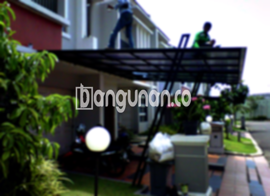

**Jasa Pasang Kanopi Rumah Minimalis di Gresik** – Mitra Bangunan yang berencana meningkatkan kenyamanan dan estetika rumah di Gresik, kanopi adalah solusi tepat untuk melindungi area luar rumah dari cuaca ekstrem. Kanopi tidak hanya memberikan perlindungan dari hujan dan terik matahari, tetapi juga menambah nilai visual pada bangunan Anda. Kami hadir sebagai penyedia jasa pemasangan kanopi rumah minimalis di Gresik dengan harga terjangkau dan kualitas terjamin.

Bagi Anda yang mencari solusi praktis dan efisien untuk melindungi teras, garasi, atau area terbuka lainnya, kanopi adalah pilihan cerdas. Dengan berbagai model dan material yang tersedia, Anda dapat menyesuaikan kanopi dengan gaya arsitektur rumah dan kebutuhan spesifik Anda.



## Keunggulan Menggunakan Jasa Pasang Kanopi Rumah Minimalis di Gresik

Memilih jasa pemasangan kanopi rumah minimalis di Gresik memberikan sejumlah manfaat signifikan bagi properti Anda. Berikut beberapa keunggulan yang bisa Anda nikmati:

### \- Pilihan Model Kanopi yang Beragam

Kami menawarkan beragam model kanopi rumah yang bisa Anda pilih sesuai selera dan kebutuhan. Setiap orang memiliki preferensi desain yang unik, dan kami siap mewujudkannya. Anda dapat memilih model persegi, persegi panjang, atau desain khusus lainnya yang sesuai dengan gaya rumah Anda.

### \- Material Ramah Lingkungan

Kanopi yang kami gunakan terbuat dari material berkualitas yang aman dan ramah lingkungan. Hal ini memastikan tidak ada dampak negatif bagi kesehatan Anda dan lingkungan sekitar. Selain itu, material yang digunakan juga mudah dibersihkan, sehingga perawatan kanopi menjadi lebih praktis.

### \- Konstruksi Kuat dan Tahan Lama

Salah satu keunggulan utama kanopi kami adalah kekuatannya. Kami menggunakan bahan-bahan berkualitas tinggi yang tahan terhadap cuaca ekstrem dan korosi. Kanopi yang kami pasang dapat bertahan selama bertahun-tahun dengan perawatan yang tepat, menjadikannya investasi jangka panjang yang cerdas.

Anda dapat mengandalkan kanopi kami untuk memberikan perlindungan maksimal selama puluhan tahun. Keawetan ini bergantung pada perawatan yang rutin, namun dengan perawatan yang baik, kanopi Anda akan tetap kokoh dan berfungsi optimal.

### \- Keamanan Terjamin

Kanopi yang terpasang dengan benar memberikan keamanan tambahan bagi area di bawahnya. Kanopi melindungi dari paparan langsung sinar matahari dan hujan, menciptakan lingkungan yang lebih nyaman dan aman. Hal ini sangat penting untuk area seperti teras, garasi, atau area bermain anak-anak.

Dengan kanopi, Anda dapat menikmati area luar rumah Anda tanpa khawatir akan cuaca yang tidak menentu. Keamanan yang terjamin akan memberikan ketenangan pikiran bagi Anda dan keluarga.

### \- Harga Kompetitif

Kami menawarkan harga yang kompetitif untuk jasa pemasangan kanopi rumah minimalis di Gresik. Meskipun kami mengutamakan kualitas, kami juga memahami pentingnya anggaran yang terjangkau. Kami berusaha memberikan penawaran terbaik tanpa mengorbankan mutu produk dan layanan.

## Informasi Harga dan Jasa Pemasangan Kanopi Rumah Minimalis di Gresik



Banyak warga Gresik yang telah merasakan manfaat memasang kanopi di rumah mereka. Kanopi dapat digunakan untuk berbagai keperluan, seperti melindungi garasi mobil, area parkir, atau sebagai penutup jendela. Pilihan penggunaan kanopi sepenuhnya bergantung pada kebutuhan spesifik Anda. 

Untuk informasi harga yang lebih detail, silakan lihat tabel harga yang tersedia **Ref by:**  [Kanopi Rumah Minimalis Gresik](https://id.wikipedia.org/wiki/Kanopi) atau hubungi tim kami untuk mendapatkan penawaran khusus. Harga kanopi dapat bervariasi tergantung pada jenis material, ukuran, dan kompleksitas desain.

Ada berbagai jenis kanopi yang tersedia, masing-masing dengan kualitas dan harga yang berbeda. Ukuran kanopi juga mempengaruhi harga, semakin besar luas area yang perlu ditutupi, semakin tinggi biayanya. Pastikan Anda memilih ukuran yang tepat sesuai kebutuhan Anda.

Bagi Anda yang ingin memasang kanopi dengan cepat dan efisien, kami siap membantu. Tim profesional kami akan memastikan pemasangan kanopi dilakukan dengan tepat dan rapi, sehingga Anda dapat segera menikmati manfaatnya.

Itulah informasi mengenai jasa pasang kanopi rumah minimalis di Gresik. Mitra Bangunan yang ingin mendapatkan layanan terbaik dan harga yang sesuai, jangan ragu untuk menghubungi kami melalui tombol WhatsApp atau Telepon di halaman ini. Kami siap membantu Anda menciptakan hunian yang nyaman dan terlindungi.