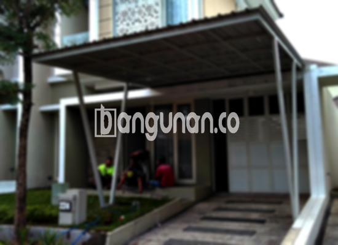

**Jasa Pasang Kanopi Rumah Minimalis di Grogol Jakarta** – Bagi Mitra Bangunan di Grogol Jakarta, keberadaan kanopi seringkali menjadi pertimbangan penting dalam meningkatkan kenyamanan dan estetika hunian. Kanopi berperan sebagai pelindung optimal dari berbagai kondisi cuaca, seperti sengatan matahari yang terik dan guyuran hujan yang deras, sekaligus menambah nilai visual pada properti Anda. Kami hadir sebagai solusi terpercaya dengan menyediakan layanan pemasangan kanopi yang berkualitas dan sesuai dengan anggaran Anda.

Dengan pengalaman bertahun-tahun di bidang ini, kami berkomitmen untuk memberikan hasil yang memuaskan bagi setiap pelanggan. Tim profesional kami siap membantu Anda memilih desain dan material kanopi yang paling tepat untuk rumah Anda. 



## Keunggulan Menggunakan Jasa Pasang Kanopi Rumah Minimalis di Grogol Jakarta

Jika Anda mempertimbangkan untuk memasang kanopi, ada beberapa keuntungan signifikan yang bisa Anda dapatkan melalui layanan kami. Berikut adalah beberapa keunggulannya:

### \- Banyak Pilihan Model dari Jasa Pasang Kanopi Rumah Minimalis di Grogol Jakarta

Kami menawarkan beragam pilihan model kanopi untuk memenuhi selera dan kebutuhan Anda. Anda dapat memilih dari berbagai bentuk, seperti kanopi datar, lengkung, atau dengan desain khusus sesuai keinginan. Setiap model dirancang untuk memberikan tampilan yang menarik dan fungsional bagi properti Anda.

### \- Material Ramah Lingkungan dari Jasa Pasang Kanopi Rumah Minimalis di Grogol Jakarta

Dalam setiap pemasangan kanopi, kami mengutamakan penggunaan material yang ramah lingkungan. Bahan-bahan yang kami gunakan tidak hanya berkualitas tinggi, namun juga aman bagi lingkungan sekitar Anda. Dengan memilih layanan kami, Anda turut berkontribusi dalam menjaga kelestarian alam. 

### \- Kanopi yang Awet dan Kokoh dari Jasa Pasang Kanopi Rumah Minimalis di Grogol Jakarta

Kanopi yang kami pasang dibuat dengan material yang tahan lama dan kokoh. Material berkualitas tinggi yang kami gunakan, seperti baja ringan dan polycarbonate, mampu menahan berbagai kondisi cuaca ekstrem. Dengan perawatan yang tepat, kanopi ini dapat bertahan selama bertahun-tahun.

Anda dapat mempercayakan kekuatan dan daya tahan kanopi kami. Investasi ini akan memberikan perlindungan jangka panjang untuk rumah Anda.

### \- Keamanan yang Terjamin dari Jasa Pasang Kanopi Rumah Minimalis di Grogol Jakarta

Keamanan adalah aspek penting yang kami perhatikan. Kanopi yang kami pasang memberikan perlindungan optimal terhadap berbagai elemen cuaca, menciptakan lingkungan yang aman dan nyaman di bawahnya. Anda dapat merasa tenang dan terlindungi dari panas matahari, hujan deras, atau bahkan puing-puing yang jatuh.

### \- Harga yang Bersaing untuk Kanopi Rumah Minimalis di Grogol Jakarta

Kami memahami pentingnya anggaran dalam setiap proyek pembangunan. Oleh karena itu, kami menawarkan harga yang kompetitif dan terjangkau untuk semua layanan pemasangan kanopi. Anda dapat menikmati kualitas terbaik tanpa harus mengorbankan anggaran Anda.

## Harga dan Jasa Pemasangan Kanopi Rumah Minimalis di Grogol Jakarta



Banyak warga Grogol Jakarta yang telah merasakan manfaat memiliki kanopi di rumah mereka. Kanopi sering digunakan untuk melindungi teras, garasi, atau area parkir kendaraan. Kebutuhan penggunaan kanopi bervariasi, tergantung pada preferensi dan gaya hidup masing-masing individu.

Untuk memahami kisaran biaya pemasangan kanopi rumah, penting untuk mempertimbangkan beberapa faktor. Harga dapat bervariasi tergantung pada jenis material yang dipilih, ukuran kanopi, dan tingkat kesulitan pemasangan. Kami sarankan Anda untuk menghubungi tim kami untuk mendapatkan estimasi harga yang paling akurat.

Selain faktor-faktor di atas, luas area yang akan ditutupi oleh kanopi juga memengaruhi biaya total. Semakin luas area tersebut, semakin besar pula biaya yang Anda butuhkan. Kami akan membantu Anda menghitung kebutuhan material dan biaya yang diperlukan berdasarkan dimensi area yang diinginkan.

Untuk memastikan proses pemasangan berjalan lancar dan efisien, kami merekomendasikan penggunaan jasa pemasangan kanopi profesional. Dengan menggunakan tenaga ahli yang berpengalaman, Anda dapat menghemat waktu dan menghindari kesalahan yang mungkin terjadi.

Dengan mempertimbangkan semua faktor tersebut, investasi dalam kanopi berkualitas di Grogol Jakarta adalah langkah cerdas untuk meningkatkan kenyamanan, keamanan, dan nilai properti Anda. Mitra Bangunan yang sedang mencari solusi kanopi terbaik, hubungi kami melalui tombol WhatsApp atau Telepon di halaman ini untuk konsultasi gratis. Kami siap membantu Anda mewujudkan kanopi impian Anda.

**Ref by:**  [Kanopi Rumah Minimalis Grogol Jakarta](https://id.wikipedia.org/wiki/Kanopi)