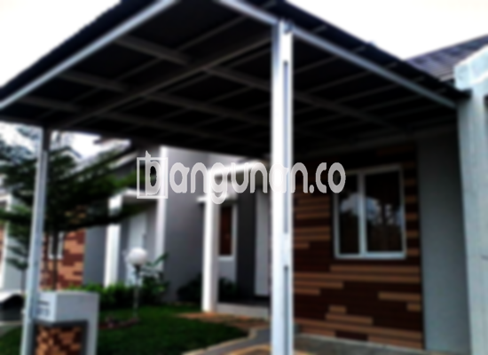

**Jasa Pasang Kanopi Rumah Minimalis di Guntur Jakarta** – Memiliki area luar ruangan yang terlindungi dari paparan cuaca adalah investasi berharga bagi setiap pemilik rumah. Jika Anda seorang Mitra Bangunan di Guntur Jakarta yang ingin meningkatkan kenyamanan dan fungsionalitas properti Anda, kanopi rumah minimalis adalah solusi ideal. Kami menyediakan layanan pemasangan kanopi berkualitas tinggi dengan harga terjangkau.

## Mengapa Memilih Jasa Pasang Kanopi Rumah Minimalis di Guntur Jakarta?

Bagi Anda yang sedang mempertimbangkan pemasangan kanopi untuk bangunan Anda, beberapa kelebihan signifikan dapat Anda peroleh dengan memilih layanan dari kami. Kami berkomitmen untuk memberikan solusi terbaik sesuai dengan kebutuhan spesifik Anda.

### \- Ragam Pilihan Model Kanopi yang Menarik

Salah satu faktor utama yang dipertimbangkan calon pembeli adalah variasi model yang tersedia. Kami menyediakan beragam pilihan model kanopi rumah yang dapat Anda sesuaikan dengan gaya arsitektur dan preferensi pribadi Anda. Pilihan bentuk seperti persegi, persegi panjang, atau desain khusus lainnya memungkinkan Anda menciptakan tampilan yang unik dan harmonis dengan rumah Anda.

### \- Material Berkualitas dan Ramah Lingkungan

Kami mengutamakan penggunaan material yang tidak hanya berkualitas tinggi tetapi juga ramah lingkungan. Material yang kami gunakan aman bagi kesehatan Anda dan tidak mencemari lingkungan sekitar. Selain itu, kanopi kami mudah dibersihkan dan dirawat, sehingga Anda dapat menghemat waktu dan tenaga.

### \- Konstruksi Kuat dan Tahan Lama

Nilai tambah utama dari layanan kami adalah kekuatan dan daya tahan kanopi yang kami pasang. Kami menggunakan bahan-bahan berkualitas yang dirancang untuk tahan terhadap berbagai kondisi cuaca ekstrem. Konstruksi yang kokoh memastikan kanopi Anda akan memberikan perlindungan optimal selama bertahun-tahun.

Anda dapat mengandalkan kanopi kami untuk melindungi properti Anda dari hujan deras, sinar matahari yang terik, dan angin kencang. Dengan perawatan yang tepat, kanopi Anda akan tetap berfungsi dengan baik selama bertahun-tahun.

### \- Keamanan dan Kenyamanan yang Terjamin

Keamanan dan kenyamanan Anda adalah prioritas utama kami. Kanopi yang kami pasang memberikan perlindungan ekstra bagi area di bawahnya, menciptakan ruang yang aman dan nyaman untuk bersantai, berkumpul bersama keluarga, atau menjalankan aktivitas lainnya.

Kanopi dapat menghalangi sinar matahari langsung dan hujan, sehingga Anda dapat menikmati ruang outdoor Anda tanpa terganggu oleh cuaca yang buruk. Keamanan yang terjamin akan memberikan ketenangan pikiran bagi Anda dan keluarga.

### \- Harga yang Terjangkau dan Bersaing

Kami memahami pentingnya anggaran dalam setiap proyek pembangunan. Oleh karena itu, kami menawarkan harga yang kompetitif dan terjangkau untuk jasa pemasangan kanopi rumah minimalis di Guntur Jakarta. Kami akan memberikan penawaran terbaik sesuai dengan kebutuhan dan anggaran Anda.

### \- Pemasangan Profesional dan Berpengalaman





Apakah Anda sudah mempertimbangkan untuk menambahkan kanopi pada rumah Anda? Banyak pemilik rumah di Guntur Jakarta yang telah menyadari manfaat signifikan dari pemasangan kanopi. Penggunaannya dapat bervariasi, mulai dari melindungi garasi mobil, menciptakan area parkir yang teduh, hingga menutupi jendela untuk mengurangi panas. Semua itu tergantung pada kebutuhan spesifik Anda.

Ada beberapa jenis kanopi yang dapat Anda pilih, termasuk:

*   **Kanopi Baja Ringan:** Menawarkan kombinasi ideal antara kekuatan, ringan, dan ketahanan terhadap karat.
*   **Kanopi Galvalum:** Tahan terhadap korosi dan memiliki umur pakai yang panjang, ideal untuk iklim tropis.
*   **Kanopi Kaca:** Memberikan tampilan modern dan elegan, cocok untuk rumah dengan desain kontemporer.
*   **Kanopi Polycarbonate:** Tahan terhadap benturan dan memiliki kemampuan untuk menyaring sinar matahari, menciptakan lingkungan yang lebih nyaman.

Kami akan membantu Anda memilih jenis kanopi yang paling sesuai dengan kebutuhan dan anggaran Anda.

**Ref by:**  [Kanopi Rumah Minimalis Guntur Jakarta](https://id.wikipedia.org/wiki/Kanopi)

Bagi Mitra Bangunan di Guntur Jakarta yang sedang mencari jasa pemasangan kanopi rumah minimalis terpercaya, jangan ragu untuk menghubungi kami melalui tombol WhatsApp atau Telepon yang tertera di halaman ini. Tim kami akan dengan senang hati memberikan konsultasi gratis dan membantu Anda menemukan solusi kanopi yang tepat untuk rumah Anda.