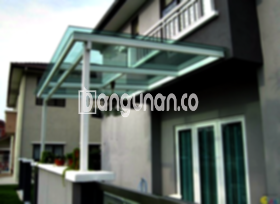

**Jasa Pasang Kanopi Rumah Minimalis di Gunung Batu Bogor** – Memiliki area luar rumah yang nyaman dan terlindungi adalah impian setiap pemilik rumah di Gunung Batu Bogor. Kanopi hadir sebagai solusi praktis untuk menjaga teras, garasi, atau area outdoor lainnya dari panas matahari dan hujan. Mitra Bangunan di Gunung Batu Bogor tidak perlu lagi khawatir mencari solusi perlindungan yang tepat untuk hunian tercinta. Kami menyediakan jasa pemasangan kanopi rumah minimalis dengan kualitas terjamin dan harga yang bersaing.

Memilih kanopi yang tepat dapat meningkatkan estetika rumah Anda sekaligus memberikan kenyamanan maksimal. Banyak sekali model kanopi yang tersedia, dan penting untuk memilih yang sesuai dengan kebutuhan dan gaya arsitektur rumah Anda. Kami siap membantu Anda menemukan pilihan yang paling ideal.



## Keunggulan Memilih Jasa Pasang Kanopi Rumah Minimalis di Gunung Batu Bogor

Keputusan untuk menggunakan jasa pemasangan kanopi profesional menawarkan sejumlah keuntungan signifikan bagi Anda. Berikut adalah beberapa di antaranya:

### \- Pilihan Model Kanopi yang Beragam

Kami menyediakan berbagai model kanopi rumah yang dapat Anda pilih sesuai selera dan kebutuhan. Baik Anda menginginkan kanopi persegi, persegi panjang, atau desain khusus, tim kami siap mewujudkannya. Anda dapat menyesuaikan desain kanopi agar harmonis dengan gaya arsitektur rumah Anda.

### \- Bahan Berkualitas dan Ramah Lingkungan

Kami hanya menggunakan bahan-bahan berkualitas tinggi yang ramah lingkungan. Hal ini memastikan kanopi yang Anda gunakan tidak hanya tahan lama tetapi juga aman bagi kesehatan Anda dan lingkungan sekitar. Selain itu, bahan-bahan yang kami gunakan mudah dibersihkan dan dirawat.

### \- Ketahanan dan Kekuatan Terjamin

Kanopi yang kami pasang dirancang untuk tahan lama dan kuat. Dengan menggunakan material berkualitas dan teknik pemasangan yang tepat, kanopi Anda akan mampu menahan cuaca ekstrem dan memberikan perlindungan optimal selama bertahun-tahun. Perawatan yang rutin juga akan membantu memperpanjang umur kanopi Anda.

### \- Keamanan dan Kenyamanan Pengguna

Kanopi yang kami pasang memberikan perlindungan ekstra terhadap area di bawahnya. Anda dapat menikmati waktu di teras atau garasi tanpa khawatir terpapar sinar matahari langsung atau hujan. Keamanan dan kenyamanan Anda adalah prioritas utama kami.

### \- Solusi Ekonomis untuk Kebutuhan Anda

Kami menawarkan solusi kanopi dengan harga yang kompetitif. Meskipun demikian, kami tidak berkompromi soal kualitas. Anda akan mendapatkan kanopi berkualitas tinggi dengan harga yang sesuai dengan anggaran Anda.

## Harga dan Jasa Pemasangan Kanopi Rumah Minimalis di Gunung Batu Bogor

Apakah Anda sedang mempertimbangkan untuk memasang kanopi di rumah Anda? Banyak pemilik rumah di Gunung Batu Bogor yang telah merasakan manfaatnya, baik untuk melindungi garasi mobil, area parkir, atau sebagai penutup jendela. Pilihan penggunaan kanopi sangat bergantung pada kebutuhan spesifik Anda.



Untuk informasi rinci mengenai harga dan penawaran terbaik, silakan hubungi tim kami. Kami akan dengan senang hati memberikan konsultasi gratis dan membantu Anda menemukan solusi kanopi yang paling sesuai dengan kebutuhan dan anggaran Anda. Kami mengutamakan transparansi harga dan tidak ada biaya tersembunyi.

Bagi Anda yang ingin pemasangan kanopi yang cepat dan efisien, menggunakan jasa pemasangan profesional seperti kami adalah pilihan yang tepat. Kami memiliki tim yang berpengalaman dan peralatan yang lengkap untuk menyelesaikan pekerjaan dengan rapi dan tepat waktu.

**Ref by:**  [Kanopi Rumah Minimalis Gunung Batu Bogor](https://id.wikipedia.org/wiki/Kanopi)

Dengan layanan **Jasa Pasang Kanopi Rumah Minimalis di Gunung Batu Bogor** dari kami, Anda tidak perlu lagi khawatir tentang kualitas, keamanan, dan estetika. Mitra Bangunan siap mewujudkan hunian yang nyaman dan terlindungi untuk Anda. Jangan ragu untuk menghubungi kami melalui tombol WhatsApp atau Telepon di halaman ini untuk mendapatkan penawaran terbaik dan konsultasi gratis. Kami siap melayani Anda dengan sepenuh hati! [Jasa Pasang Kanopi Rumah Minimalis di Babakan Bogor](/jasa-pasang-kanopi-rumah-minimalis-di-babakan-bogor/) dapat menjadi referensi tambahan untuk Anda.