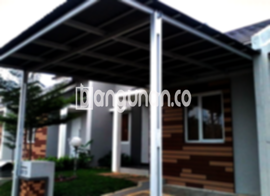

**Jasa Pasang Kanopi Rumah Minimalis di Gunung Putri** – Memiliki area luar rumah yang nyaman dan terlindungi adalah dambaan setiap pemilik rumah. Mitra Bangunan di Gunung Putri kini dapat mewujudkannya dengan mudah melalui layanan pemasangan kanopi rumah minimalis yang kami tawarkan. Kanopi tidak hanya berfungsi sebagai pelindung dari cuaca ekstrem, tetapi juga meningkatkan estetika hunian Anda. Kami menyediakan solusi atap yang tepat untuk kebutuhan Anda.

Untuk menciptakan kenyamanan di kediaman Anda, Anda dapat memilih berbagai model kanopi yang tersedia di pasaran atau memesan desain sesuai keinginan. Tersedia beragam pilihan kanopi rumah yang bisa Anda sesuaikan dengan selera dan kebutuhan. Setiap jenis kanopi menawarkan kelebihan unik, baik dari segi material, kualitas, maupun harga. Penting untuk memastikan Anda memilih kanopi yang paling sesuai dengan preferensi dan anggaran Anda.



## Keunggulan Menggunakan Jasa Pasang Kanopi Rumah Minimalis di Gunung Putri

Bagi Anda yang mempertimbangkan untuk memasang kanopi di rumah, terdapat sejumlah keuntungan yang bisa Anda rasakan:

### \- Variasi Model yang Luas dari Jasa Pasang Kanopi Rumah Minimalis di Gunung Putri

Pemilihan model merupakan aspek penting dalam membeli kanopi. Kami menawarkan beragam jenis kanopi rumah yang dapat Anda pilih sesuai selera pribadi. Anda dapat menemukan desain yang sesuai dengan gaya hunian Anda, mulai dari bentuk persegi, persegi panjang, hingga desain khusus lainnya.

### \- Material Ramah Lingkungan dari Jasa Pasang Kanopi Rumah Minimalis di Gunung Putri

Kanopi yang kami gunakan terbuat dari bahan-bahan yang aman dan ramah lingkungan. Hal ini tidak hanya menjaga kesehatan Anda dan keluarga, tetapi juga berkontribusi pada kelestarian lingkungan. Selain itu, material yang digunakan mudah dibersihkan dan dirawat.

### \- Ketahanan dan Kekuatan Jasa Pasang Kanopi Rumah Minimalis di Gunung Putri

Keunggulan utama yang kami tawarkan adalah ketahanan dan kekuatan produk. Kanopi kami dibuat dari material berkualitas tinggi yang mampu bertahan terhadap berbagai kondisi cuaca. Dengan perawatan yang tepat, kanopi Anda dapat bertahan selama bertahun-tahun.

Anda dapat membuktikan sendiri kualitas kanopi kami. Material yang kuat dan tahan lama memastikan investasi Anda memberikan manfaat jangka panjang. Perawatan rutin akan semakin memperpanjang umur pakai kanopi Anda.

### \- Keamanan Terjamin dari Jasa Pasang Kanopi Rumah Minimalis di Gunung Putri

Keamanan merupakan prioritas utama kami. Kanopi yang terpasang dengan benar dapat melindungi area di bawahnya dari bahaya seperti paparan sinar matahari langsung dan hujan deras. Dengan demikian, Anda dan keluarga dapat merasa aman dan nyaman saat beraktivitas di luar ruangan.

Kanopi melindungi teras, garasi, atau area parkir Anda dari elemen cuaca. Perlindungan yang terjamin memberikan rasa nyaman dan aman.

### \- Harga Kompetitif Kanopi Rumah Minimalis di Gunung Putri

Selain kualitas, kami juga menawarkan harga yang bersaing. Harga kanopi rumah minimalis di Gunung Putri bervariasi tergantung pada jenis material, ukuran, dan kompleksitas desain. Kami berkomitmen untuk memberikan penawaran terbaik sesuai dengan anggaran Anda.

## Harga dan Jasa Pemasangan Kanopi Rumah Minimalis di Gunung Putri



Banyak pemilik rumah di Gunung Putri yang telah merasakan manfaat memiliki kanopi. Pemanfaatannya beragam, mulai dari melindungi garasi mobil, area parkir, hingga sebagai pelindung jendela. Pilihan penggunaan sepenuhnya tergantung pada kebutuhan dan preferensi Anda. 

Untuk informasi harga yang lebih detail dan sesuai dengan spesifikasi yang Anda inginkan, silakan hubungi tim kami. Kami akan dengan senang hati memberikan konsultasi serta penawaran harga terbaik.

Bagi Anda yang berencana memasang kanopi di rumah, kami sarankan menggunakan jasa pemasangan profesional. Dengan bantuan tenaga ahli, proses pemasangan akan berjalan lebih cepat, efisien, dan terjamin kualitasnya. Anda dapat segera menikmati manfaat kanopi tersebut dengan tenang.

Demikianlah informasi mengenai jasa pasang kanopi rumah minimalis di Gunung Putri yang dapat kami sampaikan. Mitra Bangunan siap membantu Anda mewujudkan hunian yang nyaman dan terlindungi! Jangan ragu untuk menghubungi kami melalui tombol WhatsApp atau Telepon di halaman ini untuk konsultasi dan pemesanan. 

**Ref by:**  [Kanopi Rumah Minimalis Gunung Putri](https://id.wikipedia.org/wiki/Kanopi)