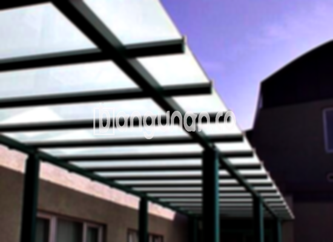

**Jasa Pasang Kanopi Rumah Minimalis di Gunung Sindur** – Mitra Bangunan yang ingin memiliki area luar ruangan yang nyaman dan terlindungi di Gunung Sindur? Kanopi adalah solusi ideal untuk melindungi teras, garasi, atau halaman depan rumah dari berbagai cuaca. Kami menyediakan layanan pemasangan kanopi rumah minimalis dengan beragam pilihan material dan desain yang sesuai dengan kebutuhan dan anggaran Anda.

Memilih kanopi yang tepat bukan hanya soal estetika, tetapi juga fungsi dan ketahanan. Dengan kanopi berkualitas, Anda bisa menikmati ruang luar tanpa khawatir terganggu oleh panas matahari atau hujan. Kami hadir untuk membantu Anda menemukan kanopi yang sempurna untuk rumah Anda di Gunung Sindur.



## Keunggulan Menggunakan Jasa Pasang Kanopi Rumah Minimalis di Gunung Sindur

Bagi Anda yang mempertimbangkan pemasangan kanopi untuk rumah atau bisnis, ada beberapa keunggulan yang perlu Anda ketahui.

### \- Pilihan Model Kanopi yang Beragam

Kami menawarkan beragam model kanopi yang dapat Anda sesuaikan dengan gaya arsitektur rumah Anda. Setiap orang memiliki preferensi desain yang berbeda, dan kami siap mewujudkannya. Anda bisa memilih model persegi, persegi panjang, atau bahkan desain custom sesuai keinginan.

### \- Material Ramah Lingkungan

Kanopi yang kami gunakan terbuat dari material yang tidak berbahaya dan ramah lingkungan. Hal ini menjadikannya pilihan yang bertanggung jawab bagi Anda dan lingkungan sekitar. Selain itu, material yang kami gunakan mudah dibersihkan dan dirawat.

### \- Daya Tahan dan Kekuatan Teruji

Salah satu keunggulan utama kanopi yang kami pasang adalah daya tahan dan kekuatannya. Kami hanya menggunakan material berkualitas tinggi yang mampu menahan berbagai kondisi cuaca ekstrem. Anda dapat mengandalkan kanopi kami untuk bertahan selama bertahun-tahun.

Anda akan merasakan sendiri bagaimana kanopi rumah dapat memberikan perlindungan yang andal, bahkan dalam jangka waktu yang lama. Perawatan yang tepat akan semakin memperpanjang usia pakainya.

### \- Keamanan yang Terjamin

Keamanan adalah prioritas utama kami. Kanopi yang kami pasang memberikan perlindungan optimal terhadap berbagai elemen cuaca seperti hujan dan sinar matahari yang berlebihan. Hal ini menciptakan lingkungan yang lebih nyaman dan aman di area luar ruangan Anda.

Dengan perlindungan yang terjamin, Anda dapat menikmati waktu di teras atau garasi tanpa khawatir terganggu oleh cuaca buruk.

### \- Harga yang Kompetitif

Kami memahami bahwa anggaran adalah pertimbangan penting bagi setiap pelanggan. Oleh karena itu, kami menawarkan harga yang kompetitif dan terjangkau untuk semua layanan pemasangan kanopi di Gunung Sindur.

## Harga dan Jasa Pemasangan Kanopi Rumah Minimalis di Gunung Sindur



Banyak pemilik rumah di Gunung Sindur yang telah merasakan manfaat dari pemasangan kanopi. Kanopi dapat digunakan untuk berbagai keperluan, seperti melindungi kendaraan di garasi, menciptakan area bersantai di teras, atau sebagai penutup jendela.

Untuk mengetahui lebih lanjut tentang perkiraan biaya, Anda dapat merujuk pada informasi tersedia. Harga kanopi rumah bervariasi tergantung pada jenis material, ukuran, dan kompleksitas desain. Kami akan memberikan penawaran harga yang disesuaikan dengan kebutuhan spesifik Anda.

Selain harga, pertimbangkan juga kualitas material dan keahlian pemasang. Kanopi yang berkualitas dan dipasang dengan benar akan memberikan manfaat jangka panjang. Dengan menggunakan jasa pemasangan profesional, Anda dapat memastikan bahwa kanopi Anda terpasang dengan aman dan tahan lama.

Jangan ragu untuk menghubungi tim kami untuk konsultasi gratis dan penawaran harga terbaik. Kami siap membantu Anda mewujudkan area luar ruangan impian Anda di Gunung Sindur.

**Ref by:**  [Kanopi Rumah Minimalis Gunung Sindur](https://id.wikipedia.org/wiki/Kanopi)

Mitra Bangunan yang sedang mencari jasa pasang kanopi di Gunung Sindur, jangan tunda lagi! Hubungi kami melalui tombol WhatsApp atau Telepon yang tersedia di halaman ini, dan kami siap memberikan solusi terbaik untuk kebutuhan Anda. Kami akan dengan senang hati membantu Anda memilih kanopi yang tepat dan memberikan layanan pemasangan yang profesional.