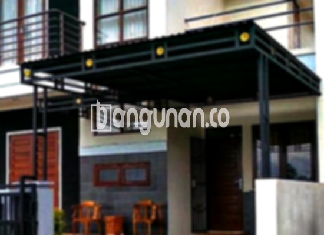

**Jasa Pasang Kanopi Rumah Minimalis di Gunungkaler Tangerang** – Memiliki area luar rumah yang nyaman dan terlindungi adalah dambaan setiap pemilik hunian. Kanopi hadir sebagai solusi ideal untuk melindungi teras, garasi, atau area lain dari paparan cuaca ekstrem. Mitra Bangunan di Gunungkaler Tangerang menyediakan jasa pemasangan kanopi yang berkualitas dan terjangkau untuk memenuhi kebutuhan Anda.

Kanopi tidak hanya berfungsi sebagai pelindung, tetapi juga berperan penting dalam meningkatkan estetika rumah Anda. Dengan desain yang tepat, kanopi dapat menyatu harmonis dengan gaya arsitektur rumah, menciptakan tampilan yang lebih menarik dan modern. 



## Keunggulan Memilih Jasa Pasang Kanopi Rumah Minimalis di Gunungkaler Tangerang

Menggunakan jasa profesional untuk pemasangan kanopi menawarkan sejumlah keuntungan signifikan bagi Anda. Berikut beberapa di antaranya:

### \- Pilihan Model Kanopi yang Beragam

Kami menawarkan beragam model kanopi yang dapat Anda pilih sesuai dengan preferensi dan kebutuhan Anda. Anda dapat menemukan kanopi dengan desain persegi, persegi panjang, atau bentuk lain yang sesuai dengan gaya rumah Anda. Setiap model memiliki keunikan tersendiri untuk melengkapi tampilan fasad rumah Anda.

### \- Material Ramah Lingkungan dan Berkualitas

Kami hanya menggunakan material yang ramah lingkungan dan berkualitas tinggi dalam pembuatan kanopi. Hal ini memastikan kanopi Anda tidak hanya tahan lama, tetapi juga aman bagi kesehatan Anda dan keluarga. Material yang ringan juga memudahkan proses pemasangan dan perawatan.

### \- Konstruksi Kanopi yang Awet dan Kokoh

Salah satu keunggulan utama kanopi yang kami pasang adalah ketahanannya. Kami menggunakan bahan-bahan berkualitas yang dirancang untuk menahan cuaca ekstrem dan tekanan fisik. Dengan perawatan yang tepat, kanopi Anda dapat bertahan selama bertahun-tahun tanpa kehilangan kualitasnya.

Anda dapat mengandalkan kekuatan dan keawetan kanopi kami untuk melindungi properti Anda dari berbagai kondisi cuaca yang tidak terduga. 

### \- Sistem Keamanan yang Terjamin

Keamanan adalah prioritas utama kami. Kanopi yang kami pasang dirancang dengan konstruksi yang kokoh dan stabil, sehingga dapat memberikan perlindungan maksimal bagi area di bawahnya. Anda dapat merasa tenang mengetahui bahwa kanopi Anda aman dan tidak akan roboh akibat angin kencang atau beban berat.

Kanopi kami juga dirancang untuk menghalangi paparan sinar matahari langsung dan hujan, menciptakan lingkungan yang lebih nyaman dan aman bagi Anda dan keluarga.

### \- Harga Kompetitif untuk Kanopi Rumah Minimalis di Gunungkaler Tangerang

Kami memahami pentingnya anggaran dalam setiap proyek pembangunan. Oleh karena itu, kami menawarkan harga yang kompetitif untuk jasa pemasangan kanopi rumah minimalis di Gunungkaler Tangerang. Harga yang kami tawarkan sebanding dengan kualitas material dan layanan yang kami berikan.

## Harga dan Jasa Pemasangan Kanopi Rumah Minimalis di Gunungkaler Tangerang



Banyak pemilik rumah di Gunungkaler Tangerang yang kini memanfaatkan kanopi untuk berbagai keperluan, mulai dari melindungi garasi mobil, area parkir, hingga menutupi jendela. Pilihan penggunaan kanopi sangat beragam, tergantung pada kebutuhan spesifik masing-masing pemilik rumah.

Untuk memberikan gambaran, harga kanopi rumah umumnya berkisar di Rp. 450.000 – Rp. 800.000 tergantung pada jenis materialnya. Untuk kanopi dengan kualitas yang lebih tinggi, harga tentu akan disesuaikan. Kami sarankan Anda untuk menghubungi tim kami untuk mendapatkan penawaran harga yang paling akurat sesuai dengan kebutuhan Anda. Harga akan dipengaruhi oleh beberapa faktor, seperti jenis bahan, ukuran, dan kompleksitas desain. Pastikan Anda memilih ukuran yang tepat sesuai dengan kebutuhan dan anggaran Anda, atau konsultasikan dengan kami.

Memilih jasa pemasangan kanopi yang profesional akan memastikan proses pemasangan berjalan lancar dan efisien. Dengan bantuan tenaga ahli, Anda dapat menghemat waktu dan tenaga, serta mendapatkan hasil yang optimal. 

**Ref by:**  [Kanopi Rumah Minimalis Gunungkaler Tangerang](https://id.wikipedia.org/wiki/Kanopi)

Mitra Bangunan siap membantu Anda mewujudkan area luar rumah yang nyaman dan terlindungi di Gunungkaler Tangerang. Jangan ragu untuk menghubungi kami melalui tombol WhatsApp atau Telepon di halaman ini untuk konsultasi gratis dan penawaran harga terbaik. Kami akan dengan senang hati membantu Anda memilih kanopi yang paling sesuai dengan kebutuhan dan anggaran Anda.