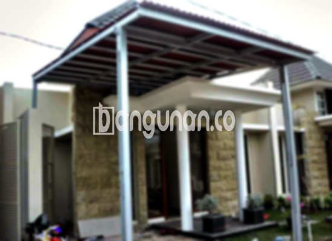

**Jasa Pasang Kanopi Rumah Minimalis di Halim Jakarta** – Memiliki area luar ruangan yang terlindungi dari cuaca ekstrem menjadi kebutuhan penting bagi Mitra Bangunan di Halim Jakarta. Kanopi adalah solusi ideal untuk melindungi teras, garasi, atau area parkir dari panas matahari dan hujan lebat. Kami hadir sebagai penyedia jasa pembuatan dan pemasangan kanopi berkualitas dengan harga terjangkau di Halim Jakarta dan sekitarnya.

Memilih kanopi yang tepat bukan hanya soal estetika, tetapi juga fungsi dan daya tahan. Dengan berbagai pilihan material dan desain, Anda dapat menemukan kanopi yang sesuai dengan gaya rumah dan kebutuhan anggaran Anda. Mari kita telaah lebih lanjut mengenai keunggulan dan opsi kanopi yang tersedia.



## Keunggulan Menggunakan Jasa Pasang Kanopi Rumah Minimalis di Halim Jakarta

Bagi Anda yang mempertimbangkan pemasangan kanopi, berikut adalah beberapa manfaat yang dapat Anda peroleh:

### \- Pilihan Model Kanopi yang Beragam

Kami menyediakan beragam model kanopi rumah untuk memenuhi preferensi estetika Anda. Baik Anda menginginkan desain sederhana atau yang lebih rumit, kami dapat menyesuaikannya. Setiap orang memiliki selera unik, dan kami berkomitmen untuk mewujudkan konsep kanopi yang Anda idamkan, mulai dari bentuk persegi hingga persegi panjang dan lainnya.

### \- Material Ramah Lingkungan

Kanopi yang kami gunakan dibuat dari material yang aman dan ramah lingkungan. Penggunaan material ini tidak hanya mendukung keberlanjutan lingkungan, tetapi juga memudahkan perawatan karena mudah dibersihkan dan tidak mudah kotor.

### \- Daya Tahan dan Kekuatan Terjamin

Salah satu keunggulan utama kanopi kami adalah daya tahan dan kekuatannya. Kami menggunakan material berkualitas tinggi yang tahan terhadap cuaca ekstrem dan korosi. Dengan perawatan yang tepat, kanopi rumah Anda dapat bertahan selama bertahun-tahun.

Anda dapat mengandalkan kanopi rumah kami untuk memberikan perlindungan yang stabil dan tahan lama. Investasi ini akan melindungi aset berharga Anda dan memberikan nilai tambah pada properti Anda.

### \- Keamanan yang Optimal

Kanopi kami dirancang untuk memberikan keamanan maksimal bagi area di bawahnya. Kanopi efektif menghalangi paparan langsung sinar matahari dan hujan, menciptakan ruang yang nyaman dan aman untuk bersantai atau beraktivitas. 

Dengan kanopi, Anda dapat menikmati area luar ruangan dengan tenang tanpa khawatir terpapar cuaca buruk. Keamanan yang terjamin adalah prioritas kami dalam setiap pemasangan.

### \- Harga Kompetitif untuk Kanopi Rumah Minimalis di Halim Jakarta

Kami memahami pentingnya anggaran dalam setiap proyek pembangunan. Oleh karena itu, kami menawarkan harga yang kompetitif untuk kanopi rumah minimalis di Halim Jakarta. Harga akan bervariasi tergantung pada jenis material, ukuran, dan kompleksitas desain yang Anda pilih. 

## Harga dan Jasa Pemasangan Kanopi Rumah Minimalis di Halim Jakarta



Banyak pemilik rumah di Halim Jakarta yang kini beralih menggunakan kanopi untuk meningkatkan kenyamanan dan estetika rumah mereka. Kanopi dapat diaplikasikan untuk berbagai keperluan, seperti melindungi garasi mobil, area parkir, atau sebagai penutup jendela. Kebutuhan spesifik Anda akan menentukan jenis kanopi yang paling sesuai.

Untuk mengetahui informasi harga lebih rinci, silakan merujuk ke tabel harga kami. Kami juga menawarkan konsultasi gratis untuk membantu Anda menentukan pilihan yang tepat dan mendapatkan penawaran terbaik.

Pemasangan kanopi dapat dilakukan secara mandiri, namun menggunakan jasa profesional akan memastikan hasil yang rapi, kuat, dan sesuai dengan standar keamanan. Tim kami terdiri dari tenaga ahli yang berpengalaman dan siap membantu Anda dalam proses pemasangan.

Dengan memilih jasa pemasangan kanopi profesional, Anda dapat menghemat waktu dan tenaga, serta memastikan bahwa kanopi terpasang dengan benar dan berfungsi optimal. 

**Ref by:**  [Kanopi Rumah Minimalis Halim Jakarta](https://id.wikipedia.org/wiki/Kanopi)

Bagi Mitra Bangunan di Halim Jakarta yang sedang mencari jasa pemasangan kanopi rumah minimalis, jangan ragu untuk menghubungi kami. Kami siap memberikan layanan terbaik dengan kualitas terjamin dan harga yang bersaing. Hubungi kami melalui tombol WhatsApp atau Telepon di halaman ini untuk konsultasi dan penawaran harga.