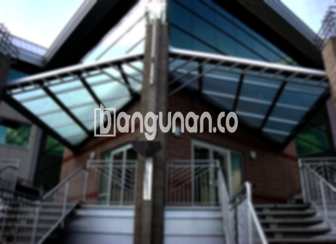

**Jasa Pasang Kanopi Rumah Minimalis di Harapan Mulya Jakarta** – Memiliki area luar ruangan yang teduh dan terlindungi adalah dambaan setiap pemilik rumah. Mitra Bangunan di Harapan Mulya Jakarta tidak perlu lagi khawatir tentang panasnya matahari atau guyuran hujan yang mengganggu aktivitas di teras, garasi, atau area parkir. Kami hadir sebagai solusi terpercaya untuk pembuatan dan pemasangan kanopi berkualitas dengan harga yang bersahabat.

Kanopi bukan hanya sekadar pelindung, melainkan juga elemen penting yang mempercantik tampilan fasad rumah Anda. Dengan memilih kanopi yang tepat, Anda dapat menciptakan ruang outdoor yang nyaman dan fungsional.



## Keunggulan Memilih Jasa Pasang Kanopi Rumah Minimalis di Harapan Mulya Jakarta

Bagi Anda yang berencana memasang kanopi untuk rumah atau tempat usaha di Harapan Mulya Jakarta, ada beberapa keunggulan yang bisa Anda dapatkan:

### \- Pilihan Model Kanopi yang Beragam

Kami menawarkan berbagai macam model kanopi rumah yang dapat Anda sesuaikan dengan gaya arsitektur dan preferensi estetika Anda. Setiap orang memiliki selera yang berbeda, dan kami siap mewujudkannya. Anda dapat memilih dari berbagai bentuk seperti persegi, persegi panjang, atau desain khusus sesuai permintaan.

### \- Bahan Kanopi Ramah Lingkungan

Kami berkomitmen untuk menggunakan bahan-bahan yang tidak berbahaya dan ramah lingkungan dalam pembuatan kanopi. Dengan memilih kanopi dari kami, Anda turut berkontribusi pada pelestarian lingkungan. Selain itu, bahan yang kami gunakan juga mudah dibersihkan dan dirawat.

### \- Kanopi Tahan Lama dan Kokoh

Salah satu keunggulan utama kanopi kami adalah ketahanannya terhadap cuaca ekstrem dan penggunaan jangka panjang. Kami menggunakan bahan berkualitas tinggi yang mampu menahan beban angin kencang, hujan deras, serta paparan sinar matahari langsung. Dengan perawatan yang tepat, kanopi Anda akan bertahan selama bertahun-tahun.

Anda dapat mengandalkan kekuatan dan daya tahan kanopi kami untuk melindungi aset berharga Anda dari berbagai kondisi cuaca.

### \- Keamanan Terjamin dengan Kanopi

Kanopi yang kami pasang memberikan perlindungan optimal terhadap area di bawahnya. Kanopi dapat menghalangi paparan langsung sinar matahari dan hujan sehingga menciptakan lingkungan yang nyaman dan aman. Hal ini sangat penting untuk melindungi furnitur outdoor, kendaraan, atau bahkan anggota keluarga Anda.

Dengan kanopi berkualitas, Anda dapat menikmati waktu luang di area terbuka tanpa khawatir terganggu oleh perubahan cuaca.

### \- Harga Kanopi Rumah Minimalis yang Ekonomis di Harapan Mulya Jakarta

Kami menawarkan harga yang kompetitif dan terjangkau untuk semua jenis kanopi rumah minimalis. Harga akan bervariasi tergantung pada jenis bahan, ukuran, dan kompleksitas desain yang Anda pilih. Kami selalu berusaha memberikan penawaran terbaik kepada setiap pelanggan.

## Informasi Harga dan Jasa Pemasangan Kanopi Rumah Minimalis di Harapan Mulya Jakarta



Apakah Anda sudah mempertimbangkan untuk memasang kanopi di rumah Anda? Semakin banyak orang menyadari manfaat kanopi untuk melindungi dan memperindah properti mereka. Kanopi dapat digunakan untuk berbagai keperluan, mulai dari melindungi garasi mobil, menaungi area parkir, hingga menciptakan ruang bersantai yang nyaman di teras.

Harga kanopi rumah bervariasi tergantung pada kualitas bahan dan kompleksitas desainnya. Kami akan memberikan penawaran harga yang sesuai dengan kebutuhan dan anggaran Anda setelah melakukan konsultasi dan survei lokasi.

Selain harga, faktor lain yang mempengaruhi biaya pemasangan kanopi adalah ukuran dan bentuk kanopi yang Anda pilih. Semakin besar dan kompleks desainnya, tentu saja akan membutuhkan biaya yang lebih tinggi. Pastikan Anda memilih ukuran dan bentuk yang sesuai dengan kebutuhan dan luas area yang akan ditutupi.

Jika Anda membutuhkan bantuan profesional dalam pemasangan kanopi, jangan ragu untuk menggunakan jasa pemasangan kanopi kami. Tim ahli kami akan memastikan proses pemasangan berjalan lancar dan efisien.

**Ref by:**  [Kanopi Rumah Minimalis Harapan Mulya Jakarta](https://id.wikipedia.org/wiki/Kanopi)

Mitra Bangunan yang sedang mencari jasa pasang kanopi rumah minimalis di Harapan Mulya Jakarta, segera hubungi kami melalui tombol WhatsApp atau Telepon yang tersedia di halaman ini. Kami siap membantu Anda mewujudkan hunian yang nyaman, terlindungi, dan estetis. Jangan tunda lagi, percayakan kebutuhan kanopi Anda kepada tenaga ahli kami!