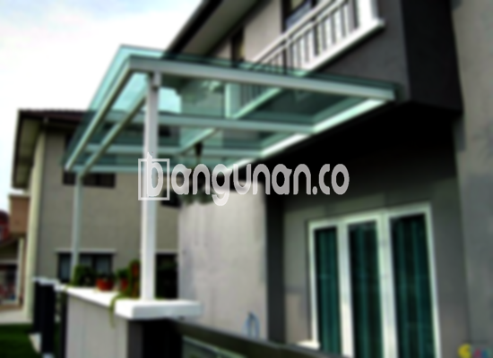

**Jasa Pasang Kanopi Rumah Minimalis di Harjasari Bogor** – Menciptakan kenyamanan dan perlindungan di area luar rumah adalah prioritas utama setiap pemilik properti di Harjasari Bogor. Kanopi hadir sebagai solusi cerdas untuk menjaga teras, garasi, atau area parkir dari paparan cuaca ekstrem. Mitra Bangunan di Harjasari Bogor tidak perlu khawatir mencari tukang yang tepat – Kami hadir untuk memberikan layanan pemasangan kanopi berkualitas dan terjangkau.

Kami memahami betul pentingnya memiliki area luar rumah yang nyaman dan aman. Memilih kanopi yang tepat tidak hanya meningkatkan estetika rumah Anda, tetapi juga memberikan perlindungan optimal dari hujan, panas matahari, dan elemen cuaca lainnya. 



## Mengapa Memilih Jasa Pasang Kanopi Rumah Minimalis di Harjasari Bogor?

Bagi Anda yang berencana memasang kanopi untuk hunian, ada beberapa keunggulan signifikan yang bisa Anda dapatkan dengan menggunakan jasa profesional di Harjasari Bogor:

### – Pilihan Model Kanopi yang Beragam

Preferensi setiap orang berbeda-beda. Kami menawarkan beragam model kanopi rumah yang bisa Anda pilih sesuai dengan selera dan gaya arsitektur rumah Anda. Baik itu model persegi, persegi panjang, atau desain khusus, kami siap mewujudkannya.

### – Material Ramah Lingkungan untuk Kanopi

Kami hanya menggunakan material yang aman dan ramah lingkungan dalam pembuatan kanopi. Hal ini memastikan bahwa kanopi yang Anda gunakan tidak hanya melindungi rumah, tetapi juga berkontribusi pada lingkungan yang lebih sehat. Selain itu, perawatan kanopi juga sangat mudah, sehingga debu dan kotoran tidak mudah menempel.

### – Ketahanan dan Kekuatan Terjamin

Kanopi yang kami pasang dirancang untuk tahan lama dan kokoh. Kami menggunakan bahan-bahan berkualitas tinggi yang mampu menahan cuaca ekstrem dan penggunaan sehari-hari. Anda dapat mengandalkan kanopi kami untuk memberikan perlindungan optimal selama bertahun-tahun.

Anda akan menemukan bahwa kanopi yang terpasang dengan benar dapat bertahan selama puluhan tahun. Keawetan ini juga bergantung pada perawatan rutin yang Anda lakukan.

### – Keamanan dan Kenyamanan yang Optimal

Keamanan adalah prioritas utama kami. Kanopi yang kami pasang memberikan perlindungan maksimal terhadap hujan, panas matahari, dan bahkan angin kencang. Dengan kanopi yang kokoh, Anda dan keluarga dapat menikmati area luar rumah dengan lebih nyaman dan aman.

### – Harga Kompetitif untuk Kanopi Rumah Minimalis di Harjasari Bogor

Kami memahami bahwa anggaran adalah pertimbangan penting. Kami menawarkan harga yang kompetitif untuk semua jenis kanopi rumah minimalis di Harjasari Bogor. Harga akan bervariasi tergantung pada jenis material, ukuran, dan desain yang Anda pilih, namun kami selalu berusaha memberikan penawaran terbaik tanpa mengorbankan kualitas.

## Informasi Harga dan Jasa Pemasangan Kanopi Rumah Minimalis di Harjasari Bogor



Banyak pemilik rumah di Harjasari Bogor yang kini memilih memasang kanopi untuk memaksimalkan fungsi area luar rumah mereka. Kanopi dapat digunakan untuk melindungi garasi mobil, area parkir, jendela, atau bahkan sebagai tempat bersantai di teras.

Untuk memberikan gambaran, harga kanopi rumah dengan kualitas standar biasanya berkisar antara Rp. 450.000 – Rp. 800.000. Namun, harga ini dapat bervariasi tergantung pada kualitas material yang Anda pilih. Jika Anda menginginkan kanopi dengan material yang lebih premium, harganya tentu akan lebih tinggi.

Faktor lain yang memengaruhi harga adalah ukuran kanopi. Semakin luas area yang perlu ditutupi, semakin mahal biaya pemasangan. Penting untuk memastikan bahwa Anda memilih ukuran kanopi yang sesuai dengan kebutuhan Anda.

Daripada repot mencari tukang sendiri, menggunakan jasa pemasangan kanopi profesional akan lebih efisien dan memastikan hasil yang optimal.

Bagi Anda yang berdomisili di Harjasari Bogor dan ingin mempercantik serta melindungi rumah dengan kanopi, jangan ragu untuk menghubungi Kami. Kami siap memberikan pelayanan terbaik dan harga yang bersaing.

**Ref by:**  [Kanopi Rumah Minimalis Harjasari Bogor](https://id.wikipedia.org/wiki/Kanopi)

Mitra Bangunan yang sedang mencari jasa pemasangan kanopi rumah minimalis di Harjasari Bogor, hubungi kami lewat tombol WhatsApp atau Telepon di halaman ini, dan kami siap membantu Anda menemukan solusi terbaik untuk kebutuhan rumah Anda.