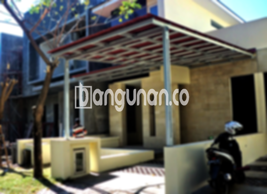

**Jasa Pasang Kanopi Rumah Minimalis di Jambe Tangerang** – Mencari solusi perlindungan yang efektif dan estetis untuk rumah Anda di Jambe Tangerang? Mitra Bangunan hadir sebagai penyedia jasa pemasangan kanopi rumah minimalis yang terpercaya. Kanopi tidak hanya melindungi teras, garasi, atau area luar lainnya dari cuaca ekstrem, tetapi juga meningkatkan tampilan fasad rumah Anda. Manfaatkan solusi praktis ini untuk menciptakan ruang luar yang nyaman dan aman.

Kanopi hadir dalam berbagai desain dan material, memungkinkan Anda memilih yang paling sesuai dengan gaya arsitektur rumah dan anggaran yang tersedia. Pertimbangkan berbagai pilihan untuk menemukan kanopi yang ideal bagi Anda.



## Keunggulan Memilih Jasa Pasang Kanopi Rumah Minimalis di Jambe Tangerang

Bagi Anda yang berencana memasang kanopi di Jambe Tangerang, berikut beberapa keunggulan yang dapat Anda peroleh:

### – Pilihan Model yang Beragam

Kami menawarkan berbagai model kanopi rumah minimalis yang dapat Anda pilih sesuai dengan preferensi pribadi. Setiap orang memiliki selera unik dalam mendesain rumah mereka. Anda dapat memilih desain yang sesuai dengan gaya arsitektur rumah Anda, seperti persegi, persegi panjang, atau bentuk lainnya.

### – Material Ramah Lingkungan

Kanopi yang kami gunakan dibuat dari material yang tidak berbahaya dan ramah lingkungan. Hal ini menjadikan kanopi pilihan yang bertanggung jawab bagi Anda yang peduli terhadap kelestarian lingkungan. Selain itu, material yang digunakan juga mudah dibersihkan, sehingga Anda tidak perlu khawatir tentang perawatan yang rumit.

### – Ketahanan dan Kekuatan Terjamin

Salah satu keunggulan utama kanopi kami adalah daya tahan dan kekuatannya. Kanopi terbuat dari bahan berkualitas tinggi yang mampu menahan berbagai kondisi cuaca ekstrem. Kekuatan ini memastikan kanopi dapat bertahan selama bertahun-tahun, memberikan perlindungan jangka panjang bagi rumah Anda.

Anda dapat mengandalkan kanopi kami untuk memberikan perlindungan yang andal terhadap hujan, sinar matahari, dan angin kencang. Dengan perawatan yang tepat, kanopi akan tetap kokoh dan berfungsi optimal selama bertahun-tahun.

### – Keamanan yang Optimal

Kanopi kami memberikan tingkat keamanan yang tinggi, melindungi area di bawahnya dari berbagai elemen cuaca. Halaman depan rumah Anda, teras, atau area parkir akan terlindungi dengan sempurna dari hujan, panas matahari, dan potensi kerusakan akibat cuaca buruk. 

Dengan kanopi yang andal, Anda dapat menikmati ruang luar rumah Anda dengan lebih nyaman dan aman, tanpa khawatir tentang kondisi cuaca.

### – Harga yang Kompetitif

Kami menawarkan harga yang ekonomis dan bersaing untuk jasa pemasangan kanopi rumah minimalis di Jambe Tangerang. Harga akan bervariasi tergantung pada jenis kanopi yang Anda pilih dan kompleksitas pemasangan. Kami berkomitmen untuk memberikan penawaran terbaik yang sesuai dengan anggaran Anda.

## Harga dan Proses Pemasangan Kanopi Rumah Minimalis di Jambe Tangerang



Semakin banyak pemilik rumah di Jambe Tangerang yang menyadari manfaat memiliki kanopi. Kanopi banyak diaplikasikan untuk melindungi garasi mobil, area parkir, atau sebagai penutup jendela. Pilihan penggunaan kanopi sangat bergantung pada kebutuhan spesifik Anda.

Untuk informasi detail mengenai harga, silakan lihat tabel harga yang tersedia atau hubungi tim kami untuk mendapatkan penawaran yang disesuaikan dengan kebutuhan Anda.

Harga kanopi rumah dipengaruhi oleh beberapa faktor, termasuk kualitas material, ukuran kanopi, dan desain yang dipilih. Semakin berkualitas material yang digunakan, semakin tinggi pula harganya. Selain itu, luas area yang akan ditutupi juga mempengaruhi biaya pemasangan.

Untuk Anda yang menginginkan pemasangan kanopi yang cepat dan efisien, kami siap membantu. Tim profesional kami akan memastikan pemasangan dilakukan dengan rapi dan tepat waktu. Dengan menggunakan jasa pemasangan profesional, Anda dapat menikmati kanopi yang terpasang dengan sempurna dan tahan lama.

**Ref by:**  [Kanopi Rumah Minimalis Jambe Tangerang](https://id.wikipedia.org/wiki/Kanopi) 

Mitra Bangunan siap menjadi solusi terbaik untuk kebutuhan kanopi rumah minimalis Anda di Jambe Tangerang. Segera hubungi kami melalui tombol WhatsApp atau Telepon di halaman ini untuk konsultasi gratis dan penawaran terbaik. Kami siap membantu Anda mewujudkan rumah impian yang nyaman dan terlindungi!