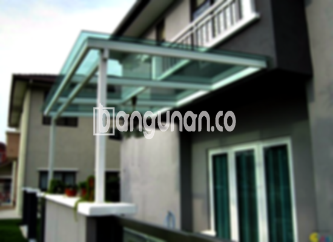

**Jasa Pasang Kanopi Rumah Minimalis di Jati Padang Jakarta** – Memiliki area terbuka yang terlindungi dari elemen cuaca menjadi pertimbangan penting bagi setiap pemilik rumah. Mitra Bangunan di Jati Padang Jakarta hadir sebagai solusi andalan untuk mewujudkan hal tersebut melalui layanan pembuatan dan pemasangan kanopi berkualitas dengan harga yang bersaing. Dengan layanan kami, Anda tidak perlu lagi khawatir mencari tukang yang tepat untuk menciptakan kenyamanan di area luar rumah Anda.

Kanopi kini bukan sekadar elemen dekoratif, melainkan investasi penting dalam meningkatkan fungsionalitas dan nilai estetika bangunan Anda. Kami menawarkan beragam pilihan desain dan material yang dapat disesuaikan dengan gaya arsitektur rumah dan anggaran yang Anda miliki.



## Keunggulan Menggunakan Jasa Pasang Kanopi Rumah Minimalis di Jati Padang Jakarta

Bagi Anda yang berencana memasang kanopi untuk hunian atau properti komersial di Jati Padang Jakarta, berikut beberapa keunggulan utama yang dapat Anda rasakan:

### \- Tersedia Beragam Pilihan Model Kanopi

Kami menyediakan berbagai macam model kanopi rumah yang bisa Anda pilih untuk melengkapi desain bangunan Anda. Setiap individu memiliki preferensi berbeda, dan kami senantiasa berupaya menyediakan ragam opsi agar sesuai dengan selera masing-masing. Pilihan desain termasuk model persegi, persegi panjang, melengkung, atau desain khusus yang disesuaikan dengan permintaan Anda.

### \- Material Konstruksi yang Ramah Lingkungan

Pembuatan kanopi kami menggunakan material yang tidak berbahaya bagi lingkungan, sehingga aman dan berkelanjutan. Penggunaan material ramah lingkungan mencerminkan komitmen kami terhadap kelestarian alam. Selain itu, kanopi yang kami hasilkan juga mudah dibersihkan, memastikan perawatan yang praktis dan efisien.

### \- Konstruksi Kuat dan Tahan Lama

Salah satu keunggulan yang kami hadirkan adalah ketahanan dan kekuatan konstruksi kanopi. Kami hanya menggunakan material berkualitas tinggi yang teruji kemampuannya menahan berbagai cuaca ekstrem. Dengan perawatan yang tepat, kanopi yang kami pasang dapat bertahan selama bertahun-tahun tanpa kehilangan performanya.

Anda akan merasakan manfaatnya langsung, kanopi rumah kami dirancang untuk memberikan ketahanan optimal terhadap cuaca buruk dan penggunaan sehari-hari. Baik itu hujan deras, terik matahari, atau angin kencang, kanopi kami tetap kokoh dan melindungi area di bawahnya.

### \- Keamanan dan Kenyamanan Terjamin

Selain kekuatan, kami juga mengutamakan aspek keamanan. Kanopi yang kami pasang berfungsi melindungi area di bawahnya dari bahaya datangnya hujan, sengatan matahari, dan potensi bahaya lainnya. Hal ini menciptakan lingkungan yang aman dan nyaman bagi Anda dan keluarga.

Dengan adanya kanopi, area teras, garasi, atau halaman Anda akan terlindungi sepanjang waktu, sehingga Anda dapat menikmati waktu bersantai atau beraktivitas di luar ruangan tanpa khawatir.

### \- Harga Kompetitif dan Terjangkau

Selain kualitas, kami juga menawarkan harga yang kompetitif untuk semua jenis kanopi rumah minimalis di Jati Padang Jakarta. Kami percaya bahwa setiap orang berhak mendapatkan kualitas terbaik tanpa harus mengeluarkan biaya yang terlalu besar. 

## Harga dan Jasa Pemasangan Kanopi Rumah Minimalis di Jati Padang Jakarta



Banyak pemilik rumah di Jakarta yang kini berinvestasi pada pemasangan kanopi untuk meningkatkan nilai dan kenyamanan properti mereka. Pemanfaatan kanopi dapat ditemukan di berbagai area seperti garasi mobil, halaman depan, teras, hingga penutup jendela. Semua itu tergantung pada kebutuhan dan fungsi yang Anda inginkan.

Harga kanopi rumah minimalis bervariasi tergantung pada kualitas material, ukuran, kompleksitas desain, dan jenis material yang dipilih. Namun, Anda dapat menemukan opsi yang sesuai dengan anggaran Anda dengan berkonsultasi langsung dengan tim kami.

Kami menyediakan layanan konsultasi gratis untuk membantu Anda menentukan jenis kanopi yang paling tepat untuk kebutuhan Anda. Tim kami akan memberikan panduan profesional dan penawaran harga yang transparan.

Bagi Anda yang tinggal di Jati Padang Jakarta dan membutuhkan jasa pemasangan kanopi profesional, kami siap memberikan pelayanan terbaik. Tim kami berpengalaman dan terlatih untuk memastikan pemasangan berlangsung dengan cepat, rapi, dan sesuai dengan standar kualitas yang tinggi.

**Ref by:**  [Kanopi Rumah Minimalis Jati Padang Jakarta](https://id.wikipedia.org/wiki/Kanopi)

Jadikan properti Anda lebih nyaman, terlindungi, dan bernilai dengan kanopi berkualitas dari kami. Mitra Bangunan siap membantu Anda mewujudkan hunian impian di Jati Padang Jakarta. Jangan ragu untuk menghubungi kami melalui tombol WhatsApp atau Telepon yang tersedia di halaman ini untuk mendapatkan penawaran menarik dan konsultasi gratis.