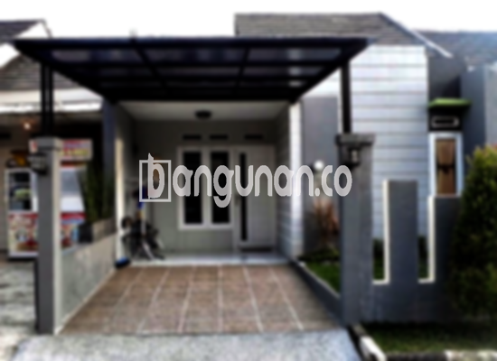

**Jasa Pasang Kanopi Rumah Minimalis di Jatibarang** – Memiliki area luar ruangan yang nyaman dan terlindungi adalah dambaan setiap pemilik rumah. Mitra Bangunan di Jatibarang tidak perlu lagi kesulitan mencari solusi terbaik untuk melindungi teras, garasi, atau area lainnya dari cuaca ekstrem. Kami hadir sebagai penyedia jasa pemasangan kanopi rumah minimalis yang berkualitas dan terjangkau.

Kanopi tidak hanya berfungsi sebagai pelindung dari panas matahari dan hujan, tetapi juga dapat meningkatkan estetika rumah Anda. Dengan berbagai pilihan model dan bahan, Anda dapat memilih kanopi yang paling sesuai dengan gaya arsitektur dan kebutuhan Anda. 



## Keunggulan Menggunakan Jasa Pasang Kanopi Rumah Minimalis di Jatibarang

Bagi Anda yang mempertimbangkan untuk memasang kanopi di rumah atau bangunan komersial, ada sejumlah keuntungan yang bisa Anda dapatkan. Berikut adalah beberapa di antaranya:

### - Pilihan Model yang Beragam dari Jasa Pasang Kanopi Rumah Minimalis di Jatibarang

Salah satu daya tarik utama dari kanopi adalah variasi model yang sangat luas. Anda dapat menemukan berbagai desain kanopi rumah yang dapat disesuaikan dengan selera dan kebutuhan Anda. Baik itu model persegi, persegi panjang, atau bentuk khusus lainnya, kami siap mewujudkannya sesuai keinginan Anda. 

### - Material Ramah Lingkungan dari Jasa Pasang Kanopi Rumah Minimalis di Jatibarang

Kami menggunakan material yang tidak berbahaya bagi lingkungan dalam pembuatan kanopi rumah. Dengan memilih kanopi kami, Anda turut berkontribusi pada pelestarian lingkungan. Selain itu, material yang kami gunakan juga mudah dibersihkan, sehingga perawatan kanopi menjadi lebih praktis.

### - Ketahanan dan Kekuatan Jasa Pasang Kanopi Rumah Minimalis di Jatibarang

Kanopi yang kami pasang terbuat dari bahan berkualitas tinggi, sehingga terjamin kekuatan dan ketahanannya terhadap berbagai kondisi cuaca. Keawetannya dapat bertahan selama bertahun-tahun, menjadikannya investasi yang menguntungkan untuk rumah Anda. Perawatan yang baik akan semakin memperpanjang umur kanopi.

Anda dapat membuktikan sendiri kualitas dan ketahanan kanopi rumah yang kami pasang. Dengan perawatan yang tepat, kanopi akan melindungi rumah Anda selama bertahun-tahun ke depan.

### - Keamanan yang Terjamin dari Jasa Pasang Kanopi Rumah Minimalis di Jatibarang

Kanopi memberikan perlindungan ekstra bagi area di bawahnya, seperti teras atau garasi. Perlindungan ini tidak hanya dari panas dan hujan, tetapi juga dari potensi bahaya lainnya. Dengan kanopi, Anda dapat merasa lebih aman dan nyaman saat berada di area luar ruangan.

Kanopi juga membantu melindungi furnitur dan barang-barang berharga Anda dari kerusakan akibat cuaca ekstrem.

### - Harga yang Kompetitif untuk Kanopi Rumah Minimalis di Jatibarang

Kami menawarkan harga yang terjangkau untuk berbagai jenis kanopi rumah minimalis. Meskipun harga dapat bervariasi tergantung pada jenis bahan dan ukuran kanopi, kami berkomitmen untuk memberikan penawaran terbaik kepada Anda. 

## Harga dan Jasa Pemasangan Kanopi Rumah Minimalis di Jatibarang



Banyak orang saat ini memilih untuk memasang kanopi di rumah mereka. Kanopi dapat digunakan untuk berbagai keperluan, seperti melindungi garasi mobil, menciptakan area parkir yang teduh, atau sebagai penutup jendela. Pilihan penggunaannya sangat fleksibel dan tergantung pada kebutuhan Anda.

Untuk mendapatkan informasi lebih lanjut mengenai harga dan penawaran terbaik, silakan hubungi tim kami. Kami akan dengan senang hati membantu Anda menemukan kanopi yang paling sesuai dengan anggaran dan kebutuhan Anda.

Kami memahami pentingnya mendapatkan harga yang sesuai dengan kualitas. Oleh karena itu, kami selalu berusaha memberikan penawaran yang kompetitif tanpa mengorbankan kualitas material dan pengerjaan.

Bagi Anda yang membutuhkan pemasangan kanopi profesional, kami siap membantu. Tim kami yang berpengalaman akan memastikan proses pemasangan berjalan lancar dan efisien.

Dengan menggunakan jasa pemasangan kanopi profesional, Anda dapat menghemat waktu dan tenaga, serta memastikan hasil pemasangan yang rapi dan kuat.

**Ref by:**  [Kanopi Rumah Minimalis Jatibarang](https://id.wikipedia.org/wiki/Kanopi)

Demikian pembahasan singkat mengenai jasa pasang kanopi rumah minimalis di Jatibarang yang bisa kami sampaikan. Mitra Bangunan siap membantu Anda mewujudkan area luar ruangan yang nyaman dan terlindungi. Jangan ragu untuk menghubungi kami melalui tombol WhatsApp atau Telepon di halaman ini untuk konsultasi dan penawaran harga terbaik.