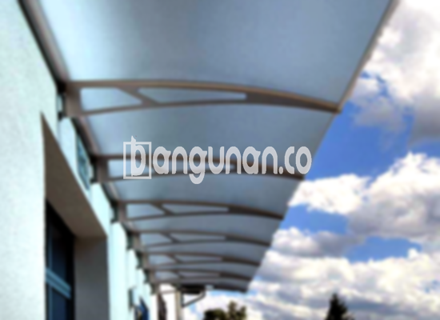

**Jasa Pasang Kanopi Rumah Minimalis di Jatijajar Depok** – Memiliki area luar rumah yang nyaman dan terlindungi adalah impian setiap pemilik rumah di Jatijajar Depok. Kanopi hadir sebagai solusi praktis untuk menjaga teras, garasi, atau area terbuka lainnya dari cuaca ekstrem. Mitra Bangunan hadir sebagai penyedia jasa pemasangan kanopi rumah minimalis yang terpercaya dan terjangkau untuk Anda.

Kami memahami pentingnya kanopi yang tidak hanya fungsional, tetapi juga memperindah tampilan rumah Anda. Dengan berbagai pilihan desain dan material, kami siap mewujudkan kanopi impian Anda di Jatijajar Depok.



## Keunggulan Memilih Jasa Pasang Kanopi Rumah Minimalis di Jatijajar Depok

Bagi Anda yang mempertimbangkan pemasangan kanopi untuk rumah atau bangunan komersial, berikut adalah beberapa keunggulan yang bisa Anda peroleh:

### \- Pilihan Model yang Beragam

Kami menawarkan beragam model kanopi rumah yang dapat Anda pilih sesuai selera dan kebutuhan. Setiap orang memiliki preferensi desain yang berbeda, dan kami siap mengakomodasi keinginan Anda. Anda dapat memilih model persegi, persegi panjang, atau desain khusus lainnya yang sesuai dengan gaya arsitektur rumah Anda.

### \- Material Ramah Lingkungan

Kanopi yang kami gunakan dibuat dari material berkualitas yang aman dan ramah lingkungan. Dengan memilih kanopi dari Kami, Anda turut berkontribusi dalam menjaga kelestarian lingkungan. Material yang digunakan juga mudah dibersihkan, sehingga kanopi Anda akan selalu terlihat bersih dan terawat.

### \- Ketahanan dan Kekuatan Teruji

Salah satu keunggulan utama kanopi kami adalah ketahanan dan kekuatannya. Kami hanya menggunakan material berkualitas tinggi yang tahan terhadap cuaca ekstrem dan penggunaan jangka panjang. Kanopi yang kami pasang dapat bertahan hingga puluhan tahun dengan perawatan yang tepat.

Anda dapat mengandalkan kanopi rumah kami untuk melindungi properti Anda dari hujan, panas, dan angin kencang. Kekuatan kanopi kami juga akan memberikan rasa aman dan nyaman bagi Anda dan keluarga.

### \- Keamanan yang Terjamin

Keamanan adalah prioritas utama kami. Kanopi yang kami pasang dirancang untuk memberikan perlindungan maksimal bagi area di bawahnya. Kanopi kami dapat menghalangi cahaya matahari langsung dan hujan, sehingga Anda dapat menikmati waktu di luar ruangan dengan nyaman dan aman.

Dengan kanopi yang terpasang dengan baik, Anda tidak perlu khawatir lagi tentang paparan cuaca ekstrem yang dapat merusak perabotan atau mengganggu aktivitas Anda.

### \- Harga yang Kompetitif

Kami menawarkan harga yang kompetitif dan terjangkau untuk semua jenis kanopi rumah minimalis di Jatijajar Depok. Meskipun kami menggunakan material berkualitas tinggi, kami tetap berkomitmen untuk memberikan harga yang bersahabat bagi pelanggan.

## Harga dan Jasa Pemasangan Kanopi Rumah Minimalis di Jatijajar Depok



Banyak orang telah merasakan manfaat memiliki kanopi di rumah mereka. Kanopi dapat digunakan untuk berbagai keperluan, seperti melindungi garasi mobil, area parkir, atau sebagai penutup jendela. Semua tergantung pada kebutuhan spesifik Anda.

Informasi harga yang lebih akurat dan sesuai dengan spesifikasi kanopi yang Anda inginkan, silakan hubungi tim kami untuk mendapatkan penawaran terbaik. Kami akan dengan senang hati membantu Anda memilih kanopi yang tepat dan memberikan estimasi biaya yang sesuai.

Mempercayakan pemasangan kanopi kepada profesional adalah pilihan yang bijak. Kami memiliki tenaga ahli yang berpengalaman dan peralatan yang lengkap untuk memastikan pemasangan kanopi yang rapi, kuat, dan aman. Dengan menggunakan jasa Kami, Anda dapat menghemat waktu dan tenaga, serta mendapatkan hasil yang optimal.

Jadi, tunggu apa lagi? Percayakan kebutuhan kanopi rumah Anda kepada Kami. Kami siap memberikan pelayanan terbaik dan membantu Anda menciptakan area luar rumah yang nyaman dan indah di Jatijajar Depok. Mitra Bangunan siap melayani Anda dengan sepenuh hati.

**Ref by:**  [Kanopi Rumah Minimalis Jatijajar Depok](https://id.wikipedia.org/wiki/Kanopi)