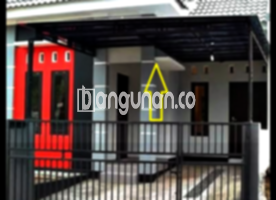

**Jasa Pasang Kanopi Rumah Minimalis di Jatisampurna Bekasi** – Perlindungan rumah dari cuaca ekstrem merupakan kebutuhan mendasar setiap pemilik properti. Salah satu solusi efektif adalah dengan pemasangan kanopi berkualitas. Mitra Bangunan hadir di Jatisampurna Bekasi menawarkan layanan pemasangan kanopi rumah minimalis yang presisi dan terpercaya. Kami menyadari betul betapa pentingnya memiliki area luar rumah yang nyaman dan terlindungi dari hujan maupun sengatan matahari.

Kanopi menjadi investasi cerdas yang mampu meningkatkan nilai estetika sekaligus memberikan kenyamanan bagi Anda dan keluarga. Tak hanya itu, kanopi juga berperan penting dalam melindungi perabot rumah tangga yang berada di luar ruangan. Dengan berbagai pilihan desain dan material, Anda dapat menentukan kanopi yang paling sesuai dengan gaya arsitektur rumah Anda.

## Keunggulan Memilih Jasa Pasang Kanopi Rumah Minimalis di Jatisampurna Bekasi

Ada beberapa alasan mengapa memilih layanan kami adalah keputusan yang tepat untuk kebutuhan kanopi rumah Anda di Jatisampurna Bekasi. Berikut adalah keunggulan yang bisa Anda rasakan:

### \- Model Kanopi yang Beragam Sesuai Selera Anda

Kami menyediakan beragam pilihan model kanopi rumah yang dapat disesuaikan dengan preferensi Anda. Baik itu model klasik, modern, atau minimalis, kami siap mewujudkannya. Anda dapat memilih bentuk persegi, persegi panjang, atau bahkan desain custom yang unik sesuai dengan keinginan Anda.

### \- Material Berkualitas dan Ramah Lingkungan

Kami hanya menggunakan material berkualitas tinggi yang terjamin keawetannya dan ramah terhadap lingkungan. Pemilihan material dilakukan dengan cermat untuk memastikan kanopi tahan terhadap cuaca ekstrem dan tidak membahayakan kesehatan Anda serta keluarga.

### \- Konstruksi Kokoh dan Tahan Lama

Kanopi kami dirancang dengan konstruksi yang kokoh dan tahan lama. Kami menggunakan teknik pemasangan yang profesional dan material yang kuat untuk memastikan kanopi dapat bertahan bertahun-tahun tanpa perlu perbaikan yang sering.

Anda akan mendapatkan investasi jangka panjang yang memberikan perlindungan optimal bagi rumah Anda. Kekuatan dan keawetan kanopi kami telah teruji dalam berbagai kondisi cuaca.

### \- Keamanan dan Kenyamanan Terjamin Penuh

Kanopi memberikan perlindungan maksimal terhadap berbagai elemen cuaca yang merugikan, seperti hujan deras, terik matahari langsung, dan angin kencang. Dengan demikian, Anda dapat menikmati kenyamanan dan keamanan saat beraktivitas di area luar rumah.

### \- Harga Terjangkau dengan Kualitas Terbaik

Kami menawarkan harga yang kompetitif dan terjangkau tanpa mengorbankan kualitas. Dengan berinvestasi pada kanopi berkualitas dari kami, Anda akan mendapatkan solusi perlindungan yang efektif dan ekonomis.

## Menentukan Harga dan Jasa Pemasangan Kanopi Rumah Minimalis di Jatisampurna Bekasi

 

Memilih kanopi yang tepat untuk rumah Anda adalah keputusan penting. Kami menyediakan berbagai jenis kanopi dengan karakteristik dan harga yang berbeda. Beberapa jenis kanopi yang populer di Jatisampurna Bekasi meliputi:

*   **Kanopi Baja Ringan:** Solusi yang ringan, kuat, dan ekonomis. Pilihan ideal untuk carport atau area terbuka yang luas.
*   **Kanopi Galvalum:** Lebih tahan terhadap korosi dan memiliki umur pakai yang lebih panjang dibandingkan baja ringan.
*   **Kanopi Kaca:** Memberikan kesan modern dan elegan. Ideal untuk teras depan atau area yang membutuhkan tampilan mewah.
*   **Kanopi Polycarbonate:** Kuat, ringan, dan tahan benturan. Mampu menyaring sinar matahari sehingga menciptakan suasana yang lebih sejuk dan nyaman.

Harga kanopi rumah di Jatisampurna Bekasi dapat bervariasi tergantung pada jenis material, ukuran, dan desain yang Anda pilih. Anda dapat melihat daftar harga lengkap kami di  atau menghubungi tim kami untuk mendapatkan penawaran harga yang sesuai dengan kebutuhan Anda.

**Ref by:**  [Kanopi Rumah Minimalis Jatisampurna Bekasi](https://id.wikipedia.org/wiki/Kanopi)

Mitra Bangunan siap membantu Anda mewujudkan kanopi impian Anda di Jatisampurna Bekasi. Jangan tunda lagi, hubungi kami melalui tombol WhatsApp atau Telepon yang tersedia di halaman ini untuk konsultasi gratis dan penawaran terbaik. Kami berkomitmen memberikan pelayanan profesional, berkualitas, dan memuaskan bagi setiap pelanggan kami.