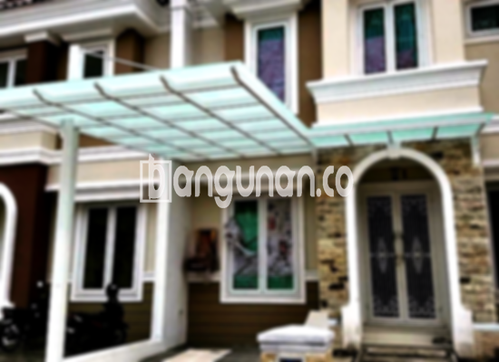

**Jasa Pasang Kanopi Rumah Minimalis di Jatisari Karawang** – Untuk melindungi teras depan rumah atau area lainnya dari berbagai kondisi cuaca seperti hujan dan terik matahari, penggunaan kanopi menjadi solusi yang umum dan efektif. Kanopi rumah dirancang khusus untuk memberikan kenyamanan dan perlindungan yang Anda butuhkan dalam aktivitas sehari-hari. Mitra Bangunan di Jatisari Karawang dapat dengan mudah menemukan solusi ini melalui layanan pembuatan dan pemasangan kanopi rumah minimalis yang kami sediakan.

Kami menyediakan beragam pilihan kanopi yang dapat disesuaikan dengan gaya arsitektur rumah Anda serta kebutuhan spesifik Anda. Dengan pengalaman yang kami miliki dan tenaga ahli yang profesional, kami menjamin setiap pemasangan kanopi dilaksanakan dengan cermat dan menghasilkan kualitas yang terbaik.



## Manfaat Menggunakan Jasa Pasang Kanopi Rumah Minimalis di Jatisari Karawang

Bagi Anda yang berencana memasang kanopi untuk rumah, terdapat beberapa keuntungan signifikan yang dapat Anda peroleh, di antaranya:

### \- Ragam Pilihan Model Kanopi yang Tersedia

Pilihan model kanopi menjadi pertimbangan penting bagi banyak orang. Kami menyediakan berbagai model kanopi rumah yang dapat Anda pilih sesuai dengan selera dan kebutuhan Anda. Setiap individu memiliki preferensi unik dalam memilih desain kanopi yang sesuai dengan gaya rumah mereka. Anda dapat memilih desain yang paling cocok, misalnya persegi, persegi panjang, atau bentuk lainnya.

### \- Material Ramah Lingkungan pada Kanopi Rumah

Kanopi yang kami gunakan dibuat dari material yang aman dan tidak berbahaya, sehingga ramah terhadap lingkungan. Dengan menggunakan kanopi rumah, Anda turut berkontribusi dalam menjaga kelestarian lingkungan. Selain itu, kanopi yang kami tawarkan mudah dibersihkan, sehingga Anda tidak perlu khawatir akan kotoran yang menumpuk.

### \- Kanopi Rumah: Awet dan Kokoh

Salah satu keunggulan utama yang dapat Anda nikmati adalah daya tahan dan kekokohan kanopi kami. Hal ini disebabkan oleh penggunaan bahan-bahan berkualitas yang mampu menahan berbagai kondisi cuaca. Kekokohan kanopi ini dapat bertahan dalam jangka waktu yang sangat lama.

Anda dapat membuktikan sendiri bahwa kanopi yang dipasang dengan benar dapat bertahan hingga puluhan tahun. Namun, umur pakai kanopi juga bergantung pada perawatan yang Anda lakukan. Dengan perawatan yang rutin dan tepat, kualitas kanopi dapat tetap terjaga dalam kondisi prima.

### \- Tingkat Keamanan yang Tinggi

Keamanan merupakan aspek penting yang kami prioritaskan. Kanopi yang kami pasang memberikan perlindungan optimal bagi area di bawahnya, melindungi Anda dan keluarga dari paparan langsung sinar matahari dan hujan. Dengan demikian, Anda dapat menikmati aktivitas di luar rumah dengan lebih nyaman dan aman.

Sebagai contoh, kanopi efektif menghalangi sinar matahari langsung yang dapat membahayakan kulit, serta melindungi dari hujan deras yang dapat membuat Anda basah kuyup. Dengan begitu, area di bawah kanopi akan terlindungi dengan baik, memberikan rasa aman dan nyaman kepada Anda.

### \- Harga Terjangkau untuk Kualitas Terbaik

Selain kualitas yang tinggi, kami juga menawarkan harga yang kompetitif dan terjangkau. Harga yang murah menjadi salah satu keunggulan kanopi rumah yang kami tawarkan. Tentu saja, harga juga dipengaruhi oleh jenis kanopi yang Anda pilih. Semakin berkualitas material yang digunakan, semakin tinggi pula harganya.

## Harga dan Jasa Pemasangan Kanopi Rumah Minimalis di Jatisari Karawang



Banyak warga Jatisari Karawang yang telah merasakan manfaat memiliki kanopi di rumah mereka. Kanopi sering digunakan untuk melindungi garasi mobil, area parkir, atau bahkan jendela rumah dari cuaca ekstrem. Pemanfaatan kanopi sangat bergantung pada kebutuhan dan preferensi masing-masing individu.

Harga kanopi rumah bervariasi, mulai dari sekitar Rp. 450.000 hingga Rp. 800.000 untuk kualitas standar. Harga dapat meningkat jika Anda menginginkan material yang lebih berkualitas tinggi. 

Harga juga dipengaruhi oleh banyak faktor, seperti bahan dasar kanopi yang Anda pilih. Setiap material memiliki karakteristik dan harga yang berbeda-beda. Selain itu, ukuran kanopi juga menjadi faktor penentu harga. Semakin besar ukuran yang Anda butuhkan, semakin tinggi pula biaya yang harus Anda keluarkan. Oleh karena itu, pastikan Anda memilih ukuran yang sesuai dengan kebutuhan Anda.

Bagi Anda yang membutuhkan pemasangan kanopi untuk bangunan komersial atau proyek yang lebih besar, kami menyediakan layanan pemasangan profesional. Dengan menggunakan jasa pemasangan, Anda dapat menghemat waktu dan tenaga serta mendapatkan hasil yang sesuai dengan harapan Anda.

**Ref by:**  [Kanopi Rumah Minimalis Jatisari Karawang](https://id.wikipedia.org/wiki/Kanopi)

Semoga informasi terkait jasa pasang kanopi rumah minimalis di Jatisari Karawang ini bermanfaat bagi Anda. Mitra Bangunan yang sedang berencana memasang kanopi, silakan hubungi kami melalui tombol WhatsApp atau Telepon yang tersedia di halaman ini. Kami siap memberikan pelayanan terbaik dan penawaran harga yang sesuai dengan kebutuhan Anda.