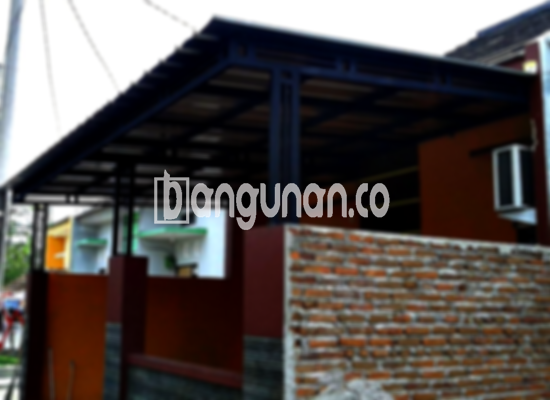

**Jasa Pasang Kanopi Rumah Minimalis di Jawilan** – Memiliki area luar rumah yang terlindungi dari cuaca ekstrem adalah impian setiap pemilik rumah di Jawilan. Kanopi hadir sebagai solusi praktis untuk menjaga teras, garasi, atau area lainnya tetap nyaman. Mitra Bangunan di Jawilan tidak perlu lagi khawatir mencari solusi perlindungan terbaik untuk hunian Anda. Kami menyediakan jasa pemasangan kanopi rumah minimalis yang berkualitas dan terjangkau.

Apakah Anda sedang mempertimbangkan untuk menambahkan kanopi ke rumah Anda? Kanopi bukan hanya berfungsi sebagai pelindung, tetapi juga dapat meningkatkan estetika bangunan. Pilihan model dan material yang beragam memungkinkan Anda menyesuaikan kanopi dengan gaya arsitektur rumah.



## Keunggulan Memilih Jasa Pasang Kanopi Rumah Minimalis di Jawilan

Bagi Anda yang berencana memasang kanopi untuk rumah, ada beberapa keunggulan yang bisa Anda dapatkan, antara lain:

### \- Variasi Model yang Luas dari Jasa Pasang Kanopi Rumah Minimalis di Jawilan

Pilihan model kanopi sangat beragam, memungkinkan Anda menyesuaikannya dengan selera dan desain rumah Anda. Anda dapat memilih dari berbagai bentuk, seperti persegi, persegi panjang, atau desain khusus sesuai keinginan Anda. Dengan banyaknya opsi yang tersedia, Anda pasti akan menemukan kanopi yang sempurna untuk melengkapi hunian Anda di Jawilan.

### \- Material Ramah Lingkungan dari Jasa Pasang Kanopi Rumah Minimalis di Jawilan

Kami menggunakan material yang tidak berbahaya bagi lingkungan, sehingga Anda dapat merasa tenang saat menggunakannya. Kanopi kami tidak hanya tahan lama tetapi juga berkontribusi pada kelestarian lingkungan sekitar Jawilan. Selain itu, material yang kami gunakan mudah dibersihkan dan dirawat.

### \- Ketahanan dan Kekokohan Jasa Pasang Kanopi Rumah Minimalis di Jawilan

Salah satu keunggulan utama kanopi kami adalah ketahanan dan kekokohannya. Bahan-bahan berkualitas tinggi memastikan kanopi dapat bertahan lama dan tahan terhadap berbagai kondisi cuaca. Anda dapat mengandalkan kanopi kami untuk melindungi rumah Anda selama bertahun-tahun. Dengan perawatan yang tepat, kanopi rumah Anda akan terus berfungsi optimal.

### \- Keamanan Optimal dari Jasa Pasang Kanopi Rumah Minimalis di Jawilan

Kanopi memberikan perlindungan tambahan bagi rumah Anda. Area di bawah kanopi terlindungi dari paparan sinar matahari langsung dan hujan deras. Hal ini menciptakan lingkungan yang lebih aman dan nyaman bagi Anda dan keluarga Anda di Jawilan. Dengan demikian, Anda dapat menikmati waktu Anda di luar ruangan tanpa khawatir terhadap cuaca.

### \- Harga Kompetitif untuk Kanopi Rumah Minimalis di Jawilan

Kami menawarkan harga yang kompetitif untuk semua layanan pemasangan kanopi rumah minimalis. Meskipun harga bervariasi tergantung pada jenis dan ukuran kanopi, Anda tetap bisa mendapatkan solusi terbaik tanpa menguras anggaran Anda. Kami berkomitmen untuk memberikan nilai terbaik bagi setiap pelanggan di Jawilan.

## Informasi Harga dan Jasa Pemasangan Kanopi Rumah Minimalis di Jawilan



Banyak orang di Jawilan kini memilih untuk memasang kanopi pada rumah mereka. Kanopi dapat diaplikasikan untuk berbagai keperluan, seperti melindungi garasi mobil, area parkir, atau sebagai penutup jendela. Pilihan tergantung pada kebutuhan spesifik Anda.

Untuk informasi harga yang lebih akurat dan sesuai dengan kebutuhan Anda, kami sarankan Anda untuk menghubungi tim kami. Kami akan memberikan penawaran terbaik berdasarkan jenis, ukuran, dan material kanopi yang Anda pilih. Jangan ragu untuk berkonsultasi dengan kami untuk mendapatkan solusi yang paling sesuai dengan anggaran Anda.

Bagi Anda yang ingin memasang kanopi untuk hunian Anda, sebaiknya gunakan jasa pemasangan profesional. Dengan menggunakan jasa pemasangan, proses akan lebih cepat dan efisien. Anda dapat segera menikmati kanopi yang telah terpasang dengan rapi dan aman.

Demikianlah informasi mengenai Jasa Pasang Kanopi Rumah Minimalis di Jawilan yang dapat kami sampaikan. Jangan tunda lagi, hubungi kami segera untuk mendapatkan layanan dan harga terbaik! Mitra Bangunan siap membantu Anda mewujudkan hunian yang nyaman dan terlindungi di Jawilan.

**Ref by:**  [Kanopi Rumah Minimalis Jawilan](https://id.wikipedia.org/wiki/Kanopi)